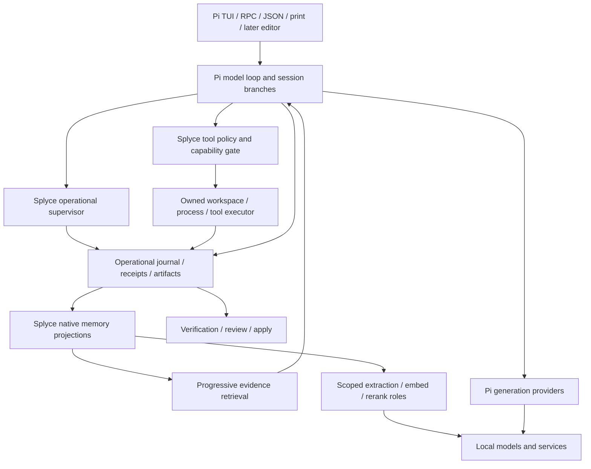

# Splyce master plan

**Status:** proposed implementation plan, based on the public-source research snapshot of **2026-10-25**. The repository contains research, agent working rules, documentation checks and an imported compendium. The Splyce runtime is not implemented; coding-agent, memory and inference performance measurements are **n=0**. Discovery remains open where the [gap journal](research/docs/agents/gap-sweep-candidates.md) or [import review](research/imports/claim-review.md) records another lead.

## Product decision

Build one coherent coding-agent tool **on Pi as the selected existing base**. Pi owns the model loop, conversation and session branches, provider-facing generation, terminal interface and headless modes. Splyce adds a host-enforced policy boundary, operational receipts, verification and native cross-session memory without creating a second autonomous loop. Interactive, headless and later editor clients share the same action/result evidence contract. Agent execution, generation, extraction, embeddings, reranking, memory, indexes and operational state run entirely locally. No hosted model, cloud agent, SaaS memory, telemetry service or cloud fallback is part of the product. Authorized web/connector actions remain distinct tool effects.

The previously proposed Rust-owned loop is superseded by this user decision. The inspected Pi source snapshot is `d5b3de22d0e24a3e9c38a9410d3329b099717283`, with its coding-agent package at version 1.4.0, MIT license and TypeScript/Node runtime requiring Node 22.19.0 or newer; this is a source snapshot, **not** a claim about a registry release or installed behavior. [Pi foundation](research/docs/foundations/pi-foundation.md) records its source-grounded seams and qualification gaps. Rust is an optional sidecar or native support layer only when an observed need warrants it; no hidden Rust host rewrite or from-scratch model loop is a fallback. Compare a Pi extension/fork with another **existing** base only if Pi fails the same authority, durability, memory and user-task gates. [The earlier stack decision](research/docs/foundations/stack-decision.md) remains historical research, not the current host selection.

No source is selected because it has the longest feature list. Adoption requires a pinned source and license, a useful mechanism, an owner, a real integration path, a baseline and an acceptance gate. Public visibility alone does not authorize copying code, artwork or a third-party design.

The following commitments are binding for the first usable release; later capabilities are conditional. An unresolved hard gate blocks the related claim and requires a recorded decision, not silent removal.

| Requirement               | First-release obligation                                                                          | Closure evidence                                         |
| ------------------------- | ------------------------------------------------------------------------------------------------- | -------------------------------------------------------- |
| B1 existing base          | Pi extension/fork, or a demonstrated better existing base after identical hard-gate failure on Pi | Pinned source/license/runtime and F0 comparison receipts |
| B2 one authority path     | Pi owns turns/branches; Splyce owns policy and effects; no second autonomous loop                 | Ordinary, nested and built-in tool dispatch tests        |
| B3 truthful recovery      | Durable action receipts, final-revision verification and uncertain-effect reconciliation          | C3/C5 crash and real-repository results                  |
| B4 native memory          | Scoped capture, cited recovery, correction, export and deletion                                   | M1/M2 empty-context and deletion/rebuild results         |
| B5 deployment profiles    | Fully local execution and every enabled model role; no hosted fallback                            | C4/R1 role capability and egress matrix                  |
| B6 supported client modes | Pi interactive and headless paths report consistent stop/result semantics                         | C1/R1 mode-by-mode event and installed-package results   |
| B7 protocol/context       | Pi built-in MCP under policy, skill provenance and healthy code-context fallback                  | P1/X1 negative and real-path results                     |

**B8 lightweight local delivery:** R1/O1 must publish measured installation/startup/idle/peak host and model costs, optional-service lifecycle and offline behavior for every supported hardware profile. Lower resource use cannot remove authority, recovery, evidence or the registered quality floor.

Delegation, ACP/A2A, graph retrieval, local browser/device execution and offline optimization remain optional until their own package gate passes. Cloud/managed execution, hosted models and hosted memory are excluded by the current local-only product ruling; they remain comparison research only. No arbitrary agent, memory or activity cap is a semantic product rule; finite budgets and actual resources still govern admitted work.

## One architecture and one owner per concern



This is a responsibility map, not a claim that Pi already enforces every Splyce requirement. Pi is authoritative for conversation history, turn execution and branches; Splyce's journal is authoritative for permission decisions, external effects, verification and memory evidence. Reconcile the two by stable run/session/branch/action IDs and durable intent/outcome records; never turn two records into two competing loops. Pi extensions execute in process with the same operating-system authority as Pi, so extension code is **trusted code, not a sandbox**. Pi tool-call blocking and error behavior must be exercised through the real path; nested tool execution, hidden delegated effects and remote effects receive only the audit coverage actually observed. Git worktrees separate changes, not process, filesystem, network or credential authority.

Start with one small Pi extension/package under planned packages/splyce-pi/, using the existing Pi loop and modes. Planned TypeScript modules are src/index.ts, policy.ts, receipts.ts, memory.ts, providers.ts and verification.ts; add context or adapters only when their caller exists. Prefer Pi's installed features, including its built-in MCP, before introducing a parallel implementation. A Rust support process is a separately qualified two-way choice before persisted contracts, and a costly migration after users store state.

| Concern            | Preferred starting point                                              | Qualification requirement                                                      |
| ------------------ | --------------------------------------------------------------------- | ------------------------------------------------------------------------------ |
| Host and clients   | Pi TUI, RPC, JSON and print modes; extension/fork only as qualified   | One model loop; mode-specific UI and shutdown behavior; reconnectable evidence |
| Policy and effects | Pi tool-call interception plus Splyce receipt owner                   | Fail closed on handler failure; prove nested and built-in tool coverage        |
| Storage            | Versioned local journal and scoped artifact files                     | Durable ordering, migration, crash recovery, export/deletion                   |
| Providers          | Pi generation adapters; separate measured memory-role services        | Preserve stream/tool/schema/usage/error semantics and per-role egress          |
| Code context       | Pi/existing search, then healthy LSP where needed                     | Revision/range provenance, stale-state rejection and lexical fallback          |
| Recall             | Local lexical baseline, then measured alternatives                    | Scope and deletion enforced before every retrieval route                       |
| Protocols          | Pi's built-in MCP first; later ACP/client and A2A/task adapters       | Negotiated versions and policy enforced at actual dispatch                     |
| Plugins            | Trusted Pi extension code first; process isolation for untrusted code | Explicit host grants, cleanup and update provenance                            |

Sources and alternatives: [Pi foundation](research/docs/foundations/pi-foundation.md), [architecture synthesis](research/docs/design/synthesis.md), [frameworks](research/docs/foundations/frameworks-and-orchestration.md), [additional runtime comparison](research/docs/foundations/additional-runtimes-and-lineage.md). Any earlier Rust-first wording in research is historical and does not override this decision.

## Durable contracts before features

1. **Run:** immutable ID, task/acceptance text, workspace/base revision, selected model-role contracts, executor location, effective grants, budgets and instruction provenance.
2. **Action:** unique ID, owner/parent, typed capability/version, validated arguments and target scope. Effective permission is the intersection of user/run, host, workspace, executor and child grants. Plugins, skills, hooks and remote tools cannot grant themselves authority.
3. **Receipt:** ordered event and artifact references describing the intent, policy decision and observed result. Record intent before an external effect and outcome before reporting success. Intent without outcome is uncertain; reconcile before retrying. Do not promise exactly-once arbitrary external effects.
4. **Evidence:** scoped source/artifact ID, revision/range, content identity and derivation links. Generated summaries and graph edges cite their sources and are never the only evidence.
5. **Result:** explicit stop reason, final diff/revision, exact verification command/exit/output receipt, cleanup status and unresolved effects. “Verified complete” requires receipts for the actual final revision.
6. **Model role:** operation, endpoint/locality, immutable model/runtime revision, schema, limits, tokenization/instructions, usage and error/cancellation semantics. Embeddings additionally specify dimension, normalization, metric and index generation.

Journal and permission schemas become compatibility commitments once users store state. Ship versioned migrations, export and recovery tools before changing them. Keep provider credentials outside receipts and prompts. Product concurrency follows measured resources and task ownership, not this research session's agent limit.

### Proposed Splyce wire contract and Pi reconciliation

These are **proposed Splyce-owned records, not Pi APIs or implemented schemas**. The compact examples are abbreviated projections, not ready-to-serialize records: implement required metadata and typed fields from the [record contract](research/docs/design/implementation-contracts.md#record-contract), and version/validate before persistence. Secrets and large content are referenced as scoped artifacts.

```jsonl
{"schemaVersion":1,"kind":"run","runId":"r1","piSessionId":"s1","branchAnchorId":"ba1","baseRevision":"git:A","workspaceId":"w1","taskArtifactId":"task1","grantIds":["g1"]}
{"schemaVersion":1,"kind":"action","runId":"r1","actionId":"a1","parentActionId":null,"capabilityId":"file.edit","targetScopeId":"w1","argumentsArtifactId":"args1"}
{"schemaVersion":1,"kind":"event","runId":"r1","sequence":7,"actionId":"a1","phase":"intent_committed","policy":"allow","effect":"unconfirmed","artifactRef":"intent1"}
{"schemaVersion":1,"kind":"result","runId":"r1","state":"verified_complete","finalRevision":"git:B","verificationReceiptIds":["v1"],"unresolvedActionIds":[]}
```

`branchAnchorId` is a **Splyce-owned reference**, not a Pi field. Store its mapping to `getSessionId()`, the fork-point entry and first-child entry; reconstruct active ancestry through `getLeafId()`/`getBranch()`. In-file branch navigation retains a Pi session ID, whereas a file fork/new session can create a new one. Test both cases and sibling ancestry. [Pinned source contract](research/docs/foundations/pi-source-contracts.md).

Each event has a stable per-run sequence and idempotent correlation ID; scope and artifact IDs are checked on read, export and replay. Only Splyce writes the operational journal. Pi remains the source for conversation content and branch ancestry. On restart, use Pi's branch reconstruction to rebuild branch-sensitive extension state, then join it with journal receipts by stored IDs; a missing Pi node, unconfirmed nested effect or mismatched base remains unresolved. Pi's transcript alone is not a complete effect ledger, especially for nested tool results. The supervisor records child intent and observed result explicitly. A session-start resource initializer may run again after restart; session-shutdown cleanup must be safe to repeat. Prompt/context hooks may supply cited memory but cannot modify grants.

| Current state       | Input                                                        | Next state and required observation                                                                  |
| ------------------- | ------------------------------------------------------------ | ---------------------------------------------------------------------------------------------------- |
| Created             | Invalid manifest or absent grant                             | Rejected; no Pi turn or effect dispatched                                                            |
| Created             | Valid manifest                                               | Ready; durable run record exists                                                                     |
| Ready or running    | Allowed tool request                                         | Intent committed, then dispatch; denial or hook failure records policy-denied/blocked with no effect |
| Intent committed    | Effect outcome observed                                      | Outcome committed; action is succeeded or failed with artifact reference                             |
| Intent committed    | Crash, timeout or lost response                              | Uncertain effect; reconcile physical state before any retry                                          |
| Running             | User cancel/deadline                                         | Canceled or timed out; report actual local cleanup and remote acknowledgement separately             |
| Running             | Changed workspace base                                       | Conflict; prior verification cannot certify the changed tree                                         |
| Running             | Successful verifier on final revision, no unresolved effects | Verified complete; receipt IDs and final revision match                                              |
| Any persisted state | Client reconnect with last event sequence N                  | Replay only events after N; state and delivered cursor remain consistent                             |

Compatible readers must reject unknown required versions and preserve unknown optional fields without granting authority. A migration changes data only after a backup/export and recovery rehearsal; downgrades that cannot read a schema fail visibly. Stop reasons and failure transitions are public contract commitments after release.

## Native cross-session memory

Memory is part of the first releasable product, not a required external note-taking agent. Use the same receipts and access policy as the run host:

1. Capture user decisions, tool outcomes, changes, failures and exact source references in the journal. Store large raw artifacts separately with explicit retention.
2. Produce typed observations and a compact task/session summary asynchronously. Retain evidence IDs, scope, timestamps, supersession and extraction-model revision. A failed summarizer must not lose captured work.
3. At session start inject only policy, a small active-state capsule and a relevant memory index. Search IDs first, expand selected timeline/graph context second, and fetch original evidence last. Keep stable prompt prefixes separate from changing retrieved context.
4. Record evidence actually supplied and used. Resolve contradictions using source recency/validity and explicit supersession; expose uncertainty instead of silently rewriting a remembered fact.
5. Apply retention, correction, export and deletion across raw artifacts, summaries, lexical/vector indexes, graph edges, caches and backups. Tombstones contain no deleted content; document backup expiry and verify rebuild/cutover behavior.

Default recall stays within the current workspace/task. Cross-project recall requires an explicit scope grant and returned provenance. Every deployment keeps **all** model roles local, including summaries, extraction, embeddings and reranking. Model-service outages preserve receipts and return a visible degraded or blocked state; they never select a hosted fallback.

Compare these configurations behind one retrieval contract: lexical/recency; dense; hybrid/RRF; each with reranking; then temporal or HippoRAG-style graph retrieval. Evaluate sparse FlyVec/Fly-LSH/BioHash and order-sensitive Comply independently. A code graph, workflow DAG, provenance graph, inferred knowledge graph and learned neural memory are different structures; do not merge their semantics.

Every embedding change that alters vector space creates a new index generation. Model revision, dimension, normalization, query/document instructions and truncation are persisted. Rebuild and validate before atomic cutover; never mix incompatible vectors silently. Rerank scores also retain their model and scoring contract.

To earn “better than claude-mem,” compare against its documented progressive-disclosure behavior as well as no-memory, hand-authored-summary and lexical baselines. Measure held-out recall, correct evidence use, temporal updates/abstention, injected and total tokens, full extraction/indexing cost, p95 latency, scope violations and deletion failures. LongMemEval/LoCoMo complement coding-task recovery tests. There is no improvement claim until these results exist. [Memory research](research/docs/capabilities/cross-session-memory.md), [context](research/docs/capabilities/context-retrieval-and-memory.md), [sparse research](research/docs/capabilities/sparse-retrieval-and-coordination.md).

## Fully local inference and lightweight operation

Treat generation, structured extraction, embeddings and reranking as separate operations. A chat-compatible endpoint does not establish every other capability. Every enabled role must execute on the same local host or an explicitly owned local isolation environment, without a hosted account or inference service. Validate endpoint identity and redirects; private-address syntax alone is not a locality guarantee. No missing role may silently use a cloud model.

Compare existing OSS local runtimes: llama.cpp/Ollama for relevant machines, SGLang/vLLM for supported accelerated workloads, and MLX, OpenVINO/ORT, MLC or Rust support candidates when hardware/model needs justify them. TEI or another local embedding/rerank service may be an owned optional worker. Validate actual code, model, native-library and asset licenses before adoption. Hosted services and unqualified/proprietary runtimes remain research comparators, not required dependencies. Preserve an offline installation/model-preparation path and prove cold-cache startup without external requests.

Lightweight is a measured requirement. Keep one Pi engine, a small local operational store and lexical recall baseline; load graph/vector/OCR/browser workers and model assets only for an enabled, justified capability. Share a local generation service for extraction where it passes the same quality contract. No always-on fleet of optional services. Measure host and model costs separately: download/install bytes, dependency/native asset sizes, cold and warm startup, idle/peak RSS, CPU, disk/write amplification, VRAM, energy where measurable, and end-to-end task quality/latency. Preregister resource budgets for each advertised hardware profile; unsupported hardware stays unsupported rather than falling back to cloud or concealing a quality reduction.

Use identical model revision, tokenizer/template, quantization, output constraints and workload for serving comparisons. Separate cold load, warm single-user, shared-prefix, long-prefill and saturated traffic. Report TTFT, output latency/throughput, p50/p95/p99, errors, cancellation, usage, RAM/VRAM and task quality. No engine is “best” for every deployment. [Inference research](research/docs/capabilities/inference-local-and-cloud.md).

## Feature-to-delivery map

| Mechanism family and research                                                                                                 | Splyce owner                    | Required proof                                                                     | Phase |
| ----------------------------------------------------------------------------------------------------------------------------- | ------------------------------- | ---------------------------------------------------------------------------------- | ----- |
| [Terminal agents](research/docs/agents/terminal-agents.md): structured turns, steering, fork/resume and headless events       | Run host and clients            | Same result contract across interactive/headless modes; truthful stop/usage events | 0–2   |
| [IDE/platform agents](research/docs/agents/ide-and-platforms.md): reviewable edits, checkpoints and apply                     | Executor/verifier               | Stale base/conflict stops apply; final diff matches receipts                       | 1–2   |
| [DeepSeek Harness](research/docs/foundations/recursive-harnesses.md): composable lifecycle/services                           | Host-owned adapters             | Load/unload cleanup and no authority escalation or duplicate owner                 | 2–3   |
| [Memory](research/docs/capabilities/cross-session-memory.md): capture, summaries, recovery and correction                     | Memory owner                    | Empty-context recovery; full scope/deletion checks; citation precision             | 1–2   |
| [LSP and code search](research/docs/capabilities/context-retrieval-and-memory.md)                                             | Context service                 | Definition/reference accuracy and stale-server fallback versus lexical baseline    | 2     |
| [MCP/ACP/A2A, skills/plugins/hooks](research/docs/capabilities/protocols-plugins-and-evaluation.md)                           | Protocol/capability adapters    | Handshake, policy, cancellation and teardown conformance                           | 2–3   |
| [Spec/workflow scaffolds](research/docs/foundations/workflows-and-scaffolds.md): task ownership and handoff                   | Task record                     | No competing writer; completion requires current evidence                          | 2–3   |
| [Inference](research/docs/capabilities/inference-local-and-cloud.md) and [stack](research/docs/foundations/stack-decision.md) | Provider-role adapters          | Local runtime/model matrix, offline and zero-hosted-fallback tests                 | 1–3   |
| [Graphs/sparse methods](research/docs/capabilities/sparse-retrieval-and-coordination.md)                                      | Optional retrieval routes       | Paired quality/cost/latency ablations with exact evidence and deletion             | 3     |
| [Governance/fleet tools](research/docs/governance/governance-and-control-planes.md)                                           | Host policy and task supervisor | Narrow child grants, real limits, spending receipts and owned cleanup              | 3     |
| [Local browser/device executors](research/docs/capabilities/protocols-plugins-and-evaluation.md)                              | Explicit execution adapters     | Deployment-scoped isolation, credential/egress and artifact tests                  | 3–4   |
| [Harness², GEPA and optimizer research](research/docs/capabilities/extended-internals.md)                                     | Offline experiment runner       | Untouched holdout, fixed baseline/budget, review and rollback                      | 4     |

This mapping covers mechanism families rather than promising every product's entire interface. The [catalog](research/docs/catalog.md), [long-tail register](research/docs/agents/gap-sweep-candidates.md) and [import review](research/imports/claim-review.md) retain candidate-specific evidence and open leads.

## Implementation sequence and acceptance gates

### Phase 0 — qualify Pi and the extension boundary

Pin Pi's source revision, license and Node runtime, then build the shortest disposable extension or fork over Pi's real tool and session lifecycle. Exercise tool-call denial, extension handler failure, nested tool dispatch, branch reconstruction, one real edit, interruption, shutdown, resume and export through Pi's TUI, RPC, JSON and print modes where those modes expose the operation. Compare another **existing** coding-agent base only if Pi cannot meet a hard gate; use the same model, task, policy and fault cases. Record what Pi provides, what Splyce owns, exact coverage gaps and maintenance cost. **Exit:** retain Pi or document the failed gate and evidence-backed existing-base replacement; never default to a newly written loop.

### Phase 1 — edit, verify, recover

Wire a Pi extension/fork across one provider, one owned workspace, Pi's read/search/edit/shell path, a Splyce policy gate, operational journal and real verification command. Capture receipts and a cited session summary. Test Pi's blocking hook and handler-failure behavior; nested tool calls need explicit outcome capture where Pi's transcript is incomplete. Inject crashes at intent/effect/outcome boundaries. **Exit:** a real repository change with a diff, successful final-revision test receipt, a proven denial and honest uncertain-effect recovery. This is a development slice, not the release.

### Phase 2 — first usable release

Add native empty-context memory recovery, retention/deletion/export, fully local model roles with no cloud fallback, interactive steering, healthy LSP context and Pi's built-in MCP/skills path under the same policy. Define Windows/Linux/macOS support from actual platform tests, including process cleanup and packaging. **Exit:** an end-to-end Pi-based code task survives session restart, retrieves the correct cited prior decision within a declared budget, produces verified changes and passes cross-workspace/deletion checks on every enabled route.

### Phase 3 — justified expansion

Add delegated coding agents, bounded parallel ownership, ACP/editor clients, optional A2A, model switching and measured hybrid/rerank/graph memory routes. Test cancellation trees, opaque-backend limits, multi-workspace conflicts and local-service/external-tool failures. Add local sandbox/browser backends only with their own authority and cleanup receipts. **Exit:** every enabled feature is wired into a real path and beats or matches its stated baseline without a policy/recovery regression.

### Phase 4 — improvement and distribution

Run offline Harness²/GEPA-style candidates over prompts, tools, retrieval and routing. Candidate code cannot edit policy, evaluator or holdout. Select with paired fixed-budget trials, then verify once on untouched tasks. Version and review changes, preserve failed experiments and support rollback. Add signed release artifacts, SBOMs/attestations and reproducible packaging once binaries actually exist. **Exit:** published installation works on supported platforms and all advertised claims have reproducible evidence.

## Evaluation and release rules

- Fix task/model/environment revisions and quality constraints before comparing. Count failed, canceled and inconclusive runs; report sample size and uncertainty. Keep baseline/candidate compute, retries and budgets comparable.
- Use repository edit/test tasks for integrated quality, Harbor/Terminal-Bench and SWE-bench where appropriate, and memory-specific temporal/recovery/deletion tasks. Public leaderboard performance is neither an uncontaminated holdout nor an integration proof.
- A speed/token-cost win must preserve task quality and evidence use. Report total cost including extraction, embedding, reranking, graph construction, refresh, idle services and recovery.
- Required implementation checks will include Node/TypeScript formatting, typecheck, build and tests for the selected Pi package; provider/protocol conformance, crash and scope/deletion tests, cross-platform packaging and appropriate code scanning. A Rust sidecar adds Rust fmt/clippy/build/tests only if one is qualified and included. Existing documentation CI is not runtime qualification.
- Review permission, journal, memory and provider boundaries with negative integration tests. A mock-only green test or worker report cannot certify the real path.

## Research and operational handoff

Use the [readiness audit](research/docs/design/readiness-audit.md) for requirement-to-research-to-fixture traceability, [implementation contracts](research/docs/design/implementation-contracts.md) for proposed records and invariants, and the [qualification register](research/docs/design/qualification-register.md) for every adoption or improvement decision. The [Pi source audit](research/docs/foundations/pi-source-contracts.md) establishes source-observed boundaries, not runtime proof.

Tool access is specified in [filesystem/terminal execution](research/docs/capabilities/tool-access-and-execution.md) and [browser/computer/device access](research/docs/capabilities/browser-computer-and-device-access.md). C2/C3 own effect grants, receipts and cleanup for every route; E1 owns optional local browser/device and authorized connector adapters. [Evidence fidelity and token efficiency](research/docs/capabilities/evidence-freshness-and-token-efficiency.md) defines X1/M2/O1 freshness, incremental-equivalence and total-cost comparisons. Research coverage does not make every optional adapter a first-release dependency.

Project-authored work uses [AGPL-3.0-only](LICENSE). Retain the separate rights and notices in [NOTICE.md](NOTICE.md). R1 must inventory corresponding source, build/install inputs, modifications and third-party licenses for the distributed artifact; any covered network deployment must provide the required source access. An unresolved compatibility or source-delivery obligation blocks that distribution.

Maintain [research/README.md](research/README.md) and category indexes as the canonical map. Imported material stays labeled as supplied synthesis; original token/count/cost assertions become test hypotheses, not constants in the implementation. Continue exact-source follow-up and record every reopened discovery pass honestly. No finite search proves every tool in a changing ecosystem has been found.

The [repository baseline](research/docs/governance/repository-baseline.md) records free controls, squash/review policy, pinned workflows and paid-feature limits. [AGENTS.md](AGENTS.md) and the focused [.skills/](.skills/README.md) library govern agent work. The next implementation change begins at Phase 0, not by scaffolding every proposed module or installing every researched framework.

## Executable work packages

The paths below are **planned**, not present source files or a mandate to create them all at once. Start as one Pi extension/package and change to a Pi fork only when a measured interception or lifecycle gap demands it. Each package has one owner, dependency, deliverable and gate; a worker may change the planned file layout only if the same contracts and tests remain traceable. Do not select every candidate engine or storage library in advance. Record the chosen version, license, native dependencies and reason when first needed. Research links are starting evidence, not implementation proof.

| ID / phase                      | Depends on                 | Planned entrypoint, input and build action                                                                                                                                                                                                                                                                          | Output, failure observation and definition of done                                                                                                                                                                                                                                                                                         |
| ------------------------------- | -------------------------- | ------------------------------------------------------------------------------------------------------------------------------------------------------------------------------------------------------------------------------------------------------------------------------------------------------------------- | ------------------------------------------------------------------------------------------------------------------------------------------------------------------------------------------------------------------------------------------------------------------------------------------------------------------------------------------ |
| F0 / foundation                 | None                       | Use a disposable Pi extension/fork at the pinned source revision. Drive one synthetic Git repo and deterministic provider through Pi TUI, RPC, JSON and print modes; call the same tool through ordinary and nested dispatch. If a hard gate fails, repeat on one existing alternative base under identical inputs. | Public-safe qualification record with hook coverage, missing effects, branch behavior, lifecycle cleanup, license/runtime and existing-base disposition. Done only when the real Pi path blocks a denied effect and exposes its evidence limits. [Pi foundation](research/docs/foundations/pi-foundation.md).                              |
| C1 / run and events             | F0                         | Planned packages/splyce-pi/src/index.ts binds Pi session/branch/turn to Splyce run IDs and subscribes to mode-appropriate events. Feed fixture event cursor N, branch fork and reconnect.                                                                                                                           | Versioned run/event records and replay cursor; no duplicated delivered event, lost branch binding or false success. Case C1 proves TUI/RPC/JSON/print behavior separately where supported. [Terminal agents](research/docs/agents/terminal-agents.md).                                                                                     |
| C2 / policy and effects         | C1                         | Planned packages/splyce-pi/src/policy.ts gates Pi tool calls, including built-in MCP and nested ctx.executeTool, against intersected grants at actual dispatch. Feed read-only scope, changed arguments and path escape fixtures.                                                                                   | Durable allow/deny and normalized target before effect; denial or handler failure blocks dispatch. If any privileged Pi path bypasses interception, F0 remains failed until a fork or existing-base change closes it. Case C2 checks unchanged fixture bytes. [Protocols](research/docs/capabilities/protocols-plugins-and-evaluation.md). |
| C3 / receipts and recovery      | C1, C2                     | Planned packages/splyce-pi/src/receipts.ts stores operational intent, policy, outcome, Pi correlation IDs and scoped artifacts. Fault at pre-intent, post-intent, effect and pre-outcome checkpoints.                                                                                                               | Reopen store and Pi branch after each kill; report uncertain effects without replay. Case C3 requires journal/artifact integrity and explicit reconciliation. Select and migrate storage only after qualifying its crash behavior. [Synthesis](research/docs/design/synthesis.md).                                                         |
| C4 / model roles                | C1, C2                     | Planned packages/splyce-pi/src/providers.ts uses Pi generation support and separately declares extract/embed/rerank role capabilities only when callers require them. Probe one generation-only endpoint and a local-only profile.                                                                                  | Model/runtime/revision/locality/usage and per-role egress receipt; unsupported operation fails before dispatch, outage degrades visibly. Case C4 includes actual-provider opt-in proof before advertising a profile. [Inference](research/docs/capabilities/inference-local-and-cloud.md).                                                 |
| C5 / edit and verification      | C2, C3                     | Planned packages/splyce-pi/src/verification.ts binds Pi edits to Git base and final revision, produces diff, runs the fixture's real verifier, and separates review from apply. Input is passing, failing and conflicting branches.                                                                                 | Case C5 rejects stale apply and old test receipts; successful result includes exact final revision, verifier command, exit and artifact. [IDE agents](research/docs/agents/ide-and-platforms.md).                                                                                                                                          |
| M1 / capture and projection     | C3, C4                     | Planned packages/splyce-pi/src/memory.ts observes Pi turns and Splyce receipts, emits cited decisions/failures and a session capsule asynchronously; kill extraction mid-write.                                                                                                                                     | Original evidence survives, retry is idempotent and every projection has Pi branch, scope, receipt IDs and extraction revision. Case M1 rejects uncited authoritative facts. [Memory](research/docs/capabilities/cross-session-memory.md).                                                                                                 |
| M2 / retrieval and lifecycle    | M1, C2                     | Extend memory.ts with scoped lexical/recency search, progressive source fetch, correction, retention, export, deletion and index rebuild; feed two-workspace canaries and a contradictory older decision.                                                                                                           | Empty-context Pi restart recovers current cited evidence; cross-scope search denies; deleted canary stays absent after rebuild/restore. Case M2 includes every enabled route and backup-expiry receipt. [Memory](research/docs/capabilities/cross-session-memory.md).                                                                      |
| X1 / code context               | C2, C3                     | Add a context module only when lexical search misses a measured case; feed versioned file, stale LSP range and server exit.                                                                                                                                                                                         | Case X1 blocks stale ranges and records lexical fallback source/revision. A code index is derived and rebuildable, never edit authority. [Context](research/docs/capabilities/context-retrieval-and-memory.md).                                                                                                                            |
| P1 / protocols and instructions | C2, C3                     | Use Pi's built-in MCP path and skill ingestion; add a narrow adapter only for a proven missing behavior. Feed a server that changes schema after handshake and an instruction requesting broader grants.                                                                                                            | Case P1 denies changed/unadvertised tools, records negotiated version, and tears down owned server work. No second MCP implementation without measured need. [Protocols](research/docs/capabilities/protocols-plugins-and-evaluation.md).                                                                                                  |
| R1 / first release              | C1–C5, M1–M2, X1, P1       | Package Pi plus Splyce extension/fork and disclosed services. On each advertised OS/architecture install, run, crash, restart with no chat history, recover, verify, export, delete and uninstall.                                                                                                                  | Installed artifact, dependency/license manifest, scope/deletion receipt, exact platform result and release blocker list. Every advertised local role is tested with an actual model/service.                                                                                                                                               |
| E1 / expansion                  | R1                         | Add bounded local task ownership, ACP/editor and optional A2A; local browser/device/process plugins only with explicit isolation manifests. Feed overlapping writers, forbidden child grant and unconfirmed external-tool cancellation. Cloud executor adapters remain excluded.                                    | Case E1 proves narrow grants, one writer per target, truthful opaque-effect limits and cleanup; optional routes keep host policy and receipt ownership. [Protocols](research/docs/capabilities/protocols-plugins-and-evaluation.md).                                                                                                       |
| O1 / improvement                | R1; E1 only when evaluated | Freeze candidate prompts/routing/retrieval against a fixed baseline and untouched holdout; build signed artifacts and SBOM after qualification.                                                                                                                                                                     | Case O1 rejects candidate access to evaluator/policy/holdout, records paired results and rollback, and links signed installed binaries to tests. [Extended internals](research/docs/capabilities/extended-internals.md).                                                                                                                   |

The proposed integration command for each case is npm --prefix packages/splyce-pi run test:integration -- --case ID, substituting the row ID. It is a **future script contract, not a runnable command today**. Each case must save its fixture revision, Pi commit, Splyce revision, exact command/exit, event and receipt artifacts, expected/observed state, OS/runtime and unresolved effects. Unit checks may narrow a defect, but a package closes only with a real Pi-host path. A worker owns one row and its named files/fixtures; parent integration reruns the full path.
The **first development slice** is a Pi extension/fork with C1–C5 plus M1 capture/summary on one provider and one owned workspace; it proves policy and recovery without replacing Pi's model loop. **First usable release** is R1: native cross-session recovery and deletion, the fully local role profile with no hosted fallback, interactive steering, code context and Pi's MCP path must work together. Neither milestone promises optional engines, graph memory, remote sandboxes or every researched tool.

### Verification fixtures and expected observations

Create planned tests/fixtures/ only for cases used by a package; fixtures must be synthetic and carry no private repository data. Favor tests through the CLI/host and a real temporary repository over mocks. A fake endpoint may exercise protocol faults, but it cannot certify provider behavior or the system under test. Each row below names the input that must fail if the behavior is removed.

| Gate                    | Concrete input or fault                                                                                                                                 | Required observation                                                                                                                                                    |
| ----------------------- | ------------------------------------------------------------------------------------------------------------------------------------------------------- | ----------------------------------------------------------------------------------------------------------------------------------------------------------------------- |
| Authority               | Run grants read-only on workspace A; a tool asks to edit workspace B, then tries an in-scope path whose symlink resolves outside A.                     | Both dispatches deny before any bytes change; decision and normalized target are journaled without sensitive content.                                                   |
| Journal recovery        | Kill the host after durable intent but before outcome for a shell action that appends to a sentinel file. Restart and request resume.                   | The action is marked uncertain and is not replayed automatically; operator reconciliation can attach observed outcome. A missing outcome never becomes success.         |
| Stream and cancellation | Disconnect after receiving event N; reconnect from N; cancel while a child process keeps a descendant alive.                                            | Events after N arrive once and in order. The process tree is reaped or cleanup failure names the survivor; stop reason remains canceled.                                |
| Revision binding        | Propose a patch at Git base A, move the target to base B before apply, or change a file after a passing test.                                           | Apply rejects the stale base; prior test receipt cannot certify B or the changed final tree.                                                                            |
| Memory recovery         | Session 1 records a decision and its exact source; session 2 begins with no chat history and asks for that decision alongside a conflicting older note. | Retrieval supplies source IDs and revision, identifies supersession or abstains, and records which evidence reached the model.                                          |
| Memory scope/deletion   | Insert unique canaries in workspaces A and B, enable every implemented retrieval route, then delete A and rebuild indexes after restart.                | B cannot retrieve A without a scope grant. A canary is absent from raw, projections, all indexes/caches and later exports; backup expiry is disclosed separately.       |
| Embedding migration     | Build an index with model revision/dimension X, then switch to incompatible revision/dimension Y and interrupt the rebuild.                             | Queries continue on validated X or report degraded mode; no mixed vectors are searched; cutover occurs only after Y validates.                                          |
| Role/egress failure     | Declare local-only, configure a cloud extraction endpoint and disconnect the local generation service.                                                  | No role sends data to cloud; captured receipts survive; run reports a specific degraded/blocked capability, not a fabricated zero result.                               |
| Context/protocol fault  | Return a stale LSP range and an MCP tool schema that changed after negotiation.                                                                         | Neither result may drive an edit; lexical source fallback is marked as such, and changed tool dispatch is denied.                                                       |
| Release recovery        | Install on a clean supported machine, edit and verify a temporary repo, terminate the client, restart, export then delete the run.                      | Result ties to final revision and exact verifier exit; resumed state and cleanup are consistent; installed binary and external runtime dependencies match the manifest. |

For every gate, record the test command, fixture revision, environment, expected and observed result, artifact path and whether it ran locally, in CI, or on installed binaries. A passing unit test does not replace the end-to-end row. A failed or unavailable check remains failed or **n=0**, with its blocker stated.

### Evaluation manifest and decision rules

Before a comparison, freeze a machine-readable trial manifest under a future tests/evaluation/ directory: task IDs and source revisions; inclusion/exclusion and contamination policy; model and runtime digests; tokenizer/template and decoding; provider locality; role assignments; grants and egress; hardware/OS; concurrency and timeout; retry policy; verifier/image digests; data-access policy; baseline and candidate commits; metric definitions and quality floor. Store trials append-only with run/receipt IDs and the exact selected configuration. Never use a public benchmark's hidden labels, grader state or later holdout observations to tune the candidate.

Use three distinct suites: (1) synthetic negative integration fixtures above, (2) real repository edit/test tasks with verified final revisions, and (3) held-out memory recovery, contradiction, temporal update and deletion tasks. Where applicable, run pinned Harbor/Terminal-Bench or SWE-bench as external comparators, labeling public contamination uncertainty. Memory candidates compare no memory, hand-authored summary, lexical/recency, claude-mem-style progressive disclosure and then added dense/hybrid/rerank/graph routes at the same recall scope. Inference candidates compare identical model artifact, tokenizer, prompt, output cap and workload; split cold start, warm single-user, shared-prefix, long-prefill and saturation cases. Record both task quality and total work: generation, extraction, indexing, refresh, rerank, storage, idle service and recovery.

Predeclare the acceptance threshold for each candidate from the user-visible requirement and baseline variance. A route may ship only if it meets the quality floor, preserves policy/deletion/recovery gates and gives a measured benefit for its added cost. Report per-task paired outcomes, sample size, uncertainty, p50/p95/p99 where meaningful, failures/cancellations and all resource costs. A projection has **n=0** and cannot satisfy an exit gate. If a new index or serving engine wins one hardware/workload cell and loses another, gate it by the qualified capability manifest rather than making a universal recommendation.

### Qualification ledger and preregistration

Before adopting a dependency, provider, retrieval route or existing-base replacement, append a public-safe qualification row under a future research/docs/design/ register. The row binds **work-package ID → requirement ID → source-ledger claim ID → exact upstream revision and license → observed integration point → trial manifest ID → test receipt ID → disposition**. Record contradictory or unavailable evidence and the next recheck trigger; do not turn a stale source URL or vendor benchmark into a tested capability. For Pi, the selected source snapshot, package/runtime requirement, extension boundary and observed versus unobserved nested effects must remain explicit. Later Pi releases trigger a compatibility retest before upgrade. The [source ledger](research/docs/evidence/README.md) establishes documentary provenance; qualification rows establish local decisions.

Each comparison gets a preregistration sheet **before** trials: the decision and baseline; independent sampling unit (repository task, session, or request); strata and task IDs; eligible inputs and held-out exclusions; model/runtime/host revisions; fixed prompts, authority and resource budgets; primary outcome and quality floor; non-inferiority or improvement margin justified by user impact and baseline variance; planned sample size or precision target; timeout/retry and incomplete-run treatment; candidate selection budget; stopping rule; and one untouched final confirmation. The sheet fixes how missing, canceled, unsupported and contaminated observations are reported, never silently removing them. Policy breach, data leakage or deletion failure is a blocking outcome regardless of mean score. If the budget cannot support a confident comparison, keep the decision provisional with **n** and uncertainty, rather than inventing a universal threshold.

### Capability coverage and evidence ledger

Treat this as the implementation checklist. Every advertised capability needs a wired user path, a negative case and an evidence row linking the build revision to the observed result. Adding a library or module alone does not check a row. The current evidence for all runtime rows is **n=0**.

| User-visible requirement                                          | Owner / package                     | User path and decisive test                                                                                                                      | Evidence needed for release                                                                               |
| ----------------------------------------------------------------- | ----------------------------------- | ------------------------------------------------------------------------------------------------------------------------------------------------ | --------------------------------------------------------------------------------------------------------- |
| Start, stream, steer, cancel and resume a task                    | Run host / C1, R1                   | CLI starts a run; a second client resumes from event cursor N while the first cancels an owned process. No duplicated event or false success.    | Run manifest, event sequence, stop reason and cleanup receipt on each supported OS.                       |
| Read, search, edit, run tests and review/apply                    | Policy, executor, verifier / C2, C5 | Temporary Git repo accepts an authorized edit and final-revision test; stale base, denied path and failing verifier block apply/verified status. | Base/final revision, diff, policy decisions, tool outcomes and exact verifier command/exit.               |
| Restart after a crash without repeating an uncertain effect       | Store / C3                          | Fault at pre-intent, post-intent, post-effect and pre-outcome checkpoints; inspect and reconcile after restart.                                  | Durable ordered receipts and explicit uncertain-effect state for any unconfirmed effect.                  |
| Use fully local models with no external inference                 | Provider and policy / C4, R1        | Run the same generate/extract/embed/rerank capability probes with a role deliberately missing and with local-only policy.                        | Per-role capability/model/runtime manifest, dispatch decisions, observed egress and degraded-mode result. |
| Remember a prior decision across sessions                         | Memory / M1, M2                     | New session with empty chat history retrieves a cited decision and original source before acting.                                                | Supplied evidence IDs, usage record, source revision, recall correctness and token/latency cost.          |
| Correct, export and delete memory                                 | Memory and store / M2               | Correct an older item, export the scoped record, delete a canary and rebuild every enabled index.                                                | Supersession chain, export inventory, deletion/rebuild/backup-expiry receipts and absence checks.         |
| Obtain current code context                                       | Context / X1                        | Changed file version and dead LSP server force lexical fallback; stale range cannot drive edit.                                                  | Source range/revision and fallback reason in the resulting action receipt.                                |
| Use external tools and instructions safely                        | Protocol and policy / P1            | MCP server changes schema after negotiation; a skill requests broader authority. Both dispatches are denied.                                     | Negotiated version, effective grants, mismatch event and observed absence of effect.                      |
| Delegate and use editor/external tool connections when advertised | Supervisor and adapters / E1        | Child requests parent-forbidden scope or two children contend for one edit target; remote cancellation is unconfirmed.                           | Ownership ledger, narrow grants, observed provider state and honest opaque-effect limits.                 |
| Install and recover on an advertised platform                     | Packaging / R1, O1                  | Clean-machine install, real task, interruption, restart, export, deletion and uninstall.                                                         | Artifact hash/signature, SBOM, dependency manifest, platform result and rollback evidence.                |

The matrix is the release inventory, not a fixed feature count. Optional capabilities may remain absent; if advertised, their row and the relevant authority, recovery, deletion and quality gates become mandatory. Research follow-up stays in the [gap journal](research/docs/agents/gap-sweep-candidates.md); new findings change the appropriate package and gate, not an untracked feature list.

### Reproducible fixture and fault layout

The future tests/fixtures/ tree should contain only synthetic repositories and canaries. Keep one small Git repository fixture with a passing test, a deliberately failing test, a conflicting branch, a symlink/path escape case and a known source range. Define expected initial/final revisions in fixture metadata. A deterministic provider fixture should emit valid deltas, partial tool arguments, malformed structured output, missing usage, timeout, cancellation acknowledgement and cancellation silence; it tests the adapter's interpretation, while opt-in real-provider tests establish actual service behavior. A deterministic MCP server fixture should change capability/schema after handshake, delay a response and leave a child process; a deterministic LSP fixture should return fresh and stale ranges and then exit. Add a Pi fixture that forces a tool_call block, a throwing handler, nested ctx.executeTool dispatch, getBranch reconstruction after fork, repeated session_start, repeated session_shutdown and each supported client mode without UI assumptions. Assert the physical workspace and Splyce receipts, not just the Pi transcript. Do not include private code, credentials or downloaded benchmark labels.

Expose named development-only fault checkpoints around intent commit, policy commit, effect dispatch, effect completion, outcome commit, index build, index validation and cutover. A test runner kills the host at each checkpoint, reopens the store and checks the public run status and physical fixture state. Fault hooks cannot ship as model-callable tools. For deletion, place distinct random canaries in two scopes, search every active route before and after deletion, restart, rebuild and restore from a permitted backup snapshot; restoration must reapply deletion tombstones before serving queries. If a backup cannot enforce this, it stays offline until expiry or repair and the release documents the limit.

Map failures to explicit terminal or resumable outcomes: denied capability means no dispatch and a policy-denied action; malformed arguments/schema mean validation failure; provider outage means blocked or degraded role with receipts intact; canceled local work means canceled plus verified teardown or cleanup failure; stale edit means conflict; failing verifier means unverified result; intent without confirmed outcome means uncertain effect requiring reconciliation; unavailable evidence means abstention or unresolved task. These statuses must be visible through CLI and headless events and persisted across restart. None may be recoded as success, zero cost or an empty search result.

### CI, installed-binary and privacy qualification

When the Pi extension/package exists, make normal CI run TypeScript formatting, typecheck, build and tests on the selected Node runtime; run deterministic Pi-host integration fixtures on Windows, Linux and macOS if advertised. Add Rust fmt/clippy/build/tests only for a qualified Rust support component. Include schema migration from each released version, fresh-store creation, corrupted/incomplete artifact handling, index rebuild, process-tree cancellation and export/deletion. Keep actual local model/runtime integration suites opt-in with a pinned model/runtime and credential-safe environment; run them before claiming those profiles for a release and record their separate results. A deterministic fake is sufficient for contract faults, never for model quality, real egress or installed-runtime compatibility.

Packaging must list required external services, native libraries, supported architectures and offline behavior, with a clean-machine smoke test for each advertised OS/architecture. The release record binds source commit, dependency/license inventory, binary hashes, signatures, SBOM, CI run IDs and installed-package smoke receipts. Rehearse downgrade/rollback for data migrations before changing a released schema; if rollback cannot read new state, block downgrade clearly and require a verified export/restore path. Treat policy, journal and memory deletion schema as review gates because their mistakes can expose data or corrupt recovery. [Platform and release research](research/docs/capabilities/platform-security-and-release.md) supplies candidate mechanisms and failure tests; it does not qualify an implementation.

Maintain a release support matrix with one row per **OS × architecture × Node/Pi revision × model-role service profile × client mode**. Each advertised row must include installation artifact/hash, required services, egress profile, deterministic integration result, actual-local-model opt-in result, end-to-end task receipt, crash/restart, memory export/deletion/restore, uninstall and rollback status. Mark unrun cells **n=0** and unavailable combinations unsupported; never infer one platform or mode from another. The installed-package drill is install → start → authorized edit/test → forced interruption → restart from empty context → cited recovery → final-revision verification → export → delete → restore from an authorized backup → confirm tombstones before queries → uninstall. Each step records exact command, exit, revision, artifact and observed result. The release gate is the intersection of mandatory requirement rows and advertised support cells.

Use explicit memory lifecycle states: active → deletion requested → query-blocked tombstone committed → raw/projection/index/cache purge pending → verified deleted, with backup replicas either tombstone-aware before serving or offline until expiry. A crash can resume pending purge but must not reopen reads; failed purge is a visible incomplete deletion and blocks a deletion claim. Correction appends a superseding record; migration and reindex publish a new generation only after validation and preserve the last valid generation or report degradation. Test each transition under restart, permission withdrawal and backup restore, keeping tombstones free of deleted content.

Before publishing any trace, fixture, docs, benchmark artifact or release archive, scan for credentials, personal paths, private repository text, unlicensed material and raw task content outside its declared scope. Export and telemetry redaction occurs before data leaves the host; a redacted event must still retain non-secret identity, order, decision and outcome. Document any unobserved action inside a delegated agent or provider. Research-only source claims remain labeled as such, and platform, provider, memory and performance claims require their own observed evidence.

### Publication and compatibility gates

Schema, permission, deletion and client event semantics become costly to reverse once user data or third-party adapters depend on them. Before the first release, review their versioning, migration/rollback, import/export and crash behavior together. Before each public release, run the repository's current documentation commands: npm run format:check, npm run lint:markdown, npm run check:docs and npm run test:docs. These commands exist today; Pi-extension typecheck/build/integration and platform package commands are **future checks**, not runnable project claims. Add them to CI only when the implementation exists. Review the diff and generated artifacts for secrets, private paths, internal research and unlicensed material before publishing. Tag claimed platform/model/provider capabilities only after installed-package tests, not after a source build or a component report.

## Source-audit blockers and required fork decisions

The pinned [Pi source audit](research/docs/foundations/pi-source-contracts.md) refines F0/C2/C3/P1. These are implementation gates, not claims that extension callbacks are a complete security boundary:

- Bind the trusted Splyce extension and policy before the first prompt. Session construction alone does not establish policy readiness.
- Cover ordinary and nested tools, resolved MCP tools and the separate interactive `user_bash` route. Direct OS effects inside trusted extension code are outside those tool hooks.
- Await pre-effect policy/intent persistence and block on failure. Pi conversation files and the operational store are separate; there is no cross-store atomic commit. Missing outcomes or missing joins require reconciliation.
- A throwing `tool_result` handler is reported/skipped by the inspected runner. Redaction only in that handler is insufficient. Protect final content, structured content, details, updates, errors, Pi session persistence and every export/JSON/provider-bound surface at an enforceable boundary. A failed redactor must withhold the data; source inspection and then physical canary tests decide whether a supported wrapper suffices or a small upstream fork patch is required.
- Pi's bounded nested-call transcript summary is not the full effect ledger. Capture operational child receipts when calls occur, and detect missing/duplicate delivery.
- Use Splyce-owned branch anchors mapped to real Pi session/entry ancestry. Never require a nonexistent upstream branch identifier.

For every required fork patch, record the exact upstream symbol, missing guarantee, smallest patch, regression test and upgrade/rebase rehearsal. If neither the supported extension path nor a maintainable patch passes the gate, compare OMP or another existing engine under identical conditions. Do not introduce a new autonomous engine.
