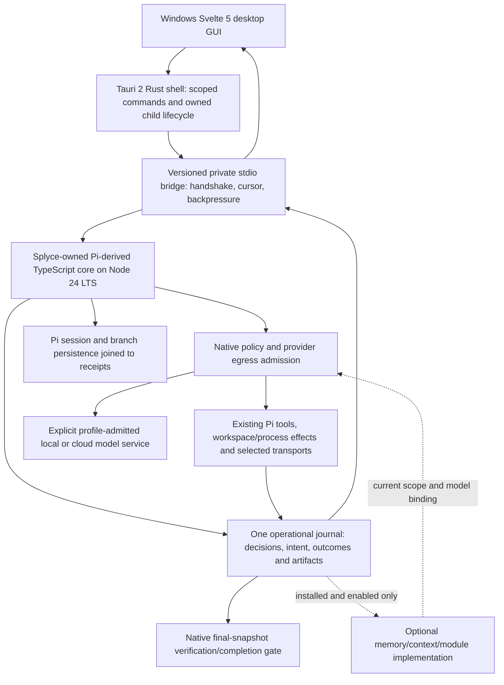

# Splyce master plan

**Status:** proposed implementation plan, reconciled **2026-10-26** against the public-source research snapshot of **2026-10-25**. The repository contains research, agent working rules, documentation checks and an imported compendium. The Splyce runtime is not implemented; coding-agent, memory and inference performance measurements are **n=0**. Discovery remains open where the [gap journal](research/docs/agents/gap-sweep-candidates.md) or [import review](research/imports/claim-review.md) records another lead.

## Product decision

Build **a proper lightweight Windows desktop GUI application for V1** with a **Splyce-owned, deeply fused Pi-derived headless engine**. The product is not a CLI/TUI or a terminal embedded in a window. The desktop uses **Tauri 2 + a thin Rust shell, Svelte 5 + strict TypeScript, Vite 8 build tooling, and packaged Node 24 LTS** running the Pi-derived TypeScript core (Node 24 is Maintenance LTS since 2026-10-20; TD-11 records the explicit 24-versus-26 decision before freezing the runtime). Exact compatible patch versions, lockfiles, byte identities and Windows architecture support are frozen by validated builds, not a moving `latest` selection. [Desktop stack decision](research/docs/foundations/desktop-stack-decision.md) and [desktop application contract](research/docs/design/desktop-application.md) define the client/IPC/lifecycle boundaries.

Splyce modifies actual Pi model-runtime, provider, tool-dispatch, session, policy, receipt, verification, optional-memory interface and lifecycle paths; an extension wrapper or a failed upstream hook is not a prerequisite for core changes. Keep one existing Pi-derived model loop and one operational authority, with the [core-fusion patch map](research/docs/design/core-fusion.md), upstream ancestry and rebase regressions. The inspected upstream baseline is `d5b3de22d0e24a3e9c38a9410d3329b099717283`, coding-agent package 1.4.0, MIT, declared Node >=22.19.0. Node 24 LTS is the selected product runtime to qualify; the declaration alone is not an installed compatibility result. Pi's TUI/RPC/JSON/print modes remain upstream-source, diagnostic and contract-test surfaces, not separate V1 products. Rust owns the native window/IPC/process boundary, not a port of Pi or a second agent loop.

The application, workspace execution, sessions, operational journal and selected memory/index storage remain local. **Users may choose local and cloud model providers independently per operation and profile.** This supersedes the former blanket local-only inference ruling; an all-local profile still rejects every hosted role dispatch. Hosted agent execution, SaaS memory, implicit fallback and unsolicited telemetry remain excluded. Model/web/connector requests require current data-class/endpoint/grant admission in native engine paths before effects or sensitive persistence.

V1 supports Windows only; Linux/macOS remain research/future-port questions, not release matrix obligations or inferred support. The base uses accessible plain-text task/file/diff views with ordinary source search. **Monaco is an explicitly selected, separately installed optional editor module**; no rich editor, language server, RAG, memory module or weights enter the base by implication. [Historical stack research](research/docs/foundations/stack-decision.md) does not override the locked GUI/fused-core decisions.

No source is selected because it has the longest feature list. Adoption requires a pinned source and license, a useful mechanism, an owner, a real integration path, a baseline and an acceptance gate. Public visibility alone does not authorize copying code, artwork or a third-party design.

The following core commitments are binding for the first usable release; optional modules carry conditional support gates. **The default install is barebones:** no RAG, cross-session memory module, LSP, extra servers/drivers, skill packs or model weights. Setup can stay base-only or explicitly select packages fetched from pinned Git repository revisions; later add/remove uses the same [modular installation contract](research/docs/design/modular-installation.md). An unresolved hard gate blocks the related claim and requires a recorded decision, not silent removal.

| Requirement               | First-release obligation                                                                                                    | Closure evidence                                                                               |
| ------------------------- | --------------------------------------------------------------------------------------------------------------------------- | ---------------------------------------------------------------------------------------------- |
| B1 existing base          | Splyce-owned Pi-derived core fork, native policy/receipt/provider/session/verification integration; one loop                | Upstream/fork pins, native call-site patch map and F0 regressions                              |
| B2 one authority path     | Native fused engine owns turns, grants/effects, receipts and completion; Rust/renderer do not create competing stores/loops | Direct core/SDK/RPC/GUI/nested dispatch denial and recovery tests                              |
| B3 truthful recovery      | Durable action receipts, final-revision verification and uncertain-effect reconciliation                                    | C3/C5 crash and real-repository results                                                        |
| B4 optional native memory | When selected: scoped capture, cited recovery, correction, export and deletion                                              | M1/M2 empty-context and deletion/rebuild results                                               |
| B5 providers/profiles     | Multiple local/cloud connections and versioned profiles; per-role API, egress, credentials and live model selection         | C4/R1 protocol matrix, policy and actual-provider receipts                                     |
| B6 Windows desktop client | Tauri/Svelte desktop GUI with versioned owned Node/Pi bridge; upstream terminal modes are diagnostics only                  | U1/R1 actual packaged Windows app, accessibility, event/reconnect/cancel and shutdown evidence |
| B7 protocol/context       | Basic file/search without LSP; selected MCP/skill/context modules under policy                                              | P1/X1 negative and real-path results                                                           |

**B9 selective installation:** I1/R1 prove base-only and skipped setup install no optional module/dependency/model payloads. The accepted setup plan names selected Git-pinned packages and complete dependency closure; installation, activation and model provisioning remain separate. No automatic fetch/load from upstream user/project/ancestor configuration is allowed. Optional data remains exportable/deletable after module removal.

**B8 measured lightweight Windows delivery:** R1/O1 must publish complete Windows app/WebView/Rust/Node/Pi installation/startup/idle/peak and model costs, optional-service lifecycle and offline behavior for each supported Windows hardware/architecture profile; no measured-lightweight claim exists yet. Lower resource use cannot remove authority, recovery, evidence or the registered quality floor.

Delegation, ACP/A2A, graph retrieval, browser/device execution and offline optimization remain optional selected modules. Cloud model inference is explicitly supported as a direction alongside local runtimes; hosted executor/memory products remain research comparators unless separately authorized. No arbitrary agent, memory or activity cap is a semantic product rule; user budgets and actual resources govern admitted work.

The [capability/configuration map](research/docs/design/capability-map.md) is the per-feature implementation map: proposed key, default, dependency, state/worker owner, planned path, data lifecycle and decisive test. Optional features are individually controllable; core authority and truthful receipts remain invariant. Configuration changes bind current revision at dispatch, fence queued work, cancel/drain owned work and report incomplete cleanup. Disabling is separate from deleting retained data/assets; missing dependencies never activate silently. These controls are proposed, not implemented settings.

The [provider/profile/session map](research/docs/design/providers-profiles-and-sessions.md) specifies connection identity, per-operation bindings, profile snapshots, switching, resume/fork, writer fencing and E2E cases. [API conformance](research/docs/capabilities/provider-api-conformance.md) maps exact wire families and per-model limits. The [module contract](research/docs/design/modular-installation.md) and [plugin-authoring map](research/docs/design/plugin-authoring.md) include user-built plugins from local folders/custom Git sources, with no marketplace approval requirement; namespaces, compatibility, effect/state ownership, rebuild/reload, migration and removal all have decisive tests. Every supported selection needs its own evidence; no API compatibility label establishes all features.

**Composition goal:** one coherent workbench built from the strongest useful mechanisms, qualified together at the native core. Follow the [composition acceptance contract](research/docs/design/core-fusion.md#composition-acceptance): shared authority/state/lifecycle ownership, selected-configuration interaction tests and whole-task contribution evidence for recommendations. Baselines diagnose added value; source popularity and feature counts cannot qualify a combination.

## Frontend direction and foundation distinction

The [dedicated frontend dossier](research/docs/frontend/README.md) uses Codex desktop's workspace/task/review structure as the UX base, complemented by Claude Code/Desktop composition and review interactions. Splyce uses original assets and components, not proprietary desktop source. Keep the locked Tauri 2/Svelte 5/strict TypeScript/Vite 8 stack. Semantic HTML is the baseline; a qualified Bits UI subset is proposed for complex accessible primitives, with no optional editor/LSP/RAG payload in base. The [2026-10 combined UX refresh](research/docs/frontend/combined-ux-2026.md) maps each user job to the strongest current Codex and Claude mechanism and adds ten gap cases (steer queue, plan mode, permission modes, hunk review, review mode, honest rewind, effort binding, context meter, attention signal, transcript semantics). Rendering, input/IME, keyboard/Narrator/high-DPI and measured-resource acceptance are specified by the dossier and owned by the tasks in the [named case table](research/docs/design/team-delivery-plan.md#named-case-ownership).

The [Codex engine assessment](research/docs/foundations/codex-engine-assessment.md) verifies that the Rust CLI/engine is Apache-2.0 OSS and can be considered independently of its proprietary desktop/services. It also finds a native-provider parity and dependency-closure qualification gap versus the current Pi plan. **Pi remains the canonical engine contract until TD-01 records an explicit source/design foundation decision and retargets every affected path/test/owner. Bounded experiment permission is separate from the later runtime/support admission gate.** This is no silent engine migration and no decision that Codex is closed source; frontend fixture work is independent of that choice.

## Nine people, 80 tasks, difficulty first

The [team delivery plan](research/docs/design/team-delivery-plan.md) is the authoritative task-by-task route: **80 unique IDs, one primary owner each, all nine people assigned**, D1–D5 risk reasons, dependencies, planned files, linked research, exact future fixture-command templates, inputs/outputs, acceptance/failure gates and handoff. Work is intentionally uneven; these counts are not effort estimates or equal quotas. The 2026-10-26 roster refresh confirms all nine have joined. Organization membership does not establish repository write or required-review authority; verify effective access before selecting a direct branch or permitted fork contribution path. This plan changes no permissions.

**Backend difficulty:** Itachi-1824 > lapsecoder > dnarsh > sreerevanth > syed-sufiyaan1207 > danishhhh9499. **GUI difficulty:** MdSiddiqx > dhanushbs10 > syed-sufiyaan1207 > dnarsh > ShlokShah01; Danish receives only very easy GUI outside the heavy-work order. The hardest native core/security/recovery and Rust shell stay with Itachi. MdSiddiqx owns GUI architecture/accessibility and UI-related backend contracts, not the highest-risk credential/concurrency implementation. Shared schemas freeze under TD-01 before integration. MdSiddiqx retains design/composition authority and gives optional UI/UX review input; Dhanush gains TD-71–74 and Shlok TD-75–78 without transferring backend or permission authority.

| Person / access              | Difficulty-based responsibility                                                                              | Complete assigned task IDs                                                                                                          |
| ---------------------------- | ------------------------------------------------------------------------------------------------------------ | ----------------------------------------------------------------------------------------------------------------------------------- |
| `Itachi-1824` / joined       | Backend and logic lead; D5 core/security/recovery/base retention/Rust shell; some frontend (19 tasks)        | TD-01, TD-07, TD-13, TD-14, TD-16, TD-25, TD-26, TD-28, TD-31, TD-32, TD-37, TD-38, TD-40, TD-47, TD-50, TD-58, TD-65, TD-70, TD-79 |
| `MdSiddiqx` / joined         | UI/UX lead; hardest GUI, UI/UX design authority and optional review; UI-related backend contracts (11 tasks) | TD-02, TD-06, TD-08, TD-12, TD-17, TD-30, TD-33, TD-34, TD-35, TD-49, TD-54                                                         |
| `lapsecoder` / joined        | 100% backend; next-hard store/receipts/engine IPC/index work (8 tasks)                                       | TD-03, TD-09, TD-15, TD-22, TD-24, TD-43, TD-51, TD-61                                                                              |
| `sreerevanth` / joined       | 100% backend; moderate build/integration/memory/providers/runtime CI (9 tasks)                               | TD-10, TD-11, TD-39, TD-44, TD-52, TD-53, TD-62, TD-69, TD-80                                                                       |
| `dnarsh` / joined            | Complex protocol/install/browser backend plus moderate overall frontend workflows (11 tasks)                 | TD-04, TD-05, TD-19, TD-20, TD-21, TD-23, TD-27, TD-45, TD-59, TD-63, TD-64                                                         |
| `ShlokShah01` / joined       | Expanded simple GUI tokens/state/source/keyboard specimens and settings (6 tasks)                            | TD-46, TD-57, TD-75, TD-76, TD-77, TD-78                                                                                            |
| `dhanushbs10` / joined       | Next-hard GUI tier; composer/shell/palette/rendering plus existing flows (10 tasks)                          | TD-18, TD-29, TD-42, TD-48, TD-55, TD-66, TD-71, TD-72, TD-73, TD-74                                                                |
| `syed-sufiyaan1207` / joined | Primarily moderate GUI outcomes/memory/advisory controls; only easy backend if assigned (3 tasks)            | TD-36, TD-41, TD-67                                                                                                                 |
| `danishhhh9499` / joined     | Very easy GUI; one fixed enum-label backend fragment only, no I/O/state/security (3 tasks)                   | TD-56, TD-60, TD-68                                                                                                                 |

Each contributor begins from [AGENTS.md](AGENTS.md), [CONTRIBUTING.md](CONTRIBUTING.md), their full task row and the [qualification record](research/docs/design/qualification-register.md). Use Ponytail ultra, fetch the current base and use `<actual-GitHub-username>/<short-scope>`; never work/commit on `main` or `staging`, impersonate a teammate, force-push or overwrite shared work. Leads coordinate shared symbols and dependency branches. Applicable local E2E must **PASS before any PR, including draft**; a missing required suite is implemented first. PRs target `staging` once the [branch flow](research/docs/governance/repository-baseline.md#branch-flow-and-automated-promotion) reads _Status: applied_ (otherwise `main`), and only Itachi-1824 or MdSiddiqx merges, once required checks are green. Docs-only work uses the real documentation pipeline and explicitly marks runtime E2E N/A when behavior is unaffected. PRs are concise bullets with task/scope, wiring/compatibility, exact tests/evidence, risks and any optional reviewers requested.

After the staging flow is activated, no human approval gates a merge (until then the live `main` rules apply): required checks on an up-to-date branch and the staging release gate are the merge authority, and only Itachi-1824 and MdSiddiqx can merge into `staging`. Lead review is optional domain input, fixed forward. Because each domain has one expert, domain proof comes from evidence anyone can check: guard-removal tests that fail when the native guard or UI behavior is removed, exact-head CI, and for UI the automated UIA checks plus the scripted `M` protocol run by a non-author; an author's green report alone never closes a task.

A contributor can hand this bounded contract to their agent without copying the whole research corpus:

```text
Task ID / primary owner / reviewer domain:
Allowed branch, files and shared symbols:
Prerequisite task IDs and their observed evidence/revisions:
Linked task research and native core or GUI integration point:
Concrete fixture/input -> required output and DoD:
Exact available commands; future commands to implement; negative/recovery/UI cases:
Candidate content snapshot/revision, artifacts and applicable local E2E PASS:
Remaining blockers, material risks and next owner's handoff input:
```

No runtime is started by assigning a row. TD-02–06 prepare proposals, TD-01 freezes their common contract, TD-07 qualifies native-core/Rust-shell seams, J0 supplies the actual store before C1/C2, then independent provider/GUI slices converge on Windows installed R1. The detailed plan owns the acyclic task DAG and current first queues.

## One architecture and one owner per concern



This is a responsibility map and a build contract, not evidence that upstream Pi already supplies the guarantees. The owned fork retains actual Pi turn/session/provider machinery and inserts policy, egress, receipt acknowledgements, redaction, snapshot verification and lifecycle fencing in native paths **before effects or sensitive persistence**. Session history and the single operational journal have distinct responsibilities and reconciled identities, not competing loops or a cross-store atomic transaction. [Core fusion](research/docs/design/core-fusion.md) owns the exact upstream symbol/patch map and upgrade regressions.

The desktop shell validates named commands, payload shape/size, workspace/profile/revision and capability scope; the renderer has no raw shell/filesystem/process passthrough or credential authority. Serve packaged local assets with CSP; model/plugin/file text is untrusted data. Package an owned pinned Node executable plus fork resources, verify versions/hashes and handshake before use, and keep stdout protocol-only. Reconnect uses cursor/snapshot reconciliation and bounded message backpressure; it never replays uncertain effects. Cancel/quit/crash tests record actual child/descendant cleanup while preserving external user-managed model services. Tauri capabilities and separate worktrees do not sandbox trusted Rust/Pi extension code.

| Concern          | Starting point                                                          | Qualification requirement                                                                                             |
| ---------------- | ----------------------------------------------------------------------- | --------------------------------------------------------------------------------------------------------------------- |
| Desktop client   | Windows Tauri 2/Svelte 5 strict TypeScript/Vite 8 static GUI            | Actual WebView2 app, keyboard/focus/accessibility/screenshots, error/approval/cancel flows; no terminal embedding     |
| Native shell     | Minimal Rust IPC/window/process supervisor                              | Least-privilege capabilities/CSP, handshake and owned Node child/descendant cleanup; no Rust AI engine                |
| Agent core       | Splyce-owned Pi-derived TypeScript/Node 24 fork                         | One loop; native model/tool/session/provider/verification/memory interfaces; upstream/fork revisions and rebase tests |
| Policy/receipts  | Native pre-effect admission and one local durable store                 | Commit ordering, grant/config races, redaction before sensitive sinks, truthful uncertainty                           |
| Providers        | Actual Pi API implementations and explicit per-role local/cloud binding | Streaming/tool/schema/history/auth/usage/cancel and every-transport egress checks                                     |
| Files/diff       | Basic accessible plain-text/diff views and existing Pi source search    | Snapshot/range provenance and stale-state rejection; no base editor/LSP dependency                                    |
| Optional modules | Explicitly installed memory/LSP/Monaco/MCP/skills/device/model closure  | No eager imports/assets/auto-downloads, native admission ports, cleanup/retention and per-selection evidence          |

The [desktop contract](research/docs/design/desktop-application.md), [stack decision](research/docs/foundations/desktop-stack-decision.md), [core-fusion contract](research/docs/design/core-fusion.md), [implementation records](research/docs/design/implementation-contracts.md), [module map](research/docs/design/modular-installation.md), [provider/profile/session map](research/docs/design/providers-profiles-and-sessions.md), [plugin map](research/docs/design/plugin-authoring.md) and [team plan](research/docs/design/team-delivery-plan.md) supply specialized details. Preserve upstream notices and source lineage; earlier Rust-first/terminal-first/extension-only proposals are historical.

## Durable contracts before features

1. **Run:** immutable ID, task/acceptance text, workspace/base revision, selected model-role contracts, executor location, effective grants, budgets and instruction provenance.
2. **Action:** unique ID, owner/parent, typed capability/version, validated arguments and target scope. Effective permission is the intersection of user/run, host, workspace, executor and child grants. Plugins, skills, hooks and remote tools cannot grant themselves authority.
3. **Receipt:** ordered event and artifact references describing the intent, policy decision and observed result. Record intent before an external effect and outcome before reporting success. Intent without outcome is uncertain; reconcile before retrying. Do not promise exactly-once arbitrary external effects.
4. **Evidence:** scoped source/artifact ID, revision/range, content identity and derivation links. Generated summaries and graph edges cite their sources and are never the only evidence.
5. **Result:** explicit stop reason, final diff/revision, exact verification command/exit/output receipt, cleanup status and unresolved effects. “Verified complete” requires receipts for the actual final revision.
6. **Model role:** operation, endpoint/locality, immutable model/runtime revision, schema, limits, tokenization/instructions, usage and error/cancellation semantics. Embeddings additionally specify dimension, normalization, metric and index generation.

**Base workspace ownership:** session writer leases protect conversation appends, not shared files. C2/J0 also fence mutations by admitted canonical workspace identity across sessions, with expected source/target preconditions and current epochs at native dispatch. Possible-writing commands retain ownership until their owned tree settles; crash/disconnect/expiry cannot authorize an overlapping writer. `C2_workspace_writer` covers contention, stale input after handoff, surviving children and independent worktrees before R1. TD-09/13/14/25/31 own this floor; E1 delegation reuses it. This does not promise mediation of arbitrary external or trusted direct-OS writers.

Journal and permission schemas become compatibility commitments once users store state. Ship versioned migrations, export and recovery tools before changing them. Keep provider credentials outside receipts and prompts. Product concurrency follows measured resources and task ownership, not this research session's agent limit.

**Verification identity:** everywhere this plan says final revision, completion additionally requires an immutable `candidateSnapshotId`. It binds the Git base/HEAD, tracked dirty bytes, declared relevant untracked inputs, file modes/link identities, diff/content manifest and the verifier environment/input contract. HEAD alone is insufficient. The verifier receipt and delivered result reference the same snapshot; recheck it immediately before apply/completion. A changed input invalidates prior verification even when HEAD is unchanged. Declare output-only exclusions and unavailable external inputs explicitly; they cannot conceal test-relevant files.

### Proposed Splyce wire contract and Pi reconciliation

These are **proposed Splyce-owned records, not Pi APIs or implemented schemas**. The compact examples are abbreviated projections, not ready-to-serialize records: implement required metadata and typed fields from the [record contract](research/docs/design/implementation-contracts.md#record-contract), and version/validate before persistence. Secrets and large content are referenced as scoped artifacts.

```jsonl
{"schemaVersion":1,"kind":"run","runId":"r1","piSessionId":"s1","branchAnchorId":"ba1","baseRevision":"git:A","baseSnapshotId":"snapshot:A","workspaceId":"w1","taskArtifactId":"task1","grantIds":["g1"]}
{"schemaVersion":1,"kind":"action","runId":"r1","actionId":"a1","parentActionId":null,"capabilityId":"file.edit","targetScopeId":"w1","argumentsArtifactId":"args1"}
{"schemaVersion":1,"kind":"event","runId":"r1","sequence":7,"actionId":"a1","phase":"intent_committed","policy":"allow","effect":"unconfirmed","artifactRef":"intent1"}
{"schemaVersion":1,"kind":"result","runId":"r1","state":"verified_complete","finalRevision":"git:B","candidateSnapshotId":"snapshot:B","verificationReceiptIds":["v1"],"unresolvedActionIds":[]}
```

`branchAnchorId` is a **Splyce-owned reference**, not a Pi field. Store its mapping to `getSessionId()`, the fork-point entry and first-child entry; reconstruct active ancestry through `getLeafId()`/`getBranch()`. In-file branch navigation retains a Pi session ID, whereas a file fork/new session can create a new one. Test both cases and sibling ancestry. [Pinned source contract](research/docs/foundations/pi-source-contracts.md).

Each event has a stable per-run sequence and idempotent correlation ID; scope and artifact IDs are checked on read, export and replay. Only Splyce writes the operational journal. Pi remains the source for conversation content and branch ancestry. On restart, use Pi's branch reconstruction to rebuild native branch-sensitive engine state, then join it with journal receipts by stored IDs; a missing Pi node, unconfirmed nested effect or mismatched base remains unresolved. Pi's transcript alone is not a complete effect ledger, especially for nested tool results. The supervisor records child intent and observed result explicitly. A session-start resource initializer may run again after restart; session-shutdown cleanup must be safe to repeat. Prompt/context hooks may supply cited memory but cannot modify grants.

| Current state       | Input                                                        | Next state and required observation                                                                              |
| ------------------- | ------------------------------------------------------------ | ---------------------------------------------------------------------------------------------------------------- |
| Created             | Invalid manifest or absent grant                             | Rejected; no Pi turn or effect dispatched                                                                        |
| Created             | Valid manifest                                               | Ready; durable run record exists                                                                                 |
| Ready or running    | Allowed native tool request                                  | Intent committed, then dispatch; denial or native admission failure records policy-denied/blocked with no effect |
| Intent committed    | Effect outcome observed                                      | Outcome committed; action is succeeded or failed with artifact reference                                         |
| Intent committed    | Crash, timeout or lost response                              | Uncertain effect; reconcile physical state before any retry                                                      |
| Running             | User cancel/deadline                                         | Canceled or timed out; report actual local cleanup and remote acknowledgement separately                         |
| Running             | Changed workspace base                                       | Conflict; prior verification cannot certify the changed tree                                                     |
| Running             | Successful verifier on final revision, no unresolved effects | Verified complete; receipt IDs and final revision match                                                          |
| Any persisted state | Client reconnect with last event sequence N                  | Replay only events after N; state and delivered cursor remain consistent                                         |

Compatible readers must reject unknown required versions and preserve unknown optional fields without granting authority. A migration changes data only after a backup/export and recovery rehearsal; downgrades that cannot read a schema fail visibly. Stop reasons and failure transitions are public contract commitments after release.

## Native cross-session memory

Native memory is an optional first-class Splyce module, **not installed or enabled in the default base**. Setup/later installation can select it without requiring an external note-taking agent or dense/graph models. The base retains operational receipts and Pi conversation state only; these do not activate cross-session capture, recall or background indexing. When the module is installed and its granular controls explicitly enabled, use the same receipts and access policy as the run host:

1. Capture user decisions, tool outcomes, changes, failures and exact source references in the journal. Store large raw artifacts separately with explicit retention.
2. Produce typed observations and a compact task/session summary asynchronously. Retain evidence IDs, scope, timestamps, supersession and extraction-model revision. A failed summarizer must not lose captured work.
3. At session start inject only policy, a small active-state capsule and a relevant memory index. Search IDs first, expand selected timeline/graph context second, and fetch original evidence last. Keep stable prompt prefixes separate from changing retrieved context.
4. Record evidence actually supplied and used. Resolve contradictions using source recency/validity and explicit supersession; expose uncertainty instead of silently rewriting a remembered fact.
5. Apply retention, correction, export and deletion across raw artifacts, summaries, lexical/vector indexes, graph edges, caches and backups. Tombstones contain no deleted content; document backup expiry and verify rebuild/cutover behavior.

When optional recall is installed/enabled, it stays within the current workspace/task; cross-project recall needs an explicit scope grant. Generation, summary/extraction, embeddings and reranking each bind to a declared local or cloud provider and data-class policy. A local-only profile permits no hosted request in any role. Service outages preserve receipts and report a blocked/degraded role; changing provider or falling back requires an explicit configured policy, never a silent substitution.

Compare these configurations behind one retrieval contract: lexical/recency; dense; hybrid/RRF; each with reranking; then temporal or HippoRAG-style graph retrieval. Evaluate sparse FlyVec/Fly-LSH/BioHash and order-sensitive Comply independently. A code graph, workflow DAG, provenance graph, inferred knowledge graph and learned neural memory are different structures; do not merge their semantics.

Every embedding change that alters vector space creates a new index generation. Model revision, dimension, normalization, query/document instructions and truncation are persisted. Rebuild and validate before atomic cutover; never mix incompatible vectors silently. Rerank scores also retain their model and scoring contract.

To earn “better than claude-mem,” compare against its documented progressive-disclosure behavior as well as no-memory, hand-authored-summary and lexical baselines. Measure held-out recall, correct evidence use, temporal updates/abstention, injected and total tokens, full extraction/indexing cost, p95 latency, scope violations and deletion failures. LongMemEval/LoCoMo complement coding-task recovery tests. There is no improvement claim until these results exist. [Memory research](research/docs/capabilities/cross-session-memory.md), [context](research/docs/capabilities/context-retrieval-and-memory.md), [sparse research](research/docs/capabilities/sparse-retrieval-and-coordination.md).

## Local/cloud inference, profiles and lightweight operation

Treat generation, structured extraction, embeddings and reranking as separate operations. A chat-compatible endpoint does not establish every capability. Users control each enabled operation's provider/API/model revision, including compatible custom checkpoints/endpoints outside a curated list. Multiple connections/profiles can coexist; no brand whitelist, implicit download, credential-driven provider selection or silent fallback. Require the [authenticated transport contract](research/docs/design/providers-profiles-and-sessions.md#provider-protocol-and-effect-boundaries) and, for hosted roles, versioned training-use/credential-scope qualification before dispatch; local-only profiles require verified local execution, mixed/cloud profiles require explicit permission for request content. [Model choice](research/docs/design/user-controlled-models.md), [profile/session workflows](research/docs/design/providers-profiles-and-sessions.md), [API-family conformance](research/docs/capabilities/provider-api-conformance.md) and [cloud lifecycle/retention/cancellation](research/docs/capabilities/cloud-inference-lifecycle.md) define credentials, model switching, remote processing limits and per-provider qualification. Local cancellation, closed transport and retention request parameters are not proof of remote cancellation, erasure or zero billing. Permitted user-provided Timestral remains a forecast choice, not an unrestricted OSS default.

Compare OSS local runtimes (llama.cpp/Ollama, SGLang/vLLM, MLX, OpenVINO/ORT, MLC and justified Rust support) alongside user-selected cloud inference APIs. The [2026-10 model landscape](research/docs/capabilities/model-landscape-2026-10.md) records served-versus-requested identity, forced-thinking replay, async/steered continuations, loopback runtimes that proxy cloud models, and which local runtimes actually run natively on Windows. Reuse Pi adapters when their exact protocol/model contract qualifies; install optional SDK/runtime/native dependencies only through the selected closure. Distributed dependencies require OSS-compatible rights; independently supplied runtimes/weights/services retain their own terms and experimental/support status. Preserve explicit model preparation and an offline base/all-local profile; cloud profiles report required connectivity, data processing and costs instead of pretending offline availability.

Lightweight is a measured requirement. Keep one Pi-derived engine, the required Windows GUI/shell/runtime closure, a small local operational store and ordinary source search; lexical memory remains optional; load graph/vector/OCR/browser workers and model assets only for an enabled, justified capability. Share a local generation service for extraction where it passes the same quality contract. No always-on fleet of optional services. Measure host and model costs separately: download/install bytes, dependency/native asset sizes, cold and warm startup, idle/peak RSS, CPU, disk/write amplification, VRAM, energy where measurable, and end-to-end task quality/latency. Preregister resource budgets for each advertised hardware profile; unsupported hardware stays unsupported rather than falling back to cloud or concealing a quality reduction.

Use identical model revision, tokenizer/template, quantization, output constraints and workload for serving comparisons. Separate cold load, warm single-user, shared-prefix, long-prefill and saturated traffic. Report TTFT, output latency/throughput, p50/p95/p99, errors, cancellation, usage, RAM/VRAM and task quality. No engine is “best” for every deployment. [Inference research](research/docs/capabilities/inference-local-and-cloud.md).

## Feature-to-delivery map

| Mechanism family and research                                                                                                 | Splyce owner                    | Required proof                                                                          | Phase |
| ----------------------------------------------------------------------------------------------------------------------------- | ------------------------------- | --------------------------------------------------------------------------------------- | ----- |
| [Terminal agents](research/docs/agents/terminal-agents.md): structured turns, steering, fork/resume and headless events       | Run host and clients            | Desktop GUI plus internal engine protocol; truthful stop/usage/cancel and cursor events | 0–2   |
| [IDE/platform agents](research/docs/agents/ide-and-platforms.md): reviewable edits, checkpoints and apply                     | Executor/verifier               | Stale base/conflict stops apply; final diff matches receipts                            | 1–2   |
| [DeepSeek Harness](research/docs/foundations/recursive-harnesses.md): composable lifecycle/services                           | Host-owned adapters             | Load/unload cleanup and no authority escalation or duplicate owner                      | 2–3   |
| [Memory](research/docs/capabilities/cross-session-memory.md): capture, summaries, recovery and correction                     | Memory owner                    | Empty-context recovery; full scope/deletion checks; citation precision                  | 1–2   |
| [LSP and code search](research/docs/capabilities/context-retrieval-and-memory.md)                                             | Context service                 | Definition/reference accuracy and stale-server fallback versus lexical baseline         | 2     |
| [MCP/ACP/A2A, skills/plugins/hooks](research/docs/capabilities/protocols-plugins-and-evaluation.md)                           | Protocol/capability adapters    | Handshake, policy, cancellation and teardown conformance                                | 2–3   |
| [Spec/workflow scaffolds](research/docs/foundations/workflows-and-scaffolds.md): task ownership and handoff                   | Task record                     | No competing writer; completion requires current evidence                               | 2–3   |
| [Inference](research/docs/capabilities/inference-local-and-cloud.md) and [stack](research/docs/foundations/stack-decision.md) | Provider-role adapters          | Local/cloud role/API matrix, all-local deny tests and explicitly scoped cloud trials    | 1–3   |
| [Graphs/sparse methods](research/docs/capabilities/sparse-retrieval-and-coordination.md)                                      | Optional retrieval routes       | Paired quality/cost/latency ablations with exact evidence and deletion                  | 3     |
| [Governance/fleet tools](research/docs/governance/governance-and-control-planes.md)                                           | Host policy and task supervisor | Narrow child grants, real limits, spending receipts and owned cleanup                   | 3     |
| [Local browser/device executors](research/docs/capabilities/protocols-plugins-and-evaluation.md)                              | Explicit execution adapters     | Deployment-scoped isolation, credential/egress and artifact tests                       | 3–4   |
| [Harness², GEPA and optimizer research](research/docs/capabilities/extended-internals.md)                                     | Offline experiment runner       | Untouched holdout, fixed baseline/budget, review and rollback                           | 4     |

This mapping covers mechanism families rather than promising every product's entire interface. The [catalog](research/docs/catalog.md), [long-tail register](research/docs/agents/gap-sweep-candidates.md) and [import review](research/imports/claim-review.md) retain candidate-specific evidence and open leads.

## Implementation sequence and acceptance gates

### Phase 0 — qualify the owned Pi core and desktop boundary

Freeze shared contracts and the source/build pins: Splyce-owned Pi fork, packaged Node 24 LTS, Tauri 2 Rust shell, Svelte 5/strict TypeScript and Vite 8. TD-07 patches actual model/tool/session/provider/persistence entrypoints and qualifies the shell/IPC boundary; this is core fusion by default, not an extension-first trial waiting to fail. Exercise direct core/SDK/RPC plus GUI bridge denial, nested tool effects, redactor failure, session ancestry, cancellation and child lifetime against synthetic fixtures. Old upstream terminal modes remain useful source/diagnostic regressions, not V1 products or substitutes for GUI evidence. **Exit:** native enforcement and handshake/CSP/lifecycle seams are observed, or precise blockers keep the gate open; one Pi-derived loop is retained.

### Phase 1 — edit, verify and recover through the fused engine

J0 first qualifies the actual authoritative store; C1/C2 then use it, and C3 extends its crash/reconciliation coverage. Wire native policy/intent/outcome ordering, model/profile egress, Pi read/search/edit/process paths and snapshot verification across one owned workspace and explicit model binding. The desktop consumes the frozen event contract while engine code is built; a fixture UI or mutable callback wrapper cannot certify engine readiness. Inject crashes before/after effect/persistence and invalidate green verification after dirty-byte changes. **Exit:** a real native engine edit/test has exact final-snapshot receipts, proven denial and honest uncertain-effect recovery. This is a development slice, not a released desktop.

### Phase 2 — first usable Windows desktop release

Complete U1's desktop screens/typed bridge and I1's base-only/skipped setup plus explicit pinned-source optional installation. The base has basic plain-text file/diff/task views, ordinary source search, native policy/receipts/verification and unconfigured provider/model selection; no Monaco, memory/RAG/LSP/server/skill/model payloads. Optional Monaco and other modules are separately selected and measured. Package the owned Node/fork resources and Tauri/WebView dependencies for each actually advertised **Windows** architecture. **Exit:** the installed Windows GUI performs workspace/model setup, approved edit/test, cancel/interruption/restart/resume/fork, final-snapshot verification, core export/delete and uninstall with no optional fetch/load/process or silent provider fallback. Selected modules add their own lifecycle/provider/deletion proof; Linux/macOS are outside V1. An internal core preview (`R1_core_preview`) installs earlier with only the manifest-selected provider families for feedback and is never advertised. Known day-one gaps versus Codex and Claude desktop are recorded, not hidden: integrated browser/preview visual verification (optional TD-64/66 work after R1) and repository-wide semantic retrieval; release claims exclude workloads that depend on them.

### Phase 3 — justified expansion

Add delegated coding agents, bounded parallel ownership, ACP/editor clients, optional A2A, model switching and measured hybrid/rerank/graph memory routes. Test cancellation trees, opaque-backend limits, multi-workspace conflicts and local-service/external-tool failures. Add local sandbox/browser backends only with their own authority and cleanup receipts. **Exit:** every implemented enabled feature is wired into a real path and passes authority, locality, compatibility and recovery gates. Recommended/default features also beat or match their stated baseline; explicit experimental model selections retain unmeasured quality status without a comparative-benchmark prerequisite.

### Phase 4 — improvement and distribution

Run offline Harness²/GEPA-style candidates over prompts, tools, retrieval and routing. Candidate code cannot edit policy, evaluator or holdout. Select with paired fixed-budget trials, then verify once on untouched tasks. Version and review changes, preserve failed experiments and support rollback. Add signed release artifacts, SBOMs/attestations and reproducible packaging once binaries actually exist. **Exit:** published installation works on supported platforms and all advertised claims have reproducible evidence.

Optional specialization has explicit research gates: [Laya/D3 decision models](research/docs/capabilities/decision-models.md) and [Timestral/forecasting alternatives](research/docs/capabilities/forecasting-models.md). Use advisory capability IDs for bounded classification or workload forecasts; do not silently extend the core provider-role schema or replace Pi's loop. Learned confidence cannot grant permission or certify completion. Default these modules off; compare rules/linear/local-generator and naive/EWMA baselines, include cold load and resident footprint, and require measured full-task benefit for recommended/default adoption. Explicit user-provided experimental selections require compatible local operation and permitted asset use, without a benchmark prerequisite. Timestral's inspected weight restriction excludes an unrestricted OSS default even though its code is Apache-2.0; permitted user installation remains available through a compatible forecast adapter.

## Evaluation and release rules

- Fix task/model/environment revisions and quality constraints before comparing. Count failed, canceled and inconclusive runs; report sample size and uncertainty. Keep baseline/candidate compute, retries and budgets comparable.
- Use repository edit/test tasks for integrated quality; pinned SWE-bench Pro public, SWE-bench Live snapshots and Terminal-Bench 2.x through Harbor as external comparators, with non-Python and UI-heavy tasks; and memory-specific temporal/recovery/deletion tasks. SWE-bench Verified shows memorization signals and never counts as holdout evidence ([technique review](research/docs/capabilities/agent-techniques-2026.md)). Public leaderboard performance is neither an uncontaminated holdout nor an integration proof.
- A speed/token-cost win must preserve task quality and evidence use. Report total cost including extraction, embedding, reranking, graph construction, refresh, idle services and recovery.
- Required implementation checks will include Node/TypeScript formatting, typecheck, build and tests for the selected Pi package; provider/protocol conformance, crash and scope/deletion tests, Windows desktop/sidecar packaging and appropriate code scanning. The required Tauri Rust shell runs fmt/clippy/build/tests; Svelte/strict TypeScript/Vite and Node/fork checks are required too. Existing documentation CI is not runtime qualification.
- Review permission, journal, memory and provider boundaries with negative integration tests. A mock-only green test or worker report cannot certify the real path.

## Research and operational handoff

Use the [readiness audit](research/docs/design/readiness-audit.md) for requirement-to-research-to-fixture traceability, [implementation contracts](research/docs/design/implementation-contracts.md) for proposed records and invariants, and the [qualification register](research/docs/design/qualification-register.md) for every adoption or improvement decision. The [Pi source audit](research/docs/foundations/pi-source-contracts.md) establishes source-observed boundaries, not runtime proof.

Tool access is specified in [filesystem/terminal execution](research/docs/capabilities/tool-access-and-execution.md) and [browser/computer/device access](research/docs/capabilities/browser-computer-and-device-access.md). C2/C3 own effect grants, receipts and cleanup for every route; workspace commands run in a contained Windows executor, with [Microsoft Execution Containers](research/docs/capabilities/tool-access-and-execution.md#windows-executor-isolation-2026-10-refresh) as the preferred qualification candidate, explicit per-surface enforcement and no silent fallback to unconfined execution; E1 owns optional local browser/device and authorized connector adapters. [Evidence fidelity and token efficiency](research/docs/capabilities/evidence-freshness-and-token-efficiency.md) defines X1/M2/O1 freshness, incremental-equivalence and total-cost comparisons. Research coverage does not make every optional adapter a first-release dependency.

Project-authored work uses [AGPL-3.0-only](LICENSE). Retain the separate rights and notices in [NOTICE.md](NOTICE.md). R1 must inventory corresponding source, build/install inputs, modifications and third-party licenses for the distributed artifact; any covered network deployment must provide the required source access. An unresolved compatibility or source-delivery obligation blocks that distribution.

Read the [2026 agent technique review](research/docs/capabilities/agent-techniques-2026.md) (prompt-cache layout, compaction order, tool search, untrusted-content provenance, verifier integrity, benchmark contamination, multi-agent limits), the [competitive weakness chains](research/docs/agents/competitive-mechanism-review.md), [Claude/Cowork inventory](research/docs/agents/claude-and-cowork-capabilities.md), [Codex inventory](research/docs/agents/codex-and-openai-capabilities.md), [failure-mode controls](research/docs/capabilities/agent-failure-modes-and-controls.md) and [efficiency chains](research/docs/capabilities/efficiency-and-recursive-improvement.md) before proposing parity or superiority. The chain is mechanism → actual limit/counterevidence → alternative → integration owner → falsifiable quality/failure test → admission. Published scores and hosted behavior do not establish local Splyce results. All-local comparisons use matched local engines; explicitly authorized cloud-profile cells use credential-safe, data-scoped opt-in provider trials. Hosted executor/memory comparators do not become dependencies. Label published service scores as external context, not paired evidence.

Maintain [research/README.md](research/README.md) and category indexes as the canonical map. Imported material stays labeled as supplied synthesis; original token/count/cost assertions become test hypotheses, not constants in the implementation. Continue exact-source follow-up and record every reopened discovery pass honestly. No finite search proves every tool in a changing ecosystem has been found.

The [repository baseline](research/docs/governance/repository-baseline.md) records free controls, the branch flow (username branch → `staging` → automated gate → `main`), merge policy, pinned workflows and paid-feature limits. [AGENTS.md](AGENTS.md) and the focused [.skills/](.skills/README.md) library govern agent work. The next implementation change begins at Phase 0, not by scaffolding every proposed module or installing every researched framework.

## Executable work packages

The paths below are **planned**, not modules to precreate. Build the owned Pi core fork and thin Windows desktop shell; optional implementations remain separately installed packages, never eager imports or bundled dormant payloads. `packages/splyce-pi/src/` names Splyce responsibilities that may be fused into reviewed upstream core locations under the [patch map](research/docs/design/core-fusion.md); it does not prescribe an independent wrapper authority. The owned fork source is planned under `vendor/pi/`, preserving upstream paths; `packages/splyce-pi/src/` owns shared contracts, native-engine imports and the desktop bridge, not an outer policy wrapper. GUI paths are `apps/desktop/src/{components,routes,stores,lib}` and `apps/desktop/src-tauri/`. Package gates roll up the [80 assigned task contracts](research/docs/design/team-delivery-plan.md), each with one primary owner; shared symbols use explicit serial handoffs.

| ID / phase                                                       | Depends on                           | Planned entrypoint, input and build action                                                                                                                                                                                                                                                                                                                                                                               | Output, failure observation and definition of done                                                                                                                                                                                                                                                                                                                                                                                                                                                                    |
| ---------------------------------------------------------------- | ------------------------------------ | ------------------------------------------------------------------------------------------------------------------------------------------------------------------------------------------------------------------------------------------------------------------------------------------------------------------------------------------------------------------------------------------------------------------------ | --------------------------------------------------------------------------------------------------------------------------------------------------------------------------------------------------------------------------------------------------------------------------------------------------------------------------------------------------------------------------------------------------------------------------------------------------------------------------------------------------------------------- |
| F0 / native foundation (Itachi-1824)                             | None                                 | Own the pinned Pi-derived fork and patch actual tool/model/session/provider/persistence seams; qualify Tauri Rust shell, private stdio handshake/CSP/process lifetime and synthetic denial before effects.                                                                                                                                                                                                               | Native call-site/upstream/fork evidence and regression artifacts; direct core/SDK/RPC/GUI cannot bypass policy. TD-01/07; [core fusion](research/docs/design/core-fusion.md).                                                                                                                                                                                                                                                                                                                                         |
| J0 / authoritative store                                         | F0                                   | Implement the single actual journal/store and schema/ReceiptPort behavior; test fresh/corrupt/read-only state and forced interruption on the store the native engine will use.                                                                                                                                                                                                                                           | J0_store_contract proves acknowledged durability/write failure/reopen before C1/C2. TD-03/09; C3 later extends reconciliation, not initial store selection.                                                                                                                                                                                                                                                                                                                                                           |
| C1 / native run/events                                           | F0, J0                               | Bind actual Pi session/entry ancestry to immutable Splyce run/branch records; native event sequencing, model/profile snapshots and GUI bridge cursor/backpressure.                                                                                                                                                                                                                                                       | No duplicated effects/completion or invented upstream branch ID. Reconnect reconciles gaps and stale windows; TD-10/15/31 and the [profile/session contract](research/docs/design/providers-profiles-and-sessions.md).                                                                                                                                                                                                                                                                                                |
| C2 / native policy/effects                                       | C1, J0                               | Insert deterministic current-grant/config/argument/target checks into actual tool/provider/effect dispatch before receipt acknowledgement/effect and sensitive persistence.                                                                                                                                                                                                                                              | Denied ordinary/nested/MCP/user-shell/core/SDK/RPC/GUI paths change no fixture bytes; write/guard failure blocks; no wrapper-only green proof. TD-13/14/50.                                                                                                                                                                                                                                                                                                                                                           |
| C3 / receipts/recovery                                           | J0, C1, C2                           | Native decision/intent/outcome/artifact join, Pi session reconciliation and fault checkpoints; engine/GUI/shell crash and controlled shutdown.                                                                                                                                                                                                                                                                           | Unconfirmed outcome remains uncertain; no replay; owned descendants cleaned or cleanup honestly incomplete; external services survive. TD-15/25/51.                                                                                                                                                                                                                                                                                                                                                                   |
| C4 / providers/profiles/models                                   | C1, C2                               | Modify actual Pi model-runtime/selection/transport/auth paths. Version provider/API/model/deployment/role/profile/egress/credential references and fence streaming switches; independent optional operations only when installed.                                                                                                                                                                                        | `C4_hosted_transport` and `C4_cloud_role_policy` must reject unqualified requests and pass explicitly admitted routes/roles through actual SDK boundaries. All ten [Pi API families](research/docs/capabilities/provider-api-conformance.md) require actual provider/operation evidence before support claims; all-local denies cloud, admitted mixed/cloud roles work, missing auth/capability blocks without substitution. Mutable aliases and unbenchmarked experimental choices labeled. TD-04/16/19–23/26/32/52. |
| C5 / native verification                                         | C2, C3                               | Native edit/apply/finalization binds Git base plus immutable dirty/untracked candidateSnapshotId and verifier input/environment manifest.                                                                                                                                                                                                                                                                                | Stale snapshot, failing verifier or uncertain effect cannot persist/emit verified_complete; exact exit/output/receipt references. TD-24/47; GUI diff consumes, never invents, the verdict.                                                                                                                                                                                                                                                                                                                            |
| M1 / capture and projection                                      | C3, C4                               | Optional packages/splyce-memory/src/memory.ts observes Pi turns and Splyce receipts, emits cited decisions/failures and a session capsule asynchronously; kill extraction mid-write.                                                                                                                                                                                                                                     | Original evidence survives, retry is idempotent and every projection has Pi branch, scope, receipt IDs and extraction revision. Case M1 rejects uncited authoritative facts. [Memory](research/docs/capabilities/cross-session-memory.md).                                                                                                                                                                                                                                                                            |
| M2 / retrieval and lifecycle                                     | M1, C2                               | Extend the optional memory package with scoped lexical/recency search, progressive source fetch, correction, retention, export, deletion and index rebuild; feed two-workspace canaries and a contradictory older decision.                                                                                                                                                                                              | Empty-context Pi restart recovers current cited evidence; cross-scope search denies; deleted canary stays absent after rebuild/restore. Case M2 includes every enabled route and backup-expiry receipt. [Memory](research/docs/capabilities/cross-session-memory.md).                                                                                                                                                                                                                                                 |
| X1 / code context                                                | C2, C3                               | Add optional packages/splyce-lsp/src/context.ts only when the user selects code intelligence; ordinary built-in source search requires no context package; feed versioned file, stale LSP range and server exit.                                                                                                                                                                                                         | Case X1 blocks stale ranges and records lexical fallback source/revision. A code index is derived and rebuildable, never edit authority. [Context](research/docs/capabilities/context-retrieval-and-memory.md).                                                                                                                                                                                                                                                                                                       |
| P1 / protocols and instructions                                  | C2, C3                               | Use Pi's `mcp` extension and skill ingestion as recorded by TD-01's engine entry mode and shipped built-in set (SDK sessions load built-ins only explicitly); add a narrow adapter only for a proven missing behavior. Codemode scripts, their `models` calls and `store()` writes are admitted routes, not exempt ones. Feed a server that changes schema after handshake and an instruction requesting broader grants. | Case P1 denies changed/unadvertised tools, records negotiated version, and tears down owned server work. No second MCP implementation without measured need. [Protocols](research/docs/capabilities/protocols-plugins-and-evaluation.md).                                                                                                                                                                                                                                                                             |
| I1 / selective installation                                      | C1, C2, C3, C4                       | Official distribution uses one artifact per selected module bound to Git commit, content digest and locked dependency closure, then hands the verified local package to Pi; no whole-monorepo clone. Plan/fetch/stage/install/activate/remove is receipted. Custom Git/local packages remain allowed with actual full cost disclosed and zero unselected resource resolution.                                            | I1_base_only/selected_closure/interrupt/pin_integrity/explicit_execution/retained_data pass in engine fixtures and actual desktop setup at R1; installed bytes/import/network inventory proves no dormant optional bundle. TD-27/28/37; [module contract](research/docs/design/modular-installation.md).                                                                                                                                                                                                              |
| U1 / Windows GUI (frontend MdSiddiqx; Rust shell F0/Itachi-1824) | F0, C1–C5, I1                        | Build Svelte 5 strict TypeScript/Vite 8 desktop routes/components/stores and scoped Tauri bridge over the owned Node engine; real windows/dialogs, no terminal embedding.                                                                                                                                                                                                                                                | Assigned GUI tasks TD-02/05/06/08/12/17/18/29/30/33–36/41/42/46/48/54/56–60/66–68/71–78, plus the GUI parts of mixed tasks TD-01/37/79/80, supply webview screenshots, keyboard/focus/accessibility/error/cancel tests. Actual packaged Windows journey is required at R1; [desktop contract](research/docs/design/desktop-application.md).                                                                                                                                                                           |
| R1 / Windows desktop release                                     | C1–C5, I1, U1; selected-module gates | Package Windows Tauri/Svelte app plus pinned Node 24/owned Pi core and required WebView/runtime resources; base-only/skipped setup and selected closures, no ambient Node or optional editor/model payload.                                                                                                                                                                                                              | Actual installed Windows GUI E2E, native policy/receipt/snapshot evidence, reconnect/cancel/crash/resume/fork/export/delete/uninstall, accessibility, source/license/SBOM/hash/signature and whole-stack footprint; unsupported Windows cells remain n=0. TD-58 after TD-79 base retention and TD-80 runtime CI; M1/M2/X1/P1 only for advertised selected modules.                                                                                                                                                    |
| E1 / expansion                                                   | R1                                   | Add bounded local task ownership, ACP/editor and optional A2A; local browser/device/process plugins only with explicit isolation manifests. Feed overlapping writers, forbidden child grant and unconfirmed external-tool cancellation. Cloud executor adapters remain excluded.                                                                                                                                         | Case E1 proves narrow grants, one writer per target, truthful opaque-effect limits and cleanup; optional routes keep host policy and receipt ownership. [Protocols](research/docs/capabilities/protocols-plugins-and-evaluation.md).                                                                                                                                                                                                                                                                                  |
| O1 / improvement                                                 | R1; E1 only when evaluated           | Freeze candidate prompts/routing/retrieval against a fixed baseline and untouched holdout; build signed artifacts and SBOM after qualification.                                                                                                                                                                                                                                                                          | Case O1 rejects candidate access to evaluator/policy/holdout, records paired results and rollback, and links signed installed binaries to tests. [Extended internals](research/docs/capabilities/extended-internals.md).                                                                                                                                                                                                                                                                                              |

The future engine integration command is `npm run test:integration -- --case ID`; GUI automation is `npm run test:desktop-ui -- --case ID`; packaged Windows acceptance is `npm run test:desktop-e2e -- --case ID --platform <Windows-cell>`, substituting the declared case/task ID. It is a **future script contract, not a runnable command today**. Each named case has one owning task in the [named case table](research/docs/design/team-delivery-plan.md#named-case-ownership). Each case must save its fixture revision, upstream base/owned-fork commit, Splyce/desktop revision, exact command/exit, event and receipt artifacts, expected/observed state, OS/runtime and unresolved effects. Unit checks may narrow a defect, but an engine package closes through actual native Pi-derived paths; U1/R1 additionally require the real Windows desktop entrypoint, not RPC/terminal proof. A worker owns one row and its named files/fixtures; parent integration reruns the full path.
The **first development slice** is the owned Pi-derived core F0/J0 plus C1–C5 and the thin desktop/engine bridge on one owned workspace and explicit model binding, with no optional Monaco/memory/RAG/LSP payloads. It proves policy, real edit/verification, session/profile identity and recovery before I1/R1 packaging. M1/M2 then implement the optional memory selection and its independent lifecycle gates; additional API/provider cells and modules use the same contracts.

Before C2 starts, J0 must pass on the actual store used by the loaded integration. Planned test case `J0_store_contract` covers write failure and reopen durability; `C2_admission_store_failure` injects failure through that same store and proves no physical dispatch. `C5_dirty_snapshot` changes tracked bytes and a declared test-relevant untracked input after verification without changing HEAD, and rejects the stale receipt. `M2_late_writer_delete` and `M2_pi_source_replay` exercise deletion epochs and surviving Pi sources. These are future cases for the integration runner, not existing successful commands.

### Verification fixtures and expected observations

Create planned tests/fixtures/ only for cases used by a package; fixtures must be synthetic and carry no private repository data. Use the real fused engine and temporary repository for contract/effect checks; use the actual installed Windows GUI for product acceptance, never a CLI substitute. A fake endpoint may exercise protocol faults, but it cannot certify provider behavior or the system under test. Each row below names the input that must fail if the behavior is removed.

| Gate                    | Concrete input or fault                                                                                                                                 | Required observation                                                                                                                                                    |
| ----------------------- | ------------------------------------------------------------------------------------------------------------------------------------------------------- | ----------------------------------------------------------------------------------------------------------------------------------------------------------------------- |
| Authority               | Run grants read-only on workspace A; a tool asks to edit workspace B, then tries an in-scope path whose symlink resolves outside A.                     | Both dispatches deny before any bytes change; decision and normalized target are journaled without sensitive content.                                                   |
| Journal recovery        | Kill the host after durable intent but before outcome for a shell action that appends to a sentinel file. Restart and request resume.                   | The action is marked uncertain and is not replayed automatically; operator reconciliation can attach observed outcome. A missing outcome never becomes success.         |
| Stream and cancellation | Disconnect after receiving event N; reconnect from N; cancel while a child process keeps a descendant alive.                                            | Events after N arrive once and in order. The process tree is reaped or cleanup failure names the survivor; stop reason remains canceled.                                |
| Revision binding        | Propose a patch at Git base A, move the target to base B before apply, or change a file after a passing test.                                           | Apply rejects the stale base; prior test receipt cannot certify B or the changed final tree.                                                                            |
| Memory recovery         | Session 1 records a decision and its exact source; session 2 begins with no chat history and asks for that decision alongside a conflicting older note. | Retrieval supplies source IDs and revision, identifies supersession or abstains, and records which evidence reached the model.                                          |
| Memory scope/deletion   | Insert unique canaries in workspaces A and B, enable every implemented retrieval route, then delete A and rebuild indexes after restart.                | B cannot retrieve A without a scope grant. A canary is absent from raw, projections, all indexes/caches and later exports; backup expiry is disclosed separately.       |
| Embedding migration     | Build an index with model revision/dimension X, then switch to incompatible revision/dimension Y and interrupt the rebuild.                             | Queries continue on validated X or report degraded mode; no mixed vectors are searched; cutover occurs only after Y validates.                                          |
| Role/egress failure     | Declare local-only, configure a cloud extraction endpoint and disconnect the local generation service.                                                  | No role sends data to cloud; captured receipts survive; run reports a specific degraded/blocked capability, not a fabricated zero result.                               |
| Context/protocol fault  | Return a stale LSP range and an MCP tool schema that changed after negotiation.                                                                         | Neither result may drive an edit; lexical source fallback is marked as such, and changed tool dispatch is denied.                                                       |
| Release recovery        | Install on a clean supported machine, edit and verify a temporary repo, terminate the client, restart, export then delete the run.                      | Result ties to final revision and exact verifier exit; resumed state and cleanup are consistent; installed binary and external runtime dependencies match the manifest. |

For every gate, record the test command, fixture revision, environment, expected and observed result, artifact path and whether it ran locally, in CI, or on installed binaries. A passing unit test does not replace the end-to-end row. A failed or unavailable check remains failed or **n=0**, with its blocker stated.

### Evaluation manifest and decision rules

Before a comparison, freeze a machine-readable trial manifest under a future tests/evaluation/ directory: task IDs and source revisions; inclusion/exclusion and contamination policy; model and runtime digests; tokenizer/template and decoding; provider locality; role assignments; grants and egress; hardware/OS; concurrency and timeout; retry policy; verifier/image digests; data-access policy; baseline and candidate commits; metric definitions and quality floor. Store trials append-only with run/receipt IDs and the exact selected configuration. Never use a public benchmark's hidden labels, grader state or later holdout observations to tune the candidate.

Use three distinct suites: (1) synthetic negative integration fixtures above, (2) real repository edit/test tasks with verified final revisions, and (3) held-out memory recovery, contradiction, temporal update and deletion tasks. Where applicable, run pinned Harbor/Terminal-Bench or SWE-bench as external comparators, labeling public contamination uncertainty. Memory candidates compare no memory, hand-authored summary, lexical/recency, claude-mem-style progressive disclosure and then added dense/hybrid/rerank/graph routes at the same recall scope. Inference candidates compare identical model artifact, tokenizer, prompt, output cap and workload; split cold start, warm single-user, shared-prefix, long-prefill and saturation cases. Record both task quality and total work: generation, extraction, indexing, refresh, rerank, storage, idle service and recovery.

Predeclare the acceptance threshold for each candidate from the user-visible requirement and baseline variance. A route may become a recommended/default optimization only if it meets the quality floor, preserves policy/deletion/recovery gates and gives a measured benefit for its added cost. For each recommended combination, compare unchanged base, the full selected configuration and preregistered targeted leave-one-out cases on matched held-out tasks; count interaction regressions and full lifecycle costs. Bind the recommendation to the tested composition/release record and reopen affected evidence after relevant changes. Mandatory safety controls remain required regardless of comparative score. Explicit experimental model selection follows the hard compatibility/locality/lifecycle contract and reports quality as unmeasured; it makes no performance or recommendation claim. Report per-task paired outcomes, sample size, uncertainty, p50/p95/p99 where meaningful, failures/cancellations and all resource costs. A projection has **n=0** and cannot satisfy an exit gate. If a new index or serving engine wins one hardware/workload cell and loses another, gate it by the qualified capability manifest rather than making a universal recommendation.

### Qualification ledger and preregistration

Before adopting a dependency, provider, retrieval route or existing-base replacement, append a public-safe qualification row under a future research/docs/design/ register. The row binds **work-package ID → requirement ID → source-ledger claim ID → exact upstream revision and license → observed integration point → trial manifest ID → test receipt ID → disposition**. Record contradictory or unavailable evidence and the next recheck trigger; do not turn a stale source URL or vendor benchmark into a tested capability. For Pi, the selected source snapshot, package/runtime requirement, extension boundary and observed versus unobserved nested effects must remain explicit. Later Pi releases trigger a compatibility retest before upgrade. The [source ledger](research/docs/evidence/README.md) establishes documentary provenance; qualification rows establish local decisions.

Each comparison gets a preregistration sheet **before** trials: the decision and baseline; independent sampling unit (repository task, session, or request); strata and task IDs; eligible inputs and held-out exclusions; model/runtime/host revisions; fixed prompts, authority and resource budgets; primary outcome and quality floor; non-inferiority or improvement margin justified by user impact and baseline variance; planned sample size or precision target; timeout/retry and incomplete-run treatment; candidate selection budget; stopping rule; and one untouched final confirmation. The sheet fixes how missing, canceled, unsupported and contaminated observations are reported, never silently removing them. Policy breach, data leakage or deletion failure is a blocking outcome regardless of mean score. If the budget cannot support a confident comparison, keep the decision provisional with **n** and uncertainty, rather than inventing a universal threshold.

### Capability coverage and evidence ledger

Treat this as the implementation checklist. Every advertised capability needs a wired user path, a negative case and an evidence row linking the build revision to the observed result. Adding a library or module alone does not check a row. The current evidence for all runtime rows is **n=0**.

| User-visible requirement                                          | Owner / package                     | User path and decisive test                                                                                                                          | Evidence needed for release                                                                               |
| ----------------------------------------------------------------- | ----------------------------------- | ---------------------------------------------------------------------------------------------------------------------------------------------------- | --------------------------------------------------------------------------------------------------------- |
| Start, stream, steer, cancel and resume a task                    | Run host / C1, R1                   | Installed Windows GUI starts a run; reconnect resumes after cursor N while a user cancels owned work. No duplicate event/effect or false completion. | Run manifest, event sequence, stop reason and cleanup receipt on each advertised Windows architecture.    |
| Read, search, edit, run tests and review/apply                    | Policy, executor, verifier / C2, C5 | Temporary Git repo accepts an authorized edit and final-revision test; stale base, denied path and failing verifier block apply/verified status.     | Base/final revision, diff, policy decisions, tool outcomes and exact verifier command/exit.               |
| Restart after a crash without repeating an uncertain effect       | Store / C3                          | Fault at pre-intent, post-intent, post-effect and pre-outcome checkpoints; inspect and reconcile after restart.                                      | Durable ordered receipts and explicit uncertain-effect state for any unconfirmed effect.                  |
| Use fully local models with no external inference                 | Provider and policy / C4, R1        | Run the same generate/extract/embed/rerank capability probes with a role deliberately missing and with local-only policy.                            | Per-role capability/model/runtime manifest, dispatch decisions, observed egress and degraded-mode result. |
| Remember a prior decision across sessions                         | Memory / M1, M2                     | New session with empty chat history retrieves a cited decision and original source before acting.                                                    | Supplied evidence IDs, usage record, source revision, recall correctness and token/latency cost.          |
| Correct, export and delete memory                                 | Memory and store / M2               | Correct an older item, export the scoped record, delete a canary and rebuild every enabled index.                                                    | Supersession chain, export inventory, deletion/rebuild/backup-expiry receipts and absence checks.         |
| Obtain current code context                                       | Context / X1                        | Changed file version and dead LSP server force lexical fallback; stale range cannot drive edit.                                                      | Source range/revision and fallback reason in the resulting action receipt.                                |
| Use external tools and instructions safely                        | Protocol and policy / P1            | MCP server changes schema after negotiation; a skill requests broader authority. Both dispatches are denied.                                         | Negotiated version, effective grants, mismatch event and observed absence of effect.                      |
| Delegate and use editor/external tool connections when advertised | Supervisor and adapters / E1        | Child requests parent-forbidden scope or two children contend for one edit target; remote cancellation is unconfirmed.                               | Ownership ledger, narrow grants, observed provider state and honest opaque-effect limits.                 |
| Install and recover on an advertised platform                     | Packaging / R1, O1                  | Clean Windows install, actual desktop task, interruption/restart, export/deletion and uninstall with owned sidecar cleanup.                          | Artifact hash/signature, SBOM, dependency manifest, platform result and rollback evidence.                |

The matrix is the release inventory, not a fixed feature count. Optional capabilities may remain absent; if advertised, their row and the relevant authority, recovery, deletion and quality gates become mandatory. Research follow-up stays in the [gap journal](research/docs/agents/gap-sweep-candidates.md); new findings change the appropriate package and gate, not an untracked feature list.

### Reproducible fixture and fault layout

The future tests/fixtures/ tree should contain only synthetic repositories and canaries. Keep one small Git repository fixture with a passing test, a deliberately failing test, a conflicting branch, a symlink/path escape case and a known source range. Define expected initial/final revisions in fixture metadata. A deterministic provider fixture should emit valid deltas, partial tool arguments, malformed structured output, missing usage, timeout, cancellation acknowledgement and cancellation silence; it tests the adapter's interpretation, while opt-in real-provider tests establish actual service behavior. A deterministic MCP server fixture should change capability/schema after handshake, delay a response and leave a child process; a deterministic LSP fixture should return fresh and stale ranges and then exit. Add a Pi fixture that forces a tool_call block, a throwing handler, nested ctx.executeTool dispatch, getBranch reconstruction after fork, repeated session_start, repeated session_shutdown and headless/source diagnostic paths plus actual Windows GUI approval/reconnect behavior. Assert the physical workspace and Splyce receipts, not just the Pi transcript. Do not include private code, credentials or downloaded benchmark labels.

Expose named development-only fault checkpoints around intent commit, policy commit, effect dispatch, effect completion, outcome commit, index build, index validation and cutover. A test runner kills the host at each checkpoint, reopens the store and checks the public run status and physical fixture state. Fault hooks cannot ship as model-callable tools. For deletion, pause an extractor after source read, commit deletion, then release its stale output: publication must reject it and physical stores must remain purged. Resume a Pi fork/compaction containing the same deleted canary and require no recovery or recapture. Also place distinct random canaries in two scopes, search every active route before and after deletion, restart, rebuild and restore from a permitted backup snapshot; restoration must reapply deletion tombstones before serving queries. If a backup cannot enforce this, it stays offline until expiry or repair and the release documents the limit.

Map failures to explicit terminal or resumable outcomes: denied capability means no dispatch and a policy-denied action; malformed arguments/schema mean validation failure; provider outage means blocked or degraded role with receipts intact; canceled local work means canceled plus verified teardown or cleanup failure; stale edit means conflict; failing verifier means unverified result; intent without confirmed outcome means uncertain effect requiring reconciliation; unavailable evidence means abstention or unresolved task. These statuses must be visible in the desktop GUI and typed engine events and persisted across restart. None may be recoded as success, zero cost or an empty search result.

### CI, installed-binary and privacy qualification

When implementation exists, CI runs Svelte/strict TypeScript/Vite checks, native Pi-derived Node 24 core tests and Rust fmt/clippy/build/tests for the required Tauri shell. Windows V1 runs deterministic native-engine/IPC/CSP/lifecycle fixtures, real-webview GUI automation and actual packaged-desktop E2E; Linux/macOS are not advertised V1 cells. Include schema migrations, corrupt/partial artifacts, config/model switches, process descendants, export/delete/recovery and optional index rebuild when selected. Real local/cloud provider suites are opt-in with scoped credentials/data/budget and pinned adapter/model identities, and run before advertising each profile. A fake establishes contract faults, not provider quality, actual egress or installed Windows app compatibility.

Packaging must list required external services, native libraries, supported architectures and offline behavior, with a clean-machine smoke test for each advertised OS/architecture. The release record binds source commit, dependency/license inventory, binary hashes, signatures, SBOM, CI run IDs and installed-package smoke receipts. Rehearse downgrade/rollback for data migrations before changing a released schema; if rollback cannot read new state, block downgrade clearly and require a verified export/restore path. Treat policy, journal and memory deletion schema as review gates because their mistakes can expose data or corrupt recovery. [Platform and release research](research/docs/capabilities/platform-security-and-release.md) supplies candidate mechanisms and failure tests; it does not qualify an implementation.

Maintain V1 support rows for **Windows architecture × WebView/runtime × Node/owned-Pi-fork revision × desktop artifact × model-role/API profile × selected-module closure**. Each advertised cell includes artifact/hash, required services, egress policy, native integration, actual-provider opt-in result, packaged GUI E2E, accessibility/keyboard/error/cancel evidence, crash/restart, core export/delete, selected-module restore/deletion, uninstall and rollback. Unrun cells are **n=0**, not support inferred from another architecture or RPC success. No Linux/macOS or CLI/TUI product row is implied.

The actual Windows desktop drill is install → open app → base-only/skipped setup → choose workspace and explicit provider/model → approved edit/test/diff → cancel/interruption → app/engine restart and cursor reconciliation → resume/fork/model switch → final-snapshot verification → core export/delete → quit/uninstall with owned descendant cleanup. An explicitly selected memory/editor/LSP/other module adds its own install/enable/disable/remove and retention fixtures; memory restore reapplies tombstones before serving. Measure complete downloaded/installed bytes, process count, cold/warm usable startup and idle/peak CPU/RAM/GPU/VRAM/disk for Rust shell, WebView, Node/Pi, modules and models; no guessed target or component-only speed claim qualifies “lightweight.”

Deletion also fences writers. Every capture/extraction/index/cache job binds the current source/scope deletion epoch; publication transactionally rechecks epoch and tombstones. On deletion, advance the epoch, deny new reads/jobs, cancel or drain affected in-flight jobs, discard late output and then verify purge. Never report completion while a job can repopulate the deleted scope. Inventory Pi session files, forks, compaction summaries, exports, Pi temp outputs (truncated tool/MCP text, `full_output_path` files, codemode images, binary resources), active model contexts and KV/prefix caches as source or derived copies. Selected LSP document buffers, pending replies, diagnostics/symbol caches, logs and persistent server indexes join the same TD-79 inventory/epoch via TD-44; close notification alone is not purge evidence. Unowned or unpurgeable server copies keep the scoped deletion incomplete. Purge the covered copies through qualified ownership paths, or block their recovery/recapture and keep deletion incomplete until the retained-content boundary is resolved. A missing Pi/cache erasure seam is an F0/M2 release blocker, not permission to claim that query suppression erased the data. Backup rules below still apply.

Use explicit memory lifecycle states: active → deletion requested → query-blocked tombstone committed → raw/projection/index/cache purge pending → verified deleted, with backup replicas either tombstone-aware before serving or offline until expiry. A crash can resume pending purge but must not reopen reads; failed purge is a visible incomplete deletion and blocks a deletion claim. Correction appends a superseding record; migration and reindex publish a new generation only after validation and preserve the last valid generation or report degradation. Test each transition under restart, permission withdrawal and backup restore, keeping tombstones free of deleted content.

Before publishing any trace, fixture, docs, benchmark artifact or release archive, scan for credentials, personal paths, private repository text, unlicensed material and raw task content outside its declared scope. Export and telemetry redaction occurs before data leaves the host; a redacted event must still retain non-secret identity, order, decision and outcome. Document any unobserved action inside a delegated agent or provider. Research-only source claims remain labeled as such, and platform, provider, memory and performance claims require their own observed evidence.

### Publication and compatibility gates

Schema, permission, deletion and client event semantics become costly to reverse once user data or third-party adapters depend on them. Before the first release, review their versioning, migration/rollback, import/export and crash behavior together. Before each public release, run the repository's current documentation commands: npm run format:check, npm run lint:markdown, npm run check:docs and npm run test:docs. These commands exist today; fused-core/desktop typecheck/build/integration and packaged Windows E2E commands are **future checks**, not runnable project claims. Add them to CI only when the implementation exists. Review the diff and generated artifacts for secrets, private paths, internal research and unlicensed material before publishing. Tag claimed platform/model/provider capabilities only after installed-package tests, not after a source build or a component report.

## Second-pass handoffs before implementation

The [snapshot audit](research/docs/design/second-pass-audit.md) found six concrete specification defects. Their repairs are reflected in the [80-task plan](research/docs/design/team-delivery-plan.md#bootstrap-and-release-handoff):

- TD-01 brings the first source with its contracts CI job and an initial `test:release-gate`; TD-07/11 is an explicit bootstrap integration slice, on the shared integration branch, that extends them with actual engine/GUI runners and applicable CI. Native unavailable-readiness denial is an early seam result; durable authority closes through TD-09/15/13/50 using the real store. TD-08 takes over TD-11's renderer skeleton and harness; TD-34 adds fixture-mode GUI cases and TD-18 the durable replay/backpressure proof.
- Native and declared routed-plugin operations receive admission/receipt checks. Arbitrary trusted in-process code retains OS authority; no checkbox or cooperative-call test proves its containment.
- TD-79 owns base-only export/delete/restore, content-free tombstones and retained-data inventory. Optional TD-40 extends that floor; removing memory/plugin code cannot remove core cleanup or require re-executing removed code.
- TD-11 freezes the selected release support-cell manifest; TD-52 requires actual evidence for those cells, TD-80 binds it to CI/artifacts, and TD-58 publishes only that scope. An unavailable selected cell blocks its release; unrelated unselected cells remain unsupported/n=0.
- TD-28/37 prove the real module manager with loaded fixture packages; TD-58 proves base absence plus actual app upgrade/uninstall. Actual LSP, memory and Monaco gates apply when that release advertises the selection, through TD-44, TD-39/40 and TD-66. A fixture pass cannot advertise those modules or make post-base optional work a prerequisite for the base release.
- TD-01 and TD-11 add applicable CI with each runtime source slice and keep `test:release-gate` current for the staging release gate. TD-80 completes the full runtime/Windows suite and required-status handoff; Itachi applies/read-backs authorized protection changes only after real statuses exist. No current docs/Python green result qualifies runtime code.
- The Pi implementation skill now routes native authority/persistence/session/provider changes directly to the owned core; extension failure is not a prerequisite.

These close planning handoffs only. Actual engine, Windows, providers, accessibility, durability, deletion and performance remain unimplemented/unqualified n=0. The audit and frontend research retain counterevidence and open qualification, rather than claiming internet-wide or production completeness.

## Native-core, desktop and source-audit blockers

The owned Pi fork is the selected implementation, not a fallback triggered by hook failure. [Core fusion](research/docs/design/core-fusion.md) records actual engine symbols, native guard locations, tests and patch/rebase ownership. Existing [source-audit findings](research/docs/foundations/pi-source-contracts.md) remain valuable baseline evidence, not proof of a working fused engine:

- Native policy and journal readiness precede the first prompt, provider request, tool effect and sensitive session/output persistence. A constructor, registered extension or mutable callback is not sufficient.
- Direct core/SDK/RPC/GUI, built-in/nested/MCP, selected plugin and retained upstream user-shell paths preserve the same native admission invariant. Trusted native/extension code has OS authority and is not falsely called sandboxed.
- Policy/intent acknowledgements precede effects; outcome precedes completion. Pi session files and the operational store are not one atomic transaction; missing joins/outcomes stay unresolved and reconcile before retry.
- The inspected result-hook exception path can continue; therefore redaction is native and fail-closed before progress/final/structured/error/transcript/export/provider sinks, with physical canary tests. No wrapper-only success claim qualifies.
- Real Pi entry ancestry and Splyce branch anchors, nested-call receipts, current profile/model revisions and deletion epochs survive resume/fork/compaction/reconnect without invented IDs or late resurrection.
- Native resource selection cannot fetch/load unselected packages, SDKs, editor/model payloads or ambient user/project/ancestor resources before filters. I1 proves accepted closure and actual installed bytes, not merely disabled checkboxes.
- Tauri capability/CSP/IPC validation, version handshake, cursor/backpressure, approved remote content boundaries and owned Windows process-tree shutdown are required; a terminal window or API response is not a desktop GUI qualification.

Every engine change records upstream ancestry, exact owned-fork symbols/revision, smallest complete native patch, regression artifacts and upgrade/rebase rehearsal. Research comparators remain inputs to explicit future decisions, not permission to replace the locked client/core architecture, build a new loop or port Pi to Rust. All implementation/desktop/provider/performance results remain **n=0** until observed.
