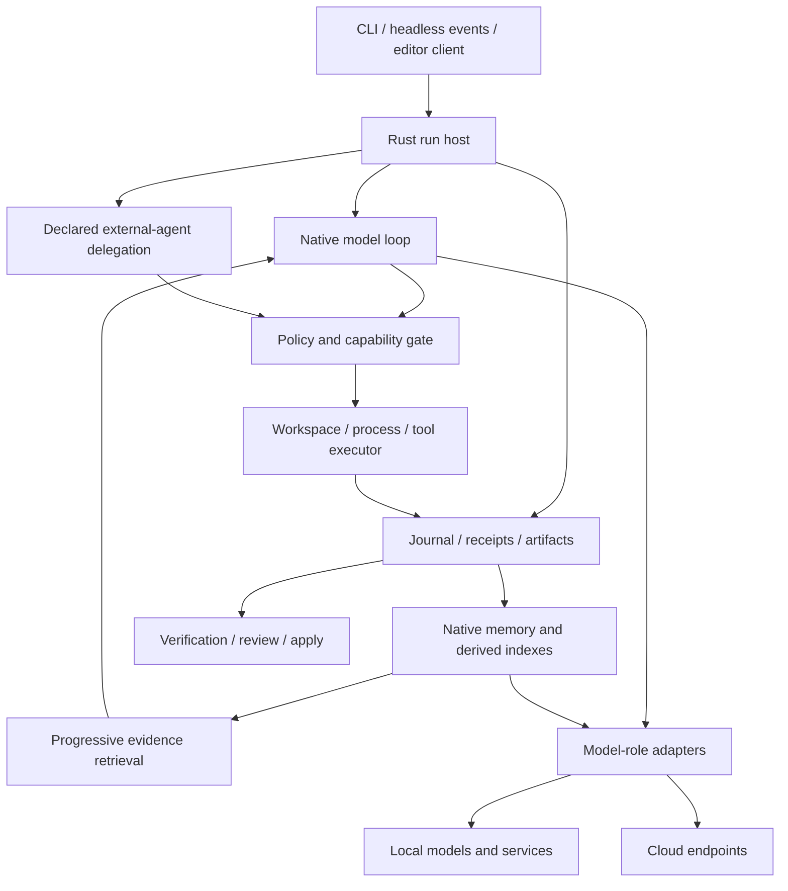

# Splyce master plan

**Status:** proposed implementation plan, based on the public-source research snapshot of **2026-10-25**. The repository contains research, agent working rules, documentation checks and an imported compendium. The Splyce runtime is not implemented; coding-agent, memory and inference performance measurements are **n=0**. Discovery remains open where the [gap journal](research/docs/agents/gap-sweep-candidates.md) or [import review](research/imports/claim-review.md) records another lead.

## Product decision

Build one coherent coding-agent tool with a **Rust-owned CLI, run host, policy boundary, journal and native memory system**. Interactive, headless and editor clients use the same state and action contracts. Local, cloud and mixed model deployments share those contracts. The project combines useful mechanisms, not several competing autonomous loops.

Rust is the preferred implementation direction. [ADR-002](research/docs/foundations/stack-decision.md) compares its costs with TypeScript, Python and upstream reuse. A Rust host can call an external inference service, language server or delegated coding agent. That does not make the entire dependency tree pure Rust. Native parsers, SQLite, accelerator kernels, ONNX Runtime and optional Python/C++ services must be disclosed in packaging and capability manifests.

No source is selected because it has the longest feature list. Adoption requires a pinned source and license, a useful mechanism, an owner, a real integration path, a baseline and an acceptance gate. Public visibility alone does not authorize copying code, artwork or a third-party design.

## One architecture and one owner per concern

This is a responsibility map. An external agent may hide its internal tool calls; an adapter must declare that limitation. Event normalization cannot manufacture enforcement or audit coverage. Git worktrees provide change separation, while operating-system/process/network isolation requires its own tested executor boundary.

Start with one Rust package and clear internal modules. Split crates only for a present public API, native linkage, compilation or ownership need. Proposed boundaries are `run`, `policy`, `executor`, `store`, `memory`, `providers`, `context`, `protocols` and `verification`; these names describe future code, not files already present.

| Concern      | Preferred starting point                                                              | Qualification requirement                                                              |
| ------------ | ------------------------------------------------------------------------------------- | -------------------------------------------------------------------------------------- |
| Host and CLI | Tokio, clap; streaming output first, Ratatui/Crossterm when interactive work needs it | Cross-platform process ownership, cancellation, deadlines and backpressure             |
| Storage      | SQLite through rusqlite; addressable artifact files                                   | Durable ordering, schema migration, crash recovery, scoped export/deletion             |
| Providers    | Evaluate Rig traits versus narrow provider adapters                                   | Preserve model-specific stream/tool/schema/usage/error semantics without a second loop |
| Code context | ripgrep, file inventory, then healthy LSP and Tree-sitter                             | Revision/range provenance, stale-state rejection and lexical fallback                  |
| Recall       | Local lexical index, then measured Tantivy/vector alternatives                        | Scope and deletion applied before every retrieval route                                |
| Protocols    | Official Rust MCP SDK; separate ACP/client and A2A/task adapters                      | Negotiated versions and permissions enforced at actual dispatch                        |
| Plugins      | Process boundary first; evaluate Wasmtime/WASI for portable code                      | Explicit host grants, versioned manifest, cleanup and update provenance                |

Sources and alternatives: [stack decision](research/docs/foundations/stack-decision.md), [architecture synthesis](research/docs/design/synthesis.md), [frameworks](research/docs/foundations/frameworks-and-orchestration.md).

## Durable contracts before features

1. **Run:** immutable ID, task/acceptance text, workspace/base revision, selected model-role contracts, executor location, effective grants, budgets and instruction provenance.
2. **Action:** unique ID, owner/parent, typed capability/version, validated arguments and target scope. Effective permission is the intersection of user/run, host, workspace, executor and child grants. Plugins, skills, hooks and remote tools cannot grant themselves authority.
3. **Receipt:** ordered event and artifact references describing the intent, policy decision and observed result. Record intent before an external effect and outcome before reporting success. Intent without outcome is uncertain; reconcile before retrying. Do not promise exactly-once arbitrary external effects.
4. **Evidence:** scoped source/artifact ID, revision/range, content identity and derivation links. Generated summaries and graph edges cite their sources and are never the only evidence.
5. **Result:** explicit stop reason, final diff/revision, exact verification command/exit/output receipt, cleanup status and unresolved effects. “Verified complete” requires receipts for the actual final revision.
6. **Model role:** operation, endpoint/locality, immutable model/runtime revision, schema, limits, tokenization/instructions, usage and error/cancellation semantics. Embeddings additionally specify dimension, normalization, metric and index generation.

Journal and permission schemas become compatibility commitments once users store state. Ship versioned migrations, export and recovery tools before changing them. Keep provider credentials outside receipts and prompts. Product concurrency follows measured resources and task ownership, not this research session's agent limit.

## Native cross-session memory

Memory is part of the first releasable product, not a required external note-taking agent. Use the same receipts and access policy as the run host:

1. Capture user decisions, tool outcomes, changes, failures and exact source references in the journal. Store large raw artifacts separately with explicit retention.
2. Produce typed observations and a compact task/session summary asynchronously. Retain evidence IDs, scope, timestamps, supersession and extraction-model revision. A failed summarizer must not lose captured work.
3. At session start inject only policy, a small active-state capsule and a relevant memory index. Search IDs first, expand selected timeline/graph context second, and fetch original evidence last. Keep stable prompt prefixes separate from changing retrieved context.
4. Record evidence actually supplied and used. Resolve contradictions using source recency/validity and explicit supersession; expose uncertainty instead of silently rewriting a remembered fact.
5. Apply retention, correction, export and deletion across raw artifacts, summaries, lexical/vector indexes, graph edges, caches and backups. Tombstones contain no deleted content; document backup expiry and verify rebuild/cutover behavior.

Default recall stays within the current workspace/task. Cross-project recall requires an explicit scope grant and returned provenance. A local-only profile keeps **all** model roles local, including summaries, extraction, embeddings and reranking. A mixed profile applies data-class egress rules independently to each role. Provider outages preserve receipts and return a visible degraded mode.

Compare these configurations behind one retrieval contract: lexical/recency; dense; hybrid/RRF; each with reranking; then temporal or HippoRAG-style graph retrieval. Evaluate sparse FlyVec/Fly-LSH/BioHash and order-sensitive Comply independently. A code graph, workflow DAG, provenance graph, inferred knowledge graph and learned neural memory are different structures; do not merge their semantics.

Every embedding change that alters vector space creates a new index generation. Model revision, dimension, normalization, query/document instructions and truncation are persisted. Rebuild and validate before atomic cutover; never mix incompatible vectors silently. Rerank scores also retain their model and scoring contract.

To earn “better than claude-mem,” compare against its documented progressive-disclosure behavior as well as no-memory, hand-authored-summary and lexical baselines. Measure held-out recall, correct evidence use, temporal updates/abstention, injected and total tokens, full extraction/indexing cost, p95 latency, scope violations and deletion failures. LongMemEval/LoCoMo complement coding-task recovery tests. There is no improvement claim until these results exist. [Memory research](research/docs/capabilities/cross-session-memory.md), [context](research/docs/capabilities/context-retrieval-and-memory.md), [sparse research](research/docs/capabilities/sparse-retrieval-and-coordination.md).

## Local and cloud inference

Treat generation, structured extraction, embeddings and reranking as separate operations. A chat-compatible endpoint does not establish every other capability. Support combinations such as local generation plus local embeddings, cloud generation plus local recall, or explicitly permitted cloud extraction/reranking.

Compare SGLang and vLLM for supported accelerated, concurrent workloads. Qualify llama.cpp, Ollama and LM Studio for local development; MLX, TensorRT-LLM/Triton, OpenVINO/ORT, ExLlamaV3, MLC and Rust-native engine candidates according to hardware/model needs. TEI or another embedding/rerank service may be a separate process under the same owner. Keep hosted endpoints/routers optional and disclose data handling, region, revision, rate/cancellation limits and complete cost.

Use identical model revision, tokenizer/template, quantization, output constraints and workload for serving comparisons. Separate cold load, warm single-user, shared-prefix, long-prefill and saturated traffic. Report TTFT, output latency/throughput, p50/p95/p99, errors, cancellation, usage, RAM/VRAM and task quality. No engine is “best” for every deployment. [Inference research](research/docs/capabilities/inference-local-and-cloud.md).

## Feature-to-delivery map

| Mechanism family and research                                                                                                 | Splyce owner                    | Required proof                                                                     | Phase |
| ----------------------------------------------------------------------------------------------------------------------------- | ------------------------------- | ---------------------------------------------------------------------------------- | ----- |
| [Terminal agents](research/docs/agents/terminal-agents.md): structured turns, steering, fork/resume and headless events       | Run host and clients            | Same result contract across interactive/headless modes; truthful stop/usage events | 0–2   |
| [IDE/platform agents](research/docs/agents/ide-and-platforms.md): reviewable edits, checkpoints and apply                     | Executor/verifier               | Stale base/conflict stops apply; final diff matches receipts                       | 1–2   |
| [DeepSeek Harness](research/docs/foundations/recursive-harnesses.md): composable lifecycle/services                           | Host-owned adapters             | Load/unload cleanup and no authority escalation or duplicate owner                 | 2–3   |
| [Memory](research/docs/capabilities/cross-session-memory.md): capture, summaries, recovery and correction                     | Memory owner                    | Empty-context recovery; full scope/deletion checks; citation precision             | 1–2   |
| [LSP and code search](research/docs/capabilities/context-retrieval-and-memory.md)                                             | Context service                 | Definition/reference accuracy and stale-server fallback versus lexical baseline    | 2     |
| [MCP/ACP/A2A, skills/plugins/hooks](research/docs/capabilities/protocols-plugins-and-evaluation.md)                           | Protocol/capability adapters    | Handshake, policy, cancellation and teardown conformance                           | 2–3   |
| [Spec/workflow scaffolds](research/docs/foundations/workflows-and-scaffolds.md): task ownership and handoff                   | Task record                     | No competing writer; completion requires current evidence                          | 2–3   |
| [Inference](research/docs/capabilities/inference-local-and-cloud.md) and [stack](research/docs/foundations/stack-decision.md) | Provider-role adapters          | Local/cloud matrix, egress and capability failure tests                            | 1–3   |
| [Graphs/sparse methods](research/docs/capabilities/sparse-retrieval-and-coordination.md)                                      | Optional retrieval routes       | Paired quality/cost/latency ablations with exact evidence and deletion             | 3     |
| [Governance/fleet tools](research/docs/governance/governance-and-control-planes.md)                                           | Host policy and task supervisor | Narrow child grants, real limits, spending receipts and owned cleanup              | 3     |
| [Browser/cloud executors](research/docs/capabilities/protocols-plugins-and-evaluation.md)                                     | Explicit execution adapters     | Deployment-scoped isolation, credential/egress and artifact tests                  | 3–4   |
| [Harness², GEPA and optimizer research](research/docs/capabilities/extended-internals.md)                                     | Offline experiment runner       | Untouched holdout, fixed baseline/budget, review and rollback                      | 4     |

This mapping covers mechanism families rather than promising every product's entire interface. The [catalog](research/docs/catalog.md), [long-tail register](research/docs/agents/gap-sweep-candidates.md) and [import review](research/imports/claim-review.md) retain candidate-specific evidence and open leads.

## Implementation sequence and acceptance gates

### Phase 0 — qualify the foundation

Pin a small representative task set and model; compare a Rust native slice with the shortest viable upstream reuse path. Exercise policy interception, streaming, one real tool call, interruption, resume and export. Record code owned, maintenance burden, capability fidelity and failure behavior. Resolve redistribution/native-library licenses. **Exit:** select and document a foundation with actual evidence; no language-speed assumption substitutes for a run.

### Phase 1 — edit, verify, recover

Build one Rust CLI/headless path over one provider, one owned workspace, read/search and guarded edit/shell tools, journal/artifacts and a real verification command. Capture receipts and a cited session summary. Inject crashes at intent/effect/outcome boundaries. **Exit:** a real repository change with a diff, successful final-revision test receipt, a proven denial and honest uncertain-effect recovery. This is a disposable development slice, not the release.

### Phase 2 — first usable release

Add native empty-context memory recovery, retention/deletion/export, a fully local model-role profile and a cloud/mixed profile, interactive steering, healthy LSP context and minimal MCP/skills support. Define Windows/Linux/macOS support from actual platform tests, including process cleanup and packaging. **Exit:** end-to-end code task survives session restart, retrieves the correct cited prior decision within a declared budget, produces verified changes and passes cross-workspace/deletion checks on every enabled route.

### Phase 3 — justified expansion

Add delegated coding agents, bounded parallel ownership, ACP/editor clients, optional A2A, model switching and measured hybrid/rerank/graph memory routes. Test cancellation trees, opaque-backend limits, multi-workspace conflicts and remote/provider failures. Add sandbox/cloud/browser backends only with their own authority and cleanup receipts. **Exit:** every enabled feature is wired into a real path and beats or matches its stated baseline without a policy/recovery regression.

### Phase 4 — improvement and distribution

Run offline Harness²/GEPA-style candidates over prompts, tools, retrieval and routing. Candidate code cannot edit policy, evaluator or holdout. Select with paired fixed-budget trials, then verify once on untouched tasks. Version and review changes, preserve failed experiments and support rollback. Add signed release artifacts, SBOMs/attestations and reproducible packaging once binaries actually exist. **Exit:** published installation works on supported platforms and all advertised claims have reproducible evidence.

## Evaluation and release rules

- Fix task/model/environment revisions and quality constraints before comparing. Count failed, canceled and inconclusive runs; report sample size and uncertainty. Keep baseline/candidate compute, retries and budgets comparable.
- Use repository edit/test tasks for integrated quality, Harbor/Terminal-Bench and SWE-bench where appropriate, and memory-specific temporal/recovery/deletion tasks. Public leaderboard performance is neither an uncontaminated holdout nor an integration proof.
- A speed/token-cost win must preserve task quality and evidence use. Report total cost including extraction, embedding, reranking, graph construction, refresh, idle services and recovery.
- Required implementation checks will include Rust fmt/clippy/build/tests, provider/protocol conformance, crash and scope/deletion tests, cross-platform packaging and the appropriate CodeQL/language coverage. Existing documentation CI is not runtime qualification.
- Review permission, journal, memory and provider boundaries with negative integration tests. A mock-only green test or worker report cannot certify the real path.

## Research and operational handoff

Maintain [research/README.md](research/README.md) and category indexes as the canonical map. Imported material stays labeled as supplied synthesis; original token/count/cost assertions become test hypotheses, not constants in the implementation. Continue exact-source follow-up and record every reopened discovery pass honestly. No finite search proves every tool in a changing ecosystem has been found.

The [repository baseline](research/docs/governance/repository-baseline.md) records free controls, squash/review policy, pinned workflows and paid-feature limits. [AGENTS.md](AGENTS.md) and the focused [.skills/](.skills/README.md) library govern agent work. The next implementation change begins at Phase 0, not by scaffolding every proposed module or installing every researched framework.
