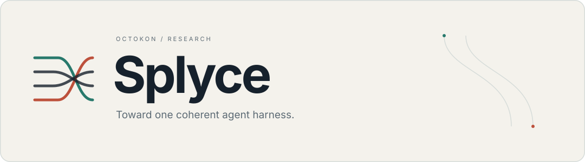

<picture>
  <source media="(prefers-color-scheme: dark) and (max-width: 640px)" srcset="assets/brand/hero-mobile-dark.svg">
  <source media="(max-width: 640px)" srcset="assets/brand/hero-mobile-light.svg">
  <source media="(prefers-color-scheme: dark)" srcset="assets/brand/hero-dark.svg">
  
</picture>

# Splyce

A research-led foundation for one coding-agent harness: capable models, useful memory, and changes backed by evidence.

[Research](research/README.md) · [Master plan](MASTER-PLAN.md) · [Contributing](CONTRIBUTING.md)

## The direction

The strongest ideas from coding agents, retrieval systems, and inference engines should work together through one consistent tool.

| Area       | Planned behavior                                                                           |
| ---------- | ------------------------------------------------------------------------------------------ |
| Models     | Local, cloud, or mixed generation, extraction, embeddings, and reranking.                  |
| Memory     | Native cross-session summaries with citations and selective recovery of original evidence. |
| Code       | Language-aware navigation, scoped edits, and actual verification receipts.                 |
| Extensions | MCP, skills, plugins, and delegated agents under shared permissions and state.             |

## Where it stands

This repository contains public-source research, an implementation plan, and documentation tooling. **The agent runtime is not built yet.** Performance improvements remain hypotheses until measured.

Start with the [research index](research/README.md) for comparisons and sources, or the [master plan](MASTER-PLAN.md) for the build sequence and acceptance gates. Contributions should connect a mechanism to a source and a testable outcome.

[Contribution guide](CONTRIBUTING.md) · [Security reporting](SECURITY.md) · [Discussions](https://github.com/OctoKon/Splyce/discussions)
