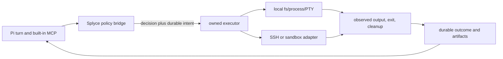

# Tool access and execution

**Active product scope:** Splyce keeps agent execution and stored state local. Each inference role may use a local runtime or an explicitly authorized cloud API profile with recorded endpoint, model/revision, and egress scope; it never silently switches provider or falls back. Hosted memory and executors below remain comparative research, not product dependencies. [Current master plan](../../../MASTER-PLAN.md).

Research date: 2026-10-25. Evidence: [tool-execution sources](../evidence/tool-execution-sources.json). This is a Pi-first design and qualification chapter. It proposes Splyce-owned contracts around the pinned Pi coding-agent source `d5b3de22d0e24a3e9c38a9410d3329b099717283`; it does **not** claim an installed executor, sandbox, remote connection, or runtime result. All execution measurements are **n=0**.

Pi remains the TypeScript/Node model loop, session/branch owner, and built-in MCP client. A Pi extension is trusted code in the same process and therefore has the host's operating-system authority [TX-12]. Tool interception is useful for policy and receipts, but does not turn an extension into containment. Splyce should add one small policy/receipt bridge and owned executor ports; it must not add a second planning loop, replacement terminal, or parallel MCP client.

## Authority model

An effect is admitted only when its effective grant is the intersection of the user/run grant, current host policy, workspace boundary, selected executor capability, child grant, and data-egress rule. A discovered MCP tool, extension, hook, skill, Git remote, or SSH configuration cannot enlarge it. Trusted extension code is outside the OS-containment guarantee, not outside the policy/accounting contract: reviewed host operations must use the same grants and receipt path. Arbitrary in-process JavaScript can still call the OS directly; only reviewed extensions may load, and F0 cannot claim complete mediation of untrusted extensions.

| Capability                             | First reuse                                        | Boundary that remains                                          | Admission and evidence gate                                                                                                                                                                                                       |
| -------------------------------------- | -------------------------------------------------- | -------------------------------------------------------------- | --------------------------------------------------------------------------------------------------------------------------------------------------------------------------------------------------------------------------------- |
| Read/search/edit in an owned workspace | Pi tool path plus `node:fs`                        | Filesystem identity and concurrent mutation                    | Canonical/handle-aware boundary check immediately before operation; record target identity and before/after digest.                                                                                                               |
| Noninteractive command                 | Pi tool path plus `child_process.spawn`/`execFile` | Child descendants, inherited environment, output pressure      | Explicit executable/argv/cwd/env allowlist, process-tree owner, timeout/cancel receipt. Avoid shell parsing by default [TX-02].                                                                                                   |
| Interactive `user_bash`                | A separately granted local PTY                     | A user-entered shell is interactive and may create descendants | Never silently downgrade to an agent shell. Durable user intent names the terminal/session and grant; transcript is retention-limited and is not a proof of all effects.                                                          |
| Git                                    | Installed Git through an owned command adapter     | Hooks, credentials, remotes, worktrees                         | Treat local repo mutation, hook execution, fetch, push and remote URL as separate capabilities. A worktree prevents ordinary file collisions, not process or credential exposure.                                                 |
| Built-in MCP                           | Pi built-in MCP under the bridge                   | Remote/server-internal actions                                 | Bind every activated server/tool call to a capability manifest and receipt. MCP authorization never grants local executor authority.                                                                                              |
| SSH/remote command                     | Explicit remote executor adapter                   | Remote process tree, filesystem, egress, credential use        | Pin and verify host identity before connection; require remote executor/session ID, target, command, egress profile and observed cleanup. SSH provides authenticated encrypted channels, not exactly-once remote effects [TX-11]. |
| Container, VM, managed sandbox         | Executor adapter only                              | Mounts, image, network, credentials, provider lifecycle        | Pin image/runner/runtime and region; produce mount, network, resource, lifecycle and cleanup receipts.                                                                                                                            |

The proposed order for every effect is: validate typed request -> intersect grants -> write policy decision -> durably commit intent -> dispatch -> observe result/physical state -> durably commit outcome -> report. A journal write failure before dispatch blocks dispatch. An interruption after intent but before a durable observed outcome means **uncertain effect**. Reconcile physical state before retrying; do not claim exactly-once execution for an arbitrary local or remote command.



## Filesystem contract

`node:fs` supplies portable operations but neither `resolve()` nor a lexical prefix check contains a target. `realpath` resolves symbolic links and dot components; hard links and bind mounts mean canonical text is still not a unique object identity [TX-01]. On Windows, reparse points can change open behavior and implement links or mounted folders [TX-04]. The executor must therefore resolve and check the actual target at the operation boundary, not only when it initially accepts a path.

`WorkspaceFs` is a proposed narrow port: `statTarget`, `read`, `writeAtomic`, `rename`, `remove`, and `list` accept a relative logical path, expected workspace ID and grant revision. Mutations additionally require current workspace ownership/epoch plus expected source/target identity or explicit expected absence; a digest is not optional for an existing read-modify-write target. Check preconditions under the shared ownership immediately before mutation, rejecting stale input without overwriting it. Read/stat/list do not require a write precondition. The [base ownership contract](../design/implementation-contracts.md#record-contract) serializes admitted Splyce writers across distinct sessions; it does not assert an OS-wide transaction against arbitrary external writers. The adapter rejects absolute paths, drive/UNC escapes, parent traversal after normalization, unsupported file types, and targets that resolve outside its approved roots. It records the logical path, resolved identity descriptor, and digest, never an unrestricted host path. For a creation whose final path does not exist, resolve and validate the nearest existing parent, create in that parent with a unique temporary name, then atomically rename while rechecking the parent/target boundary. Platform-native handles may be needed to close rename/symlink/reparse races; do not describe a pure string algorithm as complete containment.

First qualification is local-only and destructive only inside a disposable fixture: ordinary in-root file; relative and absolute symlink; Windows directory junction/reparse point; replacement between precheck and mutation; hard-link/bind-mount fixture where supported; and a denied cross-root target. Each denied case must leave its canary unchanged. Run the full applicable matrix on every advertised Windows V1 cell; Linux/macOS are future research cells unless separately selected for a later release. Unavailable primitives on an advertised cell are an explicit unsupported capability, not a skipped pass.

## Processes, shell, and PTY

Commands that may mutate the workspace acquire and retain the same base workspace ownership until all owned descendants settle; only a qualified read-only path may avoid it. A requested cancellation, expired lease or root-process exit alone cannot permit another writer.

Use direct executable plus argv for an agent command. `exec()` starts a shell whereas `execFile()` directly starts a target by default; shell quoting changes semantics and creates a larger authority surface [TX-02]. Record executable identity, argv artifact, selected cwd identity, sanitized environment-name allowlist, stdin source, process/session ID, deadline, and expected cleanup owner. Do not place secret values or unrestricted environment contents in the journal.

Node reports child lifecycle and can connect stdio, but its pipes have finite platform-specific capacity; a child can block when output is not drained [TX-02]. Store an ordered stream artifact with byte count, encoding/invalid-byte marker, stdout/stderr (or PTY) channel, and a bounded presentation preview. Truncating the model/UI preview must not silently discard the retained artifact. If retention policy requires destruction, record the range and reason, state that audit material is absent, and never rerun only to reconstruct it.

An ordinary `kill()` is insufficient for a command launched through a shell: Node documents that descendants on Linux can survive their parent [TX-02]. The process adapter has `start`, `requestCancel`, `wait`, `reconcile`, and `cleanup` operations. It owns a platform process group/tree: POSIX process-group/session behavior must be qualified; Windows uses an owned Job Object candidate [TX-05]. Cancellation records (1) request accepted locally, (2) termination signal/request sent, (3) root exit, (4) descendant/tree cleanup observed, and (5) survivors/uncertainty. Timeout, terminal disconnect, and parent crash follow the same sequence. Any survivor blocks a clean-completion claim.

PTY is an interface choice, not a security boundary. `node-pty` provides pseudoterminal reads/writes across Linux, macOS, and supported Windows ConPTY, but starts children with parent permissions [TX-03]. A PTY session must have an explicit `mode: agent_command | user_bash`; policy must reject programmatic reuse of a `user_bash` session by an agent unless a fresh user grant says otherwise. Capture raw ordered PTY bytes to the same retention policy, retain resize/input/close/cancel events, and expose a size-bounded terminal projection. Do not parse prompt text or terminal escape sequences as completion evidence; exit, tree-cleanup, and verified artifacts carry that meaning.

## Git and remote execution

Git execution is four capabilities: read/status/diff, local worktree mutation, local hook execution, and remote network effect. A Git invocation inherits the executor environment and can activate repository configuration or hooks, so commands cannot be described as read-only merely because their top-level Git verb sounds safe. Before mutation, record base revision and worktree identity; after mutation, record the observed final revision/diff artifact. Before a remote action, re-evaluate remote URL, DNS/host endpoint policy, repository identity, credentials source class, and push/ref scope. Credentials remain in an OS/agent credential facility or narrowly injected executor channel, never in action arguments or artifacts.

SSH is a remote transport whose architecture separates server authentication, user authentication, and multiplexed logical channels [TX-11]. First-contact or changed-host-key acceptance needs an explicit user policy; default unattended operation accepts only an existing pinned host key or approved CA. A remote execution receipt contains remote authority profile/version, verified host identity reference, remote workspace/session identity, command artifact, remote executor acknowledgement, output artifact, and cleanup acknowledgement. A lost SSH connection after dispatch is uncertain even if the client had already written an intent. Remote file access, port forwarding, agent forwarding, and egress are separate denied-by-default subcapabilities.

## Executor donor matrix and selection gates

| Donor / primitive                                   | Concrete reusable mechanism                                               | Do not infer                                          | Selection gate                                                                                                             |
| --------------------------------------------------- | ------------------------------------------------------------------------- | ----------------------------------------------------- | -------------------------------------------------------------------------------------------------------------------------- |
| Pi built-ins and extension seams                    | Turn, tool, lifecycle, session and built-in MCP integration [TX-12]       | OS sandbox or durable effect ordering                 | Pinned source and installed-path F0 proves ordinary, nested and MCP calls cannot bypass the bridge.                        |
| Node `fs` / `child_process`                         | Portable file I/O, direct subprocess and stream interfaces [TX-01, TX-02] | Target containment or descendant cleanup              | Node version pin; per-OS negative fixture and crash/cancel matrix pass.                                                    |
| `node-pty`                                          | Interactive PTY and ConPTY support [TX-03]                                | Separate user/agent authority or process isolation    | Pinned version/license/native build; resize, stream pressure, cancel, and cleanup fixtures pass on supported OSes.         |
| OS process tree: POSIX groups / Windows Job Objects | Tree lifecycle ownership; Windows unit-level limits/termination [TX-05]   | Cross-platform identical semantics                    | Each shipped platform proves descendant cleanup after timeout, cancel, disconnect, and parent crash.                       |
| Docker                                              | OCI image runtime with namespaces/cgroups [TX-06]                         | Safe mounts, no credentials, or no egress             | Digest-pinned image; non-root user; explicit mounts/network/resources; escape/egress negative fixture and cleanup receipt. |
| gVisor `runsc`                                      | OCI-compatible application-kernel isolation [TX-07]                       | Full Linux compatibility or application-level policy  | Pinned runtime, workload compatibility suite, configured mounts/egress, and same negative fixture pass.                    |
| Firecracker                                         | KVM microVM substrate, rate-limited control plane, jailer [TX-08]         | Provider lifecycle, persistence, or host availability | Linux/KVM availability, pinned guest image, measured boot/cleanup and mount/egress proof.                                  |
| E2B                                                 | SDK-created remote sandboxes and command execution [TX-09]                | The hosted service's current tenancy/retention policy | Pin SDK/API contract, region, template/image, retention, egress, identity, cancel and delete receipts.                     |
| Daytona                                             | Managed container/VM/Windows/macOS sandbox profiles [TX-10]               | Uniform isolation across sandbox classes              | Pin snapshot/image, target region/class, persistence, resource, egress and deletion behavior in observed tests.            |
| SSH                                                 | Authenticated encrypted remote channels [TX-11]                           | Remote process observability or idempotent effect     | Host-key/CA policy, least privilege remote identity, egress policy, disconnect reconciliation and cleanup proof.           |

Sandbox selection follows required authority, not marketing labels. Local developer commands start as a guarded local executor. Untrusted or tenant-separated code needs a qualified remote/container/VM profile. Docker uses Linux namespaces/cgroups but its daemon, configuration, mounts and hardening remain boundary inputs [TX-06]. gVisor adds an application-kernel layer with compatibility tradeoffs [TX-07]. Firecracker is a Linux/KVM microVM substrate and needs guest-image and hardware qualification [TX-08]. E2B and Daytona are adapters whose control-plane semantics, data region, credentials, egress, retention and deletion are provider contracts that must be observed before any guarantee. No source supports a current Splyce runtime claim.

## Bounded interfaces

```ts
type EffectState =
  "not-dispatched" | "observed-success" | "observed-failure" | "uncertain";

interface ExecutionRequest {
  actionId: string;
  capability:
    "fs.read" | "fs.write" | "command" | "user_bash" | "git" | "mcp" | "ssh";
  grantRevision: string;
  workspaceId: string;
  target: { kind: "relative-path" | "argv" | "remote-session"; ref: string };
  deadlineAt: string;
}

interface ExecutionReceipt {
  actionId: string;
  intentId: string;
  executor: {
    kind: "local" | "container" | "vm" | "managed" | "ssh";
    contractId: string;
  };
  state: EffectState;
  outputArtifactId?: string;
  cleanup: "not-needed" | "observed" | "pending" | "uncertain";
}

interface ExecutorPort {
  dispatch(intentId: string): Promise<ExecutionReceipt>;
  cancel(actionId: string): Promise<ExecutionReceipt>;
  reconcile(actionId: string): Promise<ExecutionReceipt>;
}
```

These interfaces are proposals, not Pi APIs. The authoritative Splyce `ReceiptPort.commitIntent(request)` is separate from `ExecutorPort.dispatch`; executors do not create an independent journal. The policy bridge checks current effective grants and commits intent before delegation. The executor refuses stale grants, changed workspace identity, unknown contracts or unavailable required isolation. Result presentation waits for a durable outcome. Memory consumes scoped receipt/artifact IDs after redaction, never terminal display alone. Cloud inference is a separately authorized provider route; remote/managed executors remain research comparisons and are not product dependencies.

## Negative physical E2E fixtures

Run these only in disposable fixtures and record Pi pin, runtime versions, OS/architecture, executor/image/snapshot contract, commands, exits, receipts, and final physical state. All are proposed tests; none has run.

| Fixture                 | Required observation                                                                                                                                                                                                       |
| ----------------------- | -------------------------------------------------------------------------------------------------------------------------------------------------------------------------------------------------------------------------- |
| `TX-path-boundary`      | An allowed in-root edit succeeds; traversal, symlink/reparse/junction escape, and an in-flight replacement leave the external canary unchanged.                                                                            |
| `C2_workspace_writer`   | Two distinct sessions share a canonical workspace: conflicting mutation denies before effect; after handoff stale expected input still denies. A surviving child blocks takeover; independent qualified worktrees proceed. |
| `TX-process-tree`       | A command creates a descendant; timeout/cancel/disconnect removes the owned tree or reports survivor/uncertain state. A later action cannot attach to its old terminal.                                                    |
| `TX-stream-retention`   | Large stdout/stderr and PTY output do not deadlock. UI/model truncation preserves an ordered retained artifact or emits a documented retention-loss receipt.                                                               |
| `TX-user-bash`          | An agent cannot write to an interactive user terminal without a new explicit grant; user cancellation produces a separate cleanup receipt.                                                                                 |
| `TX-intent-crash`       | Stop at each decision/intent/dispatch/outcome boundary. Intent with no observed outcome remains uncertain and is reconciled before retry.                                                                                  |
| `TX-git-remote`         | Local edit/hook, fetch, and push denials are individually prevented; a remote disconnect after dispatch is not reported complete.                                                                                          |
| `TX-egress-credentials` | Local, container, VM, managed, and SSH profiles deny undeclared network destinations and do not expose ambient credentials.                                                                                                |
| `TX-sandbox-cleanup`    | Cancel/delete removes the selected executor or returns explicit provider uncertainty; a new run cannot observe the former workspace or retained secret canary.                                                             |
| `TX-pi-bypass`          | Ordinary tool, nested tool, built-in MCP, extension-triggered effect, and `user_bash` all pass or deny through the same durable decision/intent/outcome boundary.                                                          |

The first implementation package must pin Node, Pi commit, executor/image/runtime, and any native PTY dependency; record license, platform support, update process, source identity and exact fallback behavior. A source observation supports a proposal. A passing local fixture supports that named platform/configuration only. CI, deployed, and live managed-service claims each require their own receipts. Until then, the status remains source-backed design with runtime **n=0**.
