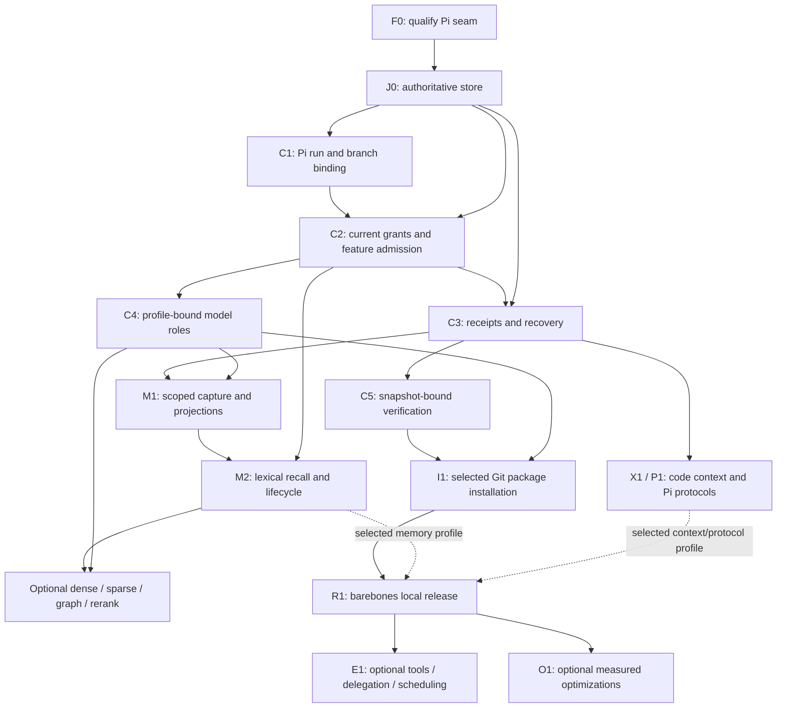

# Proposed capability and configuration map

**Status: PROPOSED, unimplemented; all runtime, integration, footprint and quality results are n=0.** This map translates the [active master plan](../../../MASTER-PLAN.md), [implementation contracts](implementation-contracts.md) and [readiness audit](readiness-audit.md) into feature ownership, dependencies and decisive tests. It is a design contract, not an inventory of working features. Every dotted key below is a **proposed Splyce identifier**, not an existing Pi setting, flag, SDK method or accepted configuration schema.

Splyce is OSS with a barebones local application, local execution/authoritative state and **user-selected local/cloud inference per operation/profile**. This supersedes the earlier global local-only restriction. All-local profiles forbid model egress; hosted profiles require explicit endpoint/data-class scope and expose processing/cost limits. No unsolicited telemetry or implicit hosted executor/memory store. Distributed assets require qualified rights/pins; independently supplied models/plugins retain their own terms. [Model choice](user-controlled-models.md), [profiles/sessions](providers-profiles-and-sessions.md) and [module/plugin installation](modular-installation.md) own the detailed contracts; private sources are not public provenance.

## Decision and alternatives

| Approach                                               | Advantage                                                            | Key cost / rejection                                                                                                                                    | Reversibility                                                                           |
| ------------------------------------------------------ | -------------------------------------------------------------------- | ------------------------------------------------------------------------------------------------------------------------------------------------------- | --------------------------------------------------------------------------------------- |
| Expose every upstream/backend setting directly         | Small initial adapter                                                | Different components can enable workers, remote endpoints or permissions outside one admission/lifecycle contract; no coherent disable/delete semantics | Easy before release; user configuration and persisted jobs make later repair costly     |
| Build a general settings DSL and dependency engine     | Uniform abstract vocabulary                                          | Adds another framework before a real caller exists; risks a second authority and imaginary Pi APIs                                                      | Two-way initially; schema/plugin dependence creates a compatibility commitment          |
| Narrow Splyce feature controls over qualified Pi seams | One existing loop; explicit optional behavior and resource ownership | Requires real per-feature fixtures and an adapter where Pi cannot enforce the contract                                                                  | Selected; two-way for unreleased keys, costly after persisted configuration/state ships |

Choose the third approach. Reuse Pi's actual settings, model selection, modes and flags where the pinned source supports their meaning; add only the missing Splyce-owned lifecycle/admission fields. Do not implement a generic settings language, alternate loop, MCP client or speculative backend registry. A tool visibility flag cannot replace permission enforcement. Persisted policy, config and journal migrations become one-way compatibility commitments: require migration/recovery evidence and broader review before changing released meanings. Optional route selection remains reversible when original evidence and a qualified baseline survive.

## Authority, packages and dependency map

Pi owns turns, generation streaming, conversation history and branch ancestry. Splyce owns grants, operational records, configuration revisions, effects, verification and memory projections. One operational store is authoritative; indexes and caches are rebuildable. J0 follows F0 and precedes C1/C2; C3 extends J0/C2 with crash/effect reconciliation rather than selecting storage after effects already execute.

Arrows show package prerequisites, not automatic activation. Each optional route requires its explicit control, qualified dependencies and current grants. Enabling graph, for example, cannot silently enable dense retrieval or a model daemon. R1's base-only profile does not depend on M1/M2, LSP or installed MCP/skill packs. Their package gates apply only to supported selected-module profiles. Ordinary built-in file/search remains available without LSP/indexing. Native memory is not installed/off by default; operational receipts and Pi's own conversation state remain core.

## Non-optional safety and ownership floor

These are invariants, not user bypass toggles. A failed invariant blocks affected work with a receipt. Users can decline a capability or stop a run; they cannot enable an unsafe variant by switching off its policy, deletion fence or evidence requirements.

| Concern / proposed identifier | Owner and planned entrypoint                            | Required dependency and state                                                                        | Decisive fixture / package                                                                                                   |
| ----------------------------- | ------------------------------------------------------- | ---------------------------------------------------------------------------------------------------- | ---------------------------------------------------------------------------------------------------------------------------- |
| `core.piHost`                 | Pi; Splyce binding in `packages/splyce-pi/src/index.ts` | F0/J0; bind trusted policy before first prompt, preserve Pi ancestry/modes; no second loop           | First-prompt binding, sibling branch and file fork; F0/C1                                                                    |
| `core.operationalStore`       | Splyce `src/store.ts`                                   | F0; versioned local runs, config revisions, decisions, intents/outcomes and deletion fences          | Failed pre-effect commit causes zero dispatch; crash/reopen validates integrity; J0                                          |
| `core.policy`                 | Splyce `src/policy.ts`                                  | C1/J0; intersect current host/workspace/user/child grants, validate targets and output boundary      | Ordinary/nested/MCP/user-shell denial; handler failure; C2/F0                                                                |
| `core.receiptsRecovery`       | Splyce `src/receipts.ts`                                | J0/C1/C2; ordered intent before effect, observed outcome before success                              | Kill at each commit/effect boundary; uncertain outcome never silently replays; C3                                            |
| `core.locality`               | Splyce `src/providers.ts` and policy                    | C2; pinned role/provider/API/model, current profile and data-class egress                            | Local-only role has zero hosted dispatch; cloud role uses only its explicit allowed endpoint/data; C4/R1                     |
| `core.verification`           | Splyce `src/verification.ts`                            | C2/C3; verifier binds exact `candidateSnapshotId`, command, environment and output                   | Dirty tracked edit or declared relevant untracked-byte change invalidates previous passing receipt even at the same HEAD; C5 |
| `core.retentionScope`         | Core `src/retention.ts` plus store/session inventory    | J0/C2/C3; correction, export, deletion/rebuild and retention remain callable with recall/capture off | Base-only export/delete/restore and retained-module inventory without removed code; TD-79/R1; optional M2 extends cleanup    |

All paths are **planned, not present implementation**. Core `index.ts`, `policy.ts`, `store.ts`, `receipts.ts`, `providers.ts`, `modules.ts` and `verification.ts` live in `packages/splyce-pi/src/`. The memory rows' `memory.ts` belongs to optional `packages/splyce-memory/src/`; optional LSP adapters belong to `packages/splyce-lsp/src/`. Dense/sparse/graph/rerank, device/document and analysis implementations belong to their selected separate module/dependency closures described in [module packaging](modular-installation.md), not the base import/dependency graph. Add a narrow adapter/module only when its package is authorized; file names do not create new upstream APIs. The [record contracts](implementation-contracts.md#record-contract) remain authoritative for field validation. `candidateSnapshotId` covers a canonical inventory of tracked state, including dirty tracked bytes, plus declared relevant untracked bytes; HEAD alone is insufficient. The verifier manifest declares exclusions and environment inputs, and snapshot mismatch requires rerun. A model's review is advisory and cannot turn a failing or absent verifier into verified completion.

## Barebones default and proposed controls

[Selective installation](modular-installation.md) precedes optional enablement: absent package code/dependencies/assets, installed-but-off, enabled/readiness and running residency are different facts. Fresh setup selects no extras. Every optional row below is **not installed/off** until the user accepts its explicit dependency plan; an On key never causes implicit installation. Repository development skills are not the default user-app payload.

“On” is a proposed fresh-profile preference **after the associated package qualifies**, not permission, implementation or evidence of availability. Before installation the state is not installed; before operation qualification the effective state is unavailable. Each key is independently settable subject to explicit dependency validation. Core code work uses Pi's existing tools; exposing a tool never grants an action. No setting here requires a permanently resident extraction, embedding or reranking daemon.

| Proposed key / group    | Default | Explicit dependencies                                                           | State / worker / model owner                                                         | Planned entrypoint and data lifecycle                                                                                 | Required test / gate                                                                                     |
| ----------------------- | ------- | ------------------------------------------------------------------------------- | ------------------------------------------------------------------------------------ | --------------------------------------------------------------------------------------------------------------------- | -------------------------------------------------------------------------------------------------------- |
| `tools.workspaceRead`   | On      | C2/C3; scoped read grant                                                        | Pi built-in tool; Splyce policy owns admission; no extra model                       | `policy.ts` around qualified built-in read/search; classified source artifacts follow retention                       | Out-of-scope read denied; stale source hydration rejected; C2/X1                                         |
| `tools.workspaceEdit`   | On      | C2/C3/C5; write grant and candidate snapshot                                    | Pi tool; Splyce owns target/intent/verification                                      | `policy.ts`, `verification.ts`; edit receipt and final diff retain source identity                                    | Denied edit unchanged; stale apply/snapshot fails; C2/C5                                                 |
| `tools.process`         | On      | C2/C3; process/path/environment grants                                          | Splyce owns admitted process tree; Pi remains loop owner                             | `policy.ts`, `receipts.ts`; stream/error artifacts classified; cancellation/closure recorded                          | Child process teardown, user-shell path and lost outcome; C2/C3/R1                                       |
| `memory.capture`        | Off     | M1/J0/C3; scope and source retention grant                                      | Splyce cursor and evidence references; no worker while idle                          | `memory.ts`; commit source/cursor idempotently before derived projections                                             | Mid-write restart yields one eligible source tuple; off produces no new memory capture; M1               |
| `memory.retrieval`      | Off     | M2/C2; eligible retained sources; capture need not remain on                    | Splyce query admission; local lexical baseline; no model required                    | `memory.ts`; IDs first, hydrate original sources after authorization; query cache follows epoch/generation            | Empty-context recall; off prevents automatic and explicit memory-query dispatch; M2                      |
| `memory.recency`        | Off     | `memory.retrieval`; timestamped eligible sources                                | Splyce lexical ordering; no extra worker/model                                       | `memory.ts`; ranking metadata only, original exact identifiers remain searchable                                      | Old exact match survives recency; off removes recency contribution; M2                                   |
| `memory.summaries`      | Off     | M1/C4; explicit source selection and qualified selected summary binding         | Splyce projection job; share selected generation service only if role/data-qualified | `memory.ts`, `providers.ts`; cited task capsules, derivation/version recorded; never sole evidence                    | Missing summarizer leaves originals usable and summary unavailable; uncited/late summary rejected; M1/C4 |
| `memory.extraction`     | Off     | M1/C4; qualified selected extraction binding and cited sources                  | Splyce optional structured-fact job; no forced daemon                                | `memory.ts`; schema/citation validation, explicit supersession, cursor and epoch checks                               | Malformed extraction distinct from zero facts; off makes zero extraction calls; M1                       |
| `context.lexical`       | On      | C2/C3; read grant                                                               | Pi/existing local search; Splyce provenance                                          | Existing search path plus context adapter only if needed; revision/range receipts, no mandatory persistent code index | Changed file and stale selected range force fresh read; X1                                               |
| `context.lsp`           | Off     | X1; qualified language server/platform, `context.lexical` for declared fallback | Splyce owns launched local server and document versions                              | Planned context adapter; diagnostics/symbol cache derived from exact source generations                               | Dead/stale server returns labeled lexical route only if enabled, otherwise unavailable; X1/R1            |
| `instructions.skills`   | Off     | P1/C2; approved source/version manifest                                         | Pi resource loader; trusted local instruction files, not extra execution authority   | `index.ts` binds qualified loader; provenance recorded, loaded content obeys retention                                | Inert discovery; instruction cannot widen grants; off removes optional skill resources; P1               |
| `artifacts.localViewer` | Off     | R1; local viewer qualification and file grants                                  | Splyce-owned optional viewer/process; Pi events remain authoritative                 | Narrow artifact adapter; local preview renders retain source hashes and scoped caches                                 | Render/semantic checks, no external assets/telemetry, close releases owned processes; R1/E1              |

Disabling `memory.capture` affects future memory ingestion, not Pi's separately retained conversation transcript or mandatory effect receipts. Disabling retrieval leaves retained records available to authorized correction/export/deletion. Summaries and extraction are independent: a summary need not create structured facts; extraction need not create a summary. Either can process explicitly selected retained evidence while capture is off. Neither may backfill a disabled capture interval without explicit user authorization. Disabling a parent dependency rejects incompatible requests or uses an explicitly approved atomic change of the affected keys; it never silently flips another key.

## Optional capability catalog

Every row defaults **not installed/off**, including each instance of a server, connector, worker, optional model role and optimization. The explicitly configured base generation binding is separate; cloud adapters obey the same selected dependency closure. Groups are navigation, not a master switch that implicitly starts children. All rows inherit current-grant admission, transactional lifecycle, selected-profile local/cloud data policy, retention, per-platform/selected-provider qualification and toggle fixtures defined below. A model role is a declared operation, not a reason to download/start a new model automatically. Every implemented role permits an explicit compatible local selection without a brand whitelist. In the tables, qualification for experimental custom use means operation/locality/lifecycle admission; comparative quality/resource evidence is additionally required for supported recommendations and defaults. Selecting a checkpoint never enables its feature or executes checkpoint-supplied code.

| Proposed key / group         | Explicit dependencies                                                                      | State / worker / model owner                                                     | Planned source entrypoint and lifecycle                                                                                        | Decisive capability test / package                                                                 |
| ---------------------------- | ------------------------------------------------------------------------------------------ | -------------------------------------------------------------------------------- | ------------------------------------------------------------------------------------------------------------------------------ | -------------------------------------------------------------------------------------------------- |
| `memory.dense`               | M2/C4; eligible source store; qualified profile-bound embed/model/index contract           | Splyce owns rebuildable vector generation; local embed worker on demand          | `memory.ts`, `providers.ts`; atomic validated cutover; preserve lexical source recall                                          | Same-dimension model/instruction change isolates generations; paired quality/lifecycle gate; M2/O1 |
| `memory.learnedSparse`       | M2/C4; qualified selected sparse encoder/runtime                                           | Splyce owns derived postings/model assets                                        | Retrieval adapter only after authorization; rebuildable index with scope/epoch                                                 | Full/incremental filter equivalence, drift and deletion; M2/O1                                     |
| `memory.graph`               | M2; source-aware graph backend; C4 only when selected mechanism needs extraction           | Splyce owns derived nodes/edges, source supports and optional local graph worker | `memory.ts` adapter; typed provenance baseline need not enable dense/extraction; backend manifest declares actual dependencies | Last-support deletion, temporal corrections, unavailable summarizer and rebuild equivalence; M2/O1 |
| `memory.rerank`              | M2/C4; qualified selected rerank binding; at least one explicitly selected candidate route | Splyce owns on-demand scorer, source IDs remain stable                           | `memory.ts`, `providers.ts`; transient scores keyed by complete role/source contract                                           | NaN/missing scores fail; outage uses a separately enabled declared baseline or unavailable; M2/O1  |
| `memory.crossWorkspace`      | M2; explicit per-source grants for each workspace                                          | Splyce query policy; no global authority bank                                    | `memory.ts`; result evidence retains source workspace and current grant revision                                               | Remove one source grant while cached/queued; no cross-scope hydration; M2                          |
| `tools.webFetch`             | C2/C3/E1; explicit network/host/data-class grants                                          | Local tool adapter; no hosted executor                                           | Narrow tool adapter, exact target and output artifact; fetched text is untrusted evidence                                      | Undeclared host denied; redirect revalidated; network outage explicit; E1                          |
| `tools.browser`              | E1/R1; qualified profile-bound browser runtime and target grants                           | Splyce owns browser session, tabs and launched worker                            | Browser adapter; session identity, downloads, screenshots and cookies inventoried                                              | DOM/action target changes, interrupted effect, restart and teardown; E1                            |
| `tools.desktop`              | E1/R1; qualified profile-bound OS accessibility/control runtime and explicit device grants | Splyce owns control session/capture worker; no inherited browser grant           | Desktop adapter; screenshot/input artifacts classified; calibration per platform                                               | Wrong target denied, lost control reports uncertainty, no background worker when off; E1/R1        |
| `tools.mobile`               | E1/R1; actual local device/transport pairing and device grants                             | Splyce owns local device session/bridge it launches                              | Device adapter; scoped screenshots/files; no cloud relay                                                                       | Disconnect/reconnect never replays unconfirmed input; real-device matrix; E1/R1                    |
| `protocol.mcpServers.<id>`   | P1/C2/C3; pinned server/transport/schema and server-specific grant                         | Pi built-in MCP; Splyce owns admission and locally launched server lifetime      | Pi MCP registration/readiness/execution seam, supervised by `index.ts`/policy; classified tool outputs                         | Late schema/tool change denied; disabling stops owned connection/process and new calls; P1         |
| `connectors.<id>`            | E1/P1; explicitly chosen local adapter; service-specific tool/data grants                  | Local connector, scoped credential facility; no remote agent or memory service   | Narrow adapter, or Pi MCP if suitable; credentials excluded from receipts                                                      | Revoked credentials/grants deny; uncertain external write never retries blindly; E1                |
| `protocol.acp`               | E1; qualified profile-bound client/protocol version, C1/C2/C3                              | Pi remains host; local client adapter owns connection                            | Editor adapter; selections bind document revision, events reconnect by cursor                                                  | Stale editor revision rejected; disconnected client cannot approve; E1                             |
| `protocol.a2a`               | E1; qualified profile-bound peer only, intersected grants and ownership                    | Local supervisor owns child/task correlation                                     | Narrow task adapter; no hosted peer/coordination service                                                                       | Peer cannot broaden grants or claim unobserved completion; E1                                      |
| `delegation.enabled`         | E1/C4; justified independent task, admitted local child model and target ownership         | Splyce supervisor owns child lifecycle; Pi owns each qualified session loop      | Narrow supervisor over existing Pi session facilities; child intent/outcome and model cost                                     | Conflicting writers, queued revocation and cancelled child; no orphan/second authority; E1/O1      |
| `models.decision`            | C4/O1; qualified selected decision binding and deterministic validation                    | Splyce advisory job; policy remains deterministic authority                      | `providers.ts`, policy caller only after qualification; proposal/schema receipts                                               | Malformed/adversarial decision cannot grant permissions or approve itself; C4/O1                   |
| `analysis.forecasting`       | E1/O1; sufficient scoped time-series history; C4 only for a qualified model-based route    | Splyce optional local advisory job; forecast never executor authority            | Narrow analysis tool; as-of trace snapshots, units/horizons and interval artifacts; no future leakage                          | Rolling-origin naive/EWMA baseline, calibration, drift and insufficient-history refusal; E1/O1     |
| `documents.parse`            | E1/R1; qualified profile-bound parser/format, artifact grants                              | Local parser job/process; no generation role unless declared                     | Document adapter; originals, extracted text, render and citations inventoried                                                  | Airplane-mode malformed/large fixture, semantic and rendered validation; E1/R1                     |
| `documents.ocr`              | `documents.parse`, C4 if model-based; qualified profile-bound OCR assets/runtime           | On-demand local OCR process/model                                                | Document adapter; image/page coordinates and OCR model revision; derived text purge                                            | Scanned/rotated pages and unavailable OCR; no online substitution; E1/R1                           |
| `retrieval.visual`           | M2/C4; eligible images, qualified profile-bound visual encoder and index contract          | Splyce local encoder/retrieval route, optional vision role                       | Retrieval adapter; source/page/region citations, index rebuild and screenshot retention                                        | Visual-only answer corpus, scope/delete/restore and paired baseline; M2/E1/O1                      |
| `scheduling.enabled`         | E1/J0/C3; durable job identity, current grants at trigger time                             | Splyce local scheduler, starts only while explicitly enabled                     | Narrow scheduling adapter; durable due/pending/running states and retained job definitions                                     | Duplicate trigger, missed interval, clock/timezone change, crash and overlap; E1                   |
| `inference.prefixCache`      | C4/O1; exact engine/model/tokenizer/template cache validity and purge capability           | Owned local serving runtime; no separate authority                               | `providers.ts` runtime option only if actual API qualifies; include KV/state in retention                                      | Cold/warm, changed prefix, revoked scope/delete and full-task quality/cost; O1                     |
| `inference.tieredCache`      | C4/O1; qualified engine's actual offload/cache mechanism                                   | Local service owns CPU/disk/accelerator tiers                                    | `providers.ts`; hierarchy state included in deletion and teardown inventory                                                    | Restore cost, low reuse, contention, failed purge and hybrid-state validity; O1                    |
| `inference.speculation`      | C4/O1; compatible local target/draft/tokenizer/runtime; fixed quality floor                | Local target/draft workers, draft starts on demand                               | `providers.ts`; draft assets retained separately from active residency                                                         | Low/high acceptance, constrained output, cold load/cancel and total work; O1                       |
| `inference.quantizedProfile` | C4/R1/O1; separately qualified model/runtime/quantization contract                         | Local selected model service                                                     | Pi model selection plus `providers.ts` qualification; never silently replace target                                            | Same task-quality floor, actual hardware and tools/schema probes; C4/O1                            |
| `improvement.offlineTrials`  | O1; frozen baseline/holdout, isolated local workspace and budgets                          | Local trial supervisor/evaluator, no self-adoption                               | Qualification workflow; candidate diff, failures, cost and rollback artifacts                                                  | Candidate cannot edit evaluator/policy/holdout or promote itself; O1                               |
| `migration.import`           | R1/E1; explicit source selection/license and schema mapping                                | Local inert importer, no new model requirement                                   | Narrow import tool; preview, original preservation and reversible output                                                       | Unknown permission meanings rejected; no credentials/history imported implicitly; R1/E1            |

Connectors may access an authorized external service under a tool grant. Model operations separately follow declared local/cloud bindings and data-class egress; choosing one cloud role does not authorize other roles or hosted state/execution. [Profiles and sessions](providers-profiles-and-sessions.md) define multiple connections, switching, resume/fork and the distinct local-only profile. Product comparators provide behavioral questions, not implemented parity.

The catalog is deliberately not a promise to build every optional row. Its purpose is to make adoption, rejection and unavailable support explicit. Research evidence and exact alternatives live in [memory review](../capabilities/memory-mechanism-review.md), [efficiency review](../capabilities/efficiency-and-recursive-improvement.md), [decision models](../capabilities/decision-models.md), [forecasting](../capabilities/forecasting-models.md), [failure controls](../capabilities/agent-failure-modes-and-controls.md), [document/multimodal tools](../capabilities/document-and-multimodal-tools.md), [device access](../capabilities/browser-computer-and-device-access.md), [protocols](../capabilities/protocols-plugins-and-evaluation.md), [Claude/Cowork](../agents/claude-and-cowork-capabilities.md) and [Codex](../agents/codex-and-openai-capabilities.md). Product comparators establish behavioral questions, not local implementation or parity.

## Selected installation

The [module map](modular-installation.md) owns setup, pinned Git package/dependency acquisition, staged install/update, integrity, loader isolation, uninstall and retained-data cleanup. No RAG/LSP/models/skill/server/driver payloads arrive with the default base. Reuse qualified Pi package APIs; a disabled resource filter cannot be assumed to stop prior package fetching. I1/R1 inspect installed files/imports/processes/network, including existing user/project settings.

## User-selected models

The [model-choice map](user-controlled-models.md) defines per-operation checkpoints, install/import/service ownership, supported versus experimental status, replacement fencing, index rebuild, removal and proposed C4/R1 fixtures. A permitted user can select local Timestral or another compatible forecast model without putting its weights in Splyce's OSS distribution. Apply these controls to generation, extraction/summary, embeddings, reranking, decision/forecast, OCR/vision/audio and draft paths where implemented. Pi retains generation selection and turn ownership; unsupported formats/operations remain explicit rather than substituted.

## Transactional control lifecycle

The following names are proposed Splyce record fields, not Pi APIs. Store only the minimal versioned control values and lifecycle receipts needed by these contracts. A group heading adds no hidden configuration semantics.

1. **Validate request.** Resolve feature/instance identity, schema version, requested value, explicit dependencies and that platform's qualified implementation. Reject unknown keys and cycles. Validate all keys in an explicitly requested atomic batch together. An unavailable dependency returns its identity/reason; never enable it implicitly, download assets, grant access or start a worker as a side effect.
2. **Commit desired state.** Compare-and-set the expected `configRevision` in J0 and commit the new revision plus transition intent. Concurrent changes conflict explicitly. Keep `desiredState` separate from `effectiveState`: not installed, off, starting, ready, draining, blocked, unavailable or failed; package staging/installed state is tracked separately. Record transition ID, actor, previous revision, affected jobs and dependency result. Store failure changes neither accepted configuration nor dispatch eligibility.
3. **Admit each operation.** Immediately before dispatch, check the committed current revision, current grants, qualified platform/model contract, source/deletion epoch and dependency readiness. Bind the receipt to those identities. Revalidate queued, scheduled, nested, resumed and delegated work. A job admitted under an older revision gains no continuing right after disable/revocation. Serialize admission and effect handoff with the revision fence so disabling cannot race an unobserved new dispatch.
4. **Enable on demand.** Enabled means eligible, not resident. Only admitted work starts an owned optional process/model. Initialization records actual success/error; a missing model or unavailable local service leaves the capability unavailable, without implicit provider/model fallback. Cloud selections make only their explicit authorized requests; all-local selections make no hosted inference requests. User-provisioned assets and model/service identity are explicit. Startup/reload reconciles pending transition intent before accepting work.
5. **Disable safely.** Commit the admission fence first, remove optional tool/resource exposure and invalidate relevant caches; stop new dispatch. Cancel cancellable work and join/close owned children/connections. A predeclared pure job may drain without publishing disabled output. An already-performed or unconfirmed external effect becomes observed/uncertain with reconciliation; do not erase it or pretend cancellation undid it. A noninterruptible job prevents a ready-off claim until its terminal/uncertain state and cleanup are recorded.
6. **Retain jobs and assets.** Pending user jobs become durably paused/blocked with reason and explicit resume/cancel choice; do not silently drop or replay them. A disabled scheduler retains job definitions and reports missed triggers under its declared catch-up policy; re-enable never launches a burst implicitly. Disabling a model feature unloads owned residency and cancels admission, but preserves installed weights by default. Deleting weights is a separate explicit scoped operation that reports shared references and blocks affected roles; it cannot remove another feature's assets silently.
7. **Finish or fail transition.** Record cleanup acknowledgement and effective state. Off requires zero owned optional workers, connections, timers/pollers or model allocations for that feature after drain; shared already-required services may remain only with explicit reference ownership. An external user-managed service is not falsely reported stopped: Splyce closes its own client and reports the service's external ownership. Failed enable rolls back newly acquired resources and records failure without activating dependencies. Failed disable remains fenced, failed/draining with reconciliation; never roll back by restoring authority or spawning a worker silently.
8. **Restart and inspect.** Reconcile desired revision, transition receipts, process identities and job states idempotently. No uncertain effect is replayed. Report per-platform capability state, unmet dependency, model/service owner, last transition/cleanup error and pending jobs through the real interactive/headless path. Settings import/reload uses the same validation/fence, not an alternate admission route.

If disabling a dependency would strand enabled dependents, reject with the dependent list unless the user explicitly requested a validated atomic batch disabling them too. A sudden dependency crash blocks dependents and records why; it does not silently alter desired preferences. Independent features keep running. Re-enabling a dependency does not replay blocked external effects or reactivate a user-disabled child.

## Retention, caches and deletion while disabled

Disabling is reversible operational suppression; deletion changes retained data. Memory control operations remain available when capture/retrieval/models are off. Commit a monotonic scope/source deletion epoch and query-blocking tombstone before purge, then cancel or fence in-flight capture, extraction, summary, embedding, graph and index jobs. Each job carries its read epoch; the same store transaction that publishes its source/projection/cursor checks the current epoch. A stale job cannot commit or mark a deleted source captured after the tombstone. Index-generation cutover and restore apply that fence too. Retain only the minimum content-free deletion proof necessary to prevent resurrection.

| Retention surface                                                 | Owner / required treatment                                                                                                                                                                                                                                                                                  |
| ----------------------------------------------------------------- | ----------------------------------------------------------------------------------------------------------------------------------------------------------------------------------------------------------------------------------------------------------------------------------------------------------- |
| Pi transcripts, copied file forks and compaction summaries        | Pi storage plus Splyce inventory; enumerate originals and descendants in the promised scope. Prevent deleted material entering active branch/context. A hook alone does not establish physical purge; unavailable upstream deletion/redaction seam blocks the claim or requires the qualified minimal fork. |
| Operational receipts/artifacts and original memory evidence       | Splyce store/artifact owner; redact or purge scoped content under declared retention, preserve minimal non-content integrity/tombstone metadata, report any legal/user retention exception before claiming completion.                                                                                      |
| Observation claims, task capsules, corrections and graph supports | Memory owner; remove all derived text/supports; preserve surviving independent supports only after validated rebuild. Failed summary rebuild is incomplete, not clean success.                                                                                                                              |
| Lexical/dense/sparse/visual indexes and hydrated/rerank caches    | Projection owner; authorize before cache lookup and after hydration. Bind keys to scope, grant revision, deletion epoch, source/index/model/config identity; retire old generations atomically.                                                                                                             |
| Browser/device screenshots, downloads and document/OCR renders    | Adapter/artifact owner; explicit scoped retention includes temporary files and derived text/images even when executor is disabled.                                                                                                                                                                          |
| Model KV/prefix/tiered caches and running prompt state            | Local service owner; use qualified invalidation, or isolate/clear/restart the owned service. Unknown or unpurgeable cache blocks successful deletion; do not invent an upstream invalidation API.                                                                                                           |
| Backups, exports and pending jobs                                 | Store/job owner; enumerate controlled copies, apply tombstones before restored service, cancel deleted-source jobs and record expiry/purge. Previously user-exported uncontrolled copies have explicit limits rather than an erasure promise.                                                               |

Revocation/config changes invalidate eligibility even when data remains retained; cache hits do not bypass current policy. Disabling indexing cannot postpone a delete until the index is next enabled. Purge failure remains incomplete and relevant queries stay blocked. Data/model deletion does not imply secure physical-media erasure; completion states specify logical exclusion, controlled-copy purge and backup expiry separately. The [memory lifecycle gates](../capabilities/memory-mechanism-review.md#minimum-useful-baseline-and-exact-experimental-gate) and [output boundary](implementation-contracts.md#output-privacy-is-a-release-blocker) remain release blockers.

## Decisive toggle fixtures

Run the common cases against **every implemented optional key/instance**, plus relevant granular memory controls, through the loaded Pi/user entrypoint. Prove actual absence/presence of effects and processes, not a configuration getter. Fixtures must fail if the admission fence, lifecycle handler or epoch check is removed. The future integration runner in the master plan is not available today; these IDs are proposed case contracts, not runnable scripts.

| Proposed case ID         | Setup / action                                                                                                  | Required observation and owning gate                                                                                                                             |
| ------------------------ | --------------------------------------------------------------------------------------------------------------- | ---------------------------------------------------------------------------------------------------------------------------------------------------------------- |
| `T_on_effect`            | Qualified dependency/model, scoped grant; enable then invoke                                                    | Expected local physical effect/source artifact and correlated config/intent/outcome; enabled alone starts no idle worker. Feature package + R1                   |
| `T_off_no_dispatch`      | Disable, then invoke directly, queued, nested and via a stale advertised tool                                   | Zero executor/model/server dispatch; explicit disabled receipt; no new derived writes. C2 + feature package                                                      |
| `T_on_permission_denied` | Enable feature but deny/expire/revoke its action grant                                                          | Zero effect despite On; include headless absent approval and changed arguments. C2/P1                                                                            |
| `T_midjob_disable`       | Disable before dispatch, during a pure job and after an external effect                                         | Fence stops new dispatch; cancel/drain recorded; late output rejected; performed/unconfirmed effect observed/uncertain; jobs retained. C3 + feature package      |
| `T_dependency_disabled`  | Enable dependent with missing/off/unqualified dependency; then disable an active dependency                     | Reject without implicit activation; atomic explicit batch works; unexpected outage blocks dependent with reason. Feature package                                 |
| `T_restart_pending`      | Kill before/after revision commit and during worker teardown; restart/reload                                    | One accepted revision, no orphan/new worker, durable paused job, no duplicated trigger/effect or false cleanup. J0/C1/C3/R1                                      |
| `T_local_down`           | Missing weights and stopped local generation/extract/embed/rerank/vision/draft service                          | Role-specific unavailable/error, retained originals/jobs, zero hosted connection attempts or fallback; baseline only when separately enabled and declared. C4/R1 |
| `T_no_hidden_worker`     | Cold start with all optional rows off; enable/use/disable one at a time                                         | Process/connection/timer/model-allocation inventory shows zero owned idle component after off; include shared-service reference accounting. R1/O1                |
| `T_delete_while_off`     | Populate raw/derived/cache/Pi fork/compaction/KV routes; disable capture/retrieval/indexing; delete and restore | Tombstone excludes immediately; all controlled-copy inventory handled, no reappearance on enable/rebuild/restore; purge failures remain blocked. M2/R1           |
| `T_delete_late_commit`   | Pause capture/summary/index worker just before publish; delete source, then release worker                      | Epoch check rejects source/projection/cursor commit and generation cutover; restart remains clean. J0/M1/M2                                                      |
| `T_config_race`          | Concurrent expected-revision changes; revoke grant during queued approval and at effect handoff                 | Explicit conflict; one committed configuration; zero newly admitted effect under stale revision/grant. J0/C2                                                     |
| `T_transition_failure`   | Inject start/close/store failure and uninterruptible worker                                                     | Failed enable cleans new resources; failed disable stays fenced and honestly failed/draining; no restored authority, dropped job or fake off. C3/R1              |
| `T_asset_vs_disable`     | Disable shared-model feature, then request scoped model deletion                                                | Off unloads owned residency, preserves weights; explicit delete reports references and blocks incompatible roles; no silent other-feature deletion. C4/R1        |
| `T_snapshot_binding`     | Pass verifier, mutate dirty tracked or declared relevant untracked bytes without changing HEAD                  | Old receipt cannot certify candidate; rerun binds new snapshot before completion. C5                                                                             |

Record fixture/source revision, Pi and Splyce pin, model/runtime, exact command/exit, requested/current config revision, grants, source epochs, action/effect receipts, process inventory, cleanup and unresolved limits. Deterministic fault fixtures establish contract behavior; actual local models/devices and installed artifacts establish supported operation. Model quality needs separate frozen paired trials; a successful toggle test is not evidence of useful retrieval or better inference.

## Platform support and lightweight acceptance

No platform cell is qualified today. R1 must publish a matrix for each advertised OS/architecture/client/hardware profile and capability instance: unavailable/unqualified/supported, dependency pins/licenses, actual model role, permissions, preparation path, transition fixtures, cleanup/deletion limits and last tested artifact. Browser/desktop/mobile/optional native dependencies need their own actual-device/runtime cells. Interactive success cannot certify headless approval or cancellation. Unsupported controls remain explicit and inert instead of being hidden behind a hosted fallback.

Measure download and installed bytes separately for host, native libraries, models/tokenizers and optional assets; process/model/cache cold and warm startup to usable task; host/service RSS, CPU, VRAM, disk, process count and peak/idle residency; task critical path and total work including retries/indexing/deletion/recovery. Missing samples remain unknown/n=0. No invented megabyte target, RSS saving, hardware support or speedup is an acceptance result. Off must avoid optional worker idle cost, while retained weights still count toward installed bytes. Initialization downloads require explicit provisioning; a cold offline fixture preserves only declared installed assets.

Promotion requires the feature's package, common toggle fixtures, declared-profile egress and all-local/offline tests, hard authority/retention/recovery gates and preregistered quality/resource floor in the [qualification register](qualification-register.md). Optional improvements cannot weaken baseline quality to claim lightweight delivery. Paired experiments compare the same user task and model contract, include on-demand startup/teardown, failures and negative results, and preserve lexical/source recovery where enabled. O1 candidates never approve their own adoption.

This document adds no runtime, settings schema or runnable tests. Runtime and installed-platform checks are unrun; n=0. Main risks remain Pi output/persistence coverage, actual local role qualification, cross-store recovery, deletion descendants and optional-worker cleanup.

[Master plan](../../../MASTER-PLAN.md) · [Implementation contracts](implementation-contracts.md) · [Readiness audit](readiness-audit.md) · [Pi foundation](../foundations/pi-foundation.md) · [Pinned Pi source contracts](../foundations/pi-source-contracts.md) · [Design index](README.md) · [Research index](../../README.md)
