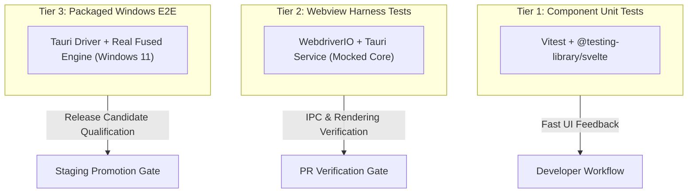

# Desktop fixture and test contract

**Status:** Proposed specification for TD-06 (`fixture-contract.md`), authored by **`MdSiddiqx`** (UI/UX Lead) to unblock TD-01 shared contract freezing. Reconciled **2026-10-26** with the [team delivery plan](team-delivery-plan.md), [trust and qualification dossier](../frontend/trust-failure-and-packaged-qualification.md), and [implementation contracts](implementation-contracts.md).

This contract defines the synthetic fixture formats, runner execution interfaces, and regression verification rules for the **Splyce Windows desktop application**. It establishes how the frontend test layers validate UI state, IPC boundaries, failure handling, and accessibility, separating frontend evidence from backend RPC mock claims.

---

## 1. Regression testing principles

1. **Independent proof:** Tests must assert observable physical behavior and fail if the underlying safety guard or UI behavior is removed. A green test that passes regardless of implementation correctness is invalid.
2. **Screenshots alone are not proof:** While visual regression specimens are captured, automated acceptance requires semantic DOM assertions, accessibility tree (UIA / Narrator) queries, and verified IPC command dispatches.
3. **No production mock pollution:** Test-only hooks, debug endpoints, or mock IPC channels must never be bundled or enabled in release builds. All release qualification runs against uninstrumented binaries.
4. **Synthetic and non-proprietary:** All test repositories, session histories, and file fixtures are synthetic and contain no proprietary third-party code or private credentials.

---

## 2. Fixture schema and structure

Fixtures are stored as JSON/JSONL documents in `tests/fixtures/gui/` and `tests/fixtures/contracts/`. Each fixture defines the test identity, environment preconditions, mock engine event sequences, and decisive physical assertions.

### 2.1 Schema specification

```typescript
export interface SplyceUiFixture {
  schemaVersion: 1;
  caseId: string; // e.g. "FUI-W2_ime_composition"
  title: string;
  targetTask: string; // e.g. "TD-02", "TD-06", "TD-08"
  description: string;
  preconditions: {
    windowMode?: "normal" | "maximized" | "high_dpi";
    dpiScale?: number; // 1.0, 1.25, 1.5, 2.0
    contrastMode?: boolean;
    reducedMotion?: boolean;
    engineStatus?: "ready" | "stopped" | "unresponsive";
  };
  eventSequence: Array<{
    delayMs: number;
    event: import("./client-contract").SplyceEngineEvent;
  }>;
  userActions: Array<{
    step: number;
    action: "type" | "click" | "shortcut" | "resize" | "ime_compose";
    targetSelector: string;
    payload?: string;
  }>;
  assertions: {
    expectedState: Record<string, unknown>;
    expectedDispatches: Array<{
      op: string;
      payloadMatch: Record<string, unknown>;
    }>;
    accessibilityQueries: Array<{
      role: string;
      name?: string;
      expectedState: string;
    }>;
    guardRemovalCheck: {
      action: string;
      mustFailWith: string;
    };
  };
}
```

---

## 3. The 10 named UI test manifests (FUI-W1 $\rightarrow$ FUI-W10)

These 10 cases represent the mandatory frontend qualification surface:

| Case ID       | Name & Target                    | Test Input & Scenario                                                                                                      | Required Observable Evidence & Failure Condition                                                                                                                              |
| :------------ | :------------------------------- | :------------------------------------------------------------------------------------------------------------------------- | :---------------------------------------------------------------------------------------------------------------------------------------------------------------------------- |
| **`FUI-W1`**  | **Base-only install**            | Clean install with skipped setup. Restart offline with zero network connectivity.                                          | No unselected assets or background workers spawned. Navigation works; generation is honestly labeled unconfigured.                                                            |
| **`FUI-W2`**  | **IME composition safety**       | Type multi-stage CJK IME text (Japanese/Chinese/Korean) in composer; press `Enter` to confirm candidates.                  | Candidate confirmation emits zero prompt submissions. Explicit `Ctrl+Enter` outside composition submits exactly intended string once.                                         |
| **`FUI-W3`**  | **Windows accessibility**        | Keyboard-only traversal via `Tab`, `Ctrl+1..4`, Narrator screen reader, Windows High Contrast mode, and 200% text scaling. | All landmarks named; focus indicators visible (2px ring); zero keyboard traps. Approval dialog locks focus safely.                                                            |
| **`FUI-W4`**  | **Stream & backpressure**        | Feed 500 rapid interleaved `turn.stream_delta` events, thought deltas, and long history.                                   | Transcript renders without dropping characters or frame tearing. Virtualized scroll maintains pinned view or user scroll position.                                            |
| **`FUI-W5`**  | **Approval race condition**      | Trigger `approval.requested`. Send user cancel command while approval dialog is focused. User subsequently clicks Approve. | Late approval returns `approval_rejected{run_canceled}`. Zero tool effects dispatched. Target scope mismatch immediately invalidates dialog.                                  |
| **`FUI-W6`**  | **Crash & disconnect recovery**  | Terminate background engine process mid-generation or mid-tool-execution.                                                  | UI displays **Engine stopped** banner with exit code. Composer draft is preserved. Stale approval dialogs are disabled immediately. Single **Restart Engine** button offered. |
| **`FUI-W7`**  | **Provider & profile switch**    | Switch active model profile while task is running or disconnected.                                                         | Active execution blocks invalid transitions. Requested vs effective profile badge remains distinct until confirmed by engine.                                                 |
| **`FUI-W8`**  | **Hunk review & stale apply**    | Modify files externally while diff review view is open. Attempt to accept a diff hunk.                                     | Stale diff detection flags file revision conflict. Prevents blind overwrite. Re-triggers fresh diff calculation.                                                              |
| **`FUI-W9`**  | **Untrusted content & CSP**      | Inject malicious script tags, remote image beacons, or local file URIs into transcript Markdown.                           | All HTML sanitized or escaped. No third-party network egress. Local paths cannot execute arbitrary shell commands.                                                            |
| **`FUI-W10`** | **Release footprint & teardown** | Verify packaged bundle assets and clean uninstall.                                                                         | No development dependencies (e.g. Vite dev server, mock runners) present in packaged release assets. Uninstall leaves zero orphaned sidecar processes.                        |

---

## 4. Guard-removal and negative testing rules

To ensure that tests verify real safety boundaries rather than superficial assertions, each suite must enforce negative test criteria:

1. **Safety guard removal check:** For every security-related fixture (e.g. `FUI-W5`, `FUI-W9`), the test suite must contain an automated negative probe verifying that if the client-side validation logic is disabled, the engine-side verification rejects the invalid payload.
2. **IME composition assertion:** If the `event.isComposing` check in `apps/desktop/src/components/Composer.svelte` is replaced with `false`, test case `FUI-W2` must fail immediately.
3. **Approval race assertion:** If the client fails to correlate `actionId` on approval response, test case `FUI-W5` must detect the race and fail the test run.

---

## 5. Test runner interfaces

Splyce establishes three distinct execution tiers for running these fixtures:



### CLI execution commands

```powershell
# Tier 1: Run Svelte component tests
npm run test:components

# Tier 2: Run specific named webview fixture test
npm run test:desktop-ui -- --case FUI-W2

# Tier 3: Run full packaged desktop acceptance on target platform
npm run test:desktop-e2e -- --case FUI-W5 --platform windows-x64
```

---

[Frontend index](../frontend/README.md) · [Client contract](client-contract.md) · [Delivery plan](team-delivery-plan.md)
