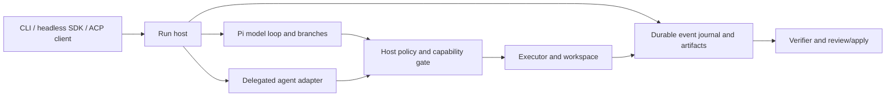

# ADR-001: Shared contracts over an existing agent engine

**Active product scope:** Splyce is OSS and entirely local: agent execution, every model role, memory and state stay on the local host. Cloud/managed services below are comparative research only, not supported product profiles or fallbacks. Authorized external web/connector actions are separate scoped tools. [Current master plan](../../../MASTER-PLAN.md).

## Status: Refined by the Pi-first decision

Research synthesis, 2026-10-25. This is a design hypothesis drawn from primary-source notes, not a selected runtime, implemented system, measured ranking, or final master plan. The root master plan incorporates the expanded memory and inference research; discovery and runtime qualification have separate closure criteria. Product names below identify the documented mechanism, not an endorsement or a claim that their implementations compose unchanged.

The [Pi-first foundation decision](../foundations/pi-foundation.md) and [master plan](../../../MASTER-PLAN.md) are authoritative. Pi owns the model loop and conversation branches; Splyce adds policy, operational receipts and memory. A new loop or wholesale Rust port is outside scope. Earlier language/runtime alternatives below are comparison history, not current build instructions.

## Context

The goal is one coding CLI/agent scaffold that works interactively, headlessly and through clients, while retaining the strongest mechanisms found across terminal agents, IDE platforms, frameworks, workflow scaffolds, retrieval systems and protocols. The sources describe different owners of the same concerns. Combining whole products would duplicate agent loops, policy engines, retry rules and state. The forcing question is which _contracts_ permit useful mechanisms to coexist without granting an adapter more authority than the run has.

Documentation alone cannot establish that the result is better, faster, safer or more reliable. No candidate has been run in this workspace. The first release should be a small vertical slice whose observable behavior can be compared with an existing coding agent on the same tasks.

## Foundation alternatives and selection

| Approach                                                                                                                                              | Benefit                                                                                                      | Key cost or fatal flaw                                                                                                                                | Reversibility and selection test                                                                                                                                                                                                |
| ----------------------------------------------------------------------------------------------------------------------------------------------------- | ------------------------------------------------------------------------------------------------------------ | ----------------------------------------------------------------------------------------------------------------------------------------------------- | ------------------------------------------------------------------------------------------------------------------------------------------------------------------------------------------------------------------------------- |
| **Reuse one existing agent/harness as the runtime** (for example Codex SDK/CLI, Pi, mini-SWE-agent, Pydantic AI Harness, Strands or DeepSeek Harness) | Shortest route to a working tool loop; existing provider and session facilities may remove substantial code. | Host may be unable to enforce policy, journal effects or preserve provider semantics at every action boundary; wrapping its output would be cosmetic. | Two-way until persisted sessions or plugin ABI depend on it. Spike the actual loop, approval interception, cancellation, resume and export contract. Choose it if all safety/evidence gates pass with fewer owned moving parts. |
| **Fork an inspectable upstream**                                                                                                                      | Direct access to the tool dispatcher and event model; reuse mature editing and terminal behavior.            | Sustained upstream merge and security maintenance; license and release constraints may make the fork impractical.                                     | Costly two-way door once users have stored data. Require a version-pinned license/API review and a small patch that survives an upstream update.                                                                                |
| **Build a new owned loop (rejected)**                                                                                                                 | One authority boundary, event schema and stop semantics; external agents remain delegated backends.          | Must implement provider streaming, tool execution, persistence and process lifecycle correctly; easy to underbuild recovery.                          | Two-way if contracts and data format are stable. Not an approved fallback: if the selected base fails a required gate, compare another existing engine and record the decision.                                                 |

**Proposed selection rule:** run equivalent disposable-repository spikes before choosing the loop or language. Compare code owned and maintained, policy enforcement coverage, cancellation/recovery failures, provider semantic fidelity, task outcomes, latency and cost. The user selected Pi as the existing base. Its TypeScript runtime stays in place; the [Rust component comparison](../foundations/stack-decision.md) is historical/support-layer research. One runtime owns the loop; libraries may own narrower services. [Framework comparison](../foundations/frameworks-and-orchestration.md), [minimal loop and SDK references](../agents/terminal-agents.md), [mini-SWE-agent and OpenHands](../agents/ide-and-platforms.md), [DeepSeek lifecycle](../foundations/recursive-harnesses.md).

## Decision

Propose a **single host-owned run contract**. It describes the task, workspace revision, model/provider identity, execution location, authority, budget, instruction provenance, available capabilities and verification requirements. A loop consumes model output, requests actions through one policy/executor boundary, and emits durable events and evidence artifacts. CLI, headless SDK and ACP are presentations over that contract; they must not become separate state owners. A delegated external coding agent is a different execution mode with declared guarantees, not secretly treated as the native provider loop.

The drawing is a responsibility map, not an assertion that a delegated agent exposes each internal tool call. If it cannot, its run manifest must say so, and it cannot receive a stronger safety or audit label than observed. ACP client permission dialogs and MCP tool catalogs never substitute for host enforcement.

### Mechanism map

| Mechanism and source note                                                                                                                                                                                    | Proposed owner/module                                               | Benefit hypothesis                                                              | Acceptance gate                                                                                            | Phase                              |
| ------------------------------------------------------------------------------------------------------------------------------------------------------------------------------------------------------------ | ------------------------------------------------------------------- | ------------------------------------------------------------------------------- | ---------------------------------------------------------------------------------------------------------- | ---------------------------------- |
| Structured turns, stop reasons and CLI/SDK JSON events: [terminal agents](../agents/terminal-agents.md), [mini-SWE-agent](../agents/ide-and-platforms.md)                                                    | Run host and event envelope                                         | Interactive and headless clients see the same outcome.                          | Ordered prompt/request/decision/result/artifact/stop events; no terminal-text scraping.                    | 0–1                                |
| Separate capability inventory, invocation approval and executor isolation: [terminal agents](../agents/terminal-agents.md), [protocols](../capabilities/protocols-plugins-and-evaluation.md)                 | Host policy gate plus executor descriptor                           | An advertised tool cannot grant itself authority.                               | Explicit deny survives auto mode, resume and adapter name collisions; no denied side effect.               | 0–1                                |
| Checkpointed task state versus cross-task memory: [frameworks](../foundations/frameworks-and-orchestration.md), [recursive harnesses](../foundations/recursive-harnesses.md)                                 | Journal and artifact store                                          | Interrupted tasks can resume without inventing completed effects.               | Crash at every action boundary yields a known state or an explicit uncertain-effect state.                 | 1                                  |
| Isolated action/observation and review/apply: [IDE platforms](../agents/ide-and-platforms.md), [protocols](../capabilities/protocols-plugins-and-evaluation.md)                                              | Executor and workspace manager                                      | Reviewable changes and controlled process access.                               | Manifest records actual isolation, mounts, egress and cleanup; two tasks do not overlap uncommitted files. | 1–2                                |
| LSP/Tree-sitter/SCIP and bounded repository map: [context](../capabilities/context-retrieval-and-memory.md), [Aider](../agents/terminal-agents.md)                                                           | Workspace intelligence                                              | Better symbol localization with less irrelevant context.                        | Versioned definition/reference evidence; stale edit rejected; ablation against lexical-only baseline.      | 2                                  |
| Native capture, cited summaries and progressive recovery: [cross-session memory](../capabilities/cross-session-memory.md)                                                                                    | Memory owner and derived retrieval projections                      | Cross-session continuity with evidence and selective context expansion.         | Receipt-backed summary; empty-context recovery; scope/export/deletion across every route.                  | 1–2 baseline; advanced retrieval 3 |
| Local/cloud generation, extraction, embeddings and reranking: [inference](../capabilities/inference-local-and-cloud.md), [memory](../capabilities/cross-session-memory.md)                                   | Provider-role adapters and deployment profiles                      | One state/memory system across backends.                                        | Role-specific conformance, egress policy, embedding reindex and real cancellation tests.                   | 1–3                                |
| MCP/skills/plugins/ACP/A2A: [protocols](../capabilities/protocols-plugins-and-evaluation.md), [terminal agents](../agents/terminal-agents.md)                                                                | Capability adapters, client transport, optional remote task adapter | Interoperability without merging trust domains.                                 | Negotiated version/capability; adapter escalation and unsupported operation fail closed.                   | MCP/ACP 2; plugins/A2A later       |
| Canonical spec, task claim, handoff and validation receipt: [workflows](../foundations/workflows-and-scaffolds.md)                                                                                           | Task record and verifier                                            | Long tasks resume with explicit ownership and evidence.                         | No complete status with missing/stale receipt; conflicting claims cannot both write.                       | 2, only for multi-step tasks       |
| Held-out candidate improvement: [Harness²](../foundations/recursive-harnesses.md), [DSPy](../foundations/frameworks-and-orchestration.md), [evaluation](../capabilities/protocols-plugins-and-evaluation.md) | Offline evaluation lab                                              | Accept useful prompt/tool/routing changes without self-authorized policy drift. | Baseline/candidate paired on fixed environment and budgets; separate untouched holdout; rollback revision. | 3                                  |

Phases are dependency order, not dates. The user’s maximum of three agents applies to this research task; the proposed product has no universal agent-count constant. Product concurrency must instead follow resource budgets and evidence from workload tests.

## Focused architecture decisions

### 1. One loop owner, with delegated agents explicitly distinct

**Decision:** Pi owns model turns; Splyce intercepts the supported action path and records operational outcomes. A delegated Codex/Claude/Gemini/other agent process receives a scoped task and reports its own events and artifacts. The host records which internal actions it can actually observe or interpose. **Alternatives:** nesting multiple autonomous frameworks multiplies retry and completion authorities; treating an opaque external agent as a native provider falsely claims control. **Cost:** adapters need maturity/capability declarations, and opaque agents may be ineligible for unattended policy levels. **Reversibility:** two-way before persisted adapter sessions; afterward migration tests are required. **Gate:** same task under native and delegated modes produces honest capability manifests and a reviewable result; no fabricated per-tool audit. [Terminal agents](../agents/terminal-agents.md), [frameworks](../foundations/frameworks-and-orchestration.md), [IDE platforms](../agents/ide-and-platforms.md).

### 2. Host authority is monotonic across all adapters

**Decision:** effective authority is the intersection of user/run grant, organization/host policy, workspace boundary, executor capability and child delegation. MCP tools, ACP clients, skills, plugins, hooks and discovered A2A cards may narrow or request authority, never increase it. Explicit deny remains deny after resume and delegation. **Alternatives:** vendor permission vocabulary is quick but inconsistent; plugin-defined policy is extensible but puts enforcement under potentially untrusted code. **Cost:** some integrations lose functions until they expose enforceable scopes. **Reversibility:** authority schema is a one-way door once persisted grants exist; require threat review, negative contract tests and a versioned migration before adoption. **Gate:** denied path/network/secret action creates no effect, including when reached through MCP, a hook or a child. [Protocols](../capabilities/protocols-plugins-and-evaluation.md), [terminal agents](../agents/terminal-agents.md).

### 3. Negotiate model and adapter capabilities before work

**Decision:** provider metadata distinguishes tool calling, streaming, reasoning/multimodal inputs, context limit, cancellation, usage accounting and structured-output behavior. Client/executor metadata separately declares filesystem, terminal, approval, resume, artifacts and isolation. Unsupported required capabilities fail before a tool runs; optional features may be disabled visibly. **Alternatives:** a least-common-denominator API discards useful capability; optimistic emulation silently changes semantics. **Cost:** a conformance suite and versioned backend IDs. **Reversibility:** two-way while adapters remain private; public manifests become a compatibility commitment. **Gate:** an incompatible provider swap or ACP client is rejected with the missing capability and no side effect. [Terminal agents](../agents/terminal-agents.md), [frameworks](../foundations/frameworks-and-orchestration.md), [protocols](../capabilities/protocols-plugins-and-evaluation.md).

### 4. Journal intentions and outcomes; never promise exactly-once effects

**Decision:** a local append-only journal stores durable, redacted run events; large outputs and diffs are addressable artifacts. Before a side effect, record the validated intent and policy result. After it, record observed outcome and receipt. Restart derives state from committed records. A gap after intent is **uncertain**; reconcile the target or require a new decision before retrying. **Alternatives:** conversation history alone loses process state; a checkpoint alone may replay external writes; event streaming without fsync/persistence is not recovery. **Cost:** schema, storage, redaction and reconciliation. **Reversibility:** journal schema is a one-way door once users rely on resume/audit; version migrations and crash injection are mandatory. **Gate:** kill at every journal/action boundary, including external write, then resume without duplicate action or false completion. [Recursive harnesses](../foundations/recursive-harnesses.md), [frameworks](../foundations/frameworks-and-orchestration.md), [protocols](../capabilities/protocols-plugins-and-evaluation.md).

### 5. Source-backed workspace intelligence precedes inferred memory

**Decision:** start with ripgrep plus file inventory, then use LSP when healthy and Tree-sitter as syntax fallback. Every hit carries workspace/revision and source range; stale edits fail. SCIP/LSIF may be used for pinned persisted indexes. Keep task DAG, code graph, inferred knowledge graph and retrieval graph typed and separate. Native receipt capture, compact summaries and source-backed recall belong in the first releasable product. HippoRAG/GraphRAG/Graphiti and vector search are later ablations over that memory, never default source-of-truth for mutable code. **Alternatives:** whole-repository prompt injection is expensive and noisy; a single global vector/graph index risks stale or cross-workspace evidence; LSP alone cannot serve every language and offline revision. **Cost:** index invalidation and provenance plumbing. **Reversibility:** retrieval backend is two-way if IDs/provenance contract remains fixed; memory retention policy is one-way for stored user data and needs deletion proof. **Gate:** stale-range, ignored-file, cross-workspace and deletion tests; retrieval-on improves task outcome or context cost on held-out tasks versus lexical-only. [Context research](../capabilities/context-retrieval-and-memory.md), [Aider](../agents/terminal-agents.md).

### 6. Edits, tests and apply have separate receipts

**Decision:** edit only against a declared base revision and owned workspace; collect a diff/checkpoint artifact, exact test command, exit code and output artifact, then expose review/apply as a separate operation. A model statement that tests passed is not a receipt. Rollback of file snapshots, Git history and applying an isolated branch are distinct. **Alternatives:** direct mutation is simplest but can overwrite other work; automatic merge/apply hides conflict and approval state; requiring a full spec for every fix adds overhead. **Cost:** worktree lifecycle and integration checks. **Reversibility:** two-way; adoption can begin with a single worktree and explicit apply. **Gate:** stale base and overlapping edits stop apply; a failing/stale/missing test receipt blocks verified-complete status. [IDE platforms](../agents/ide-and-platforms.md), [workflows](../foundations/workflows-and-scaffolds.md).

### 7. Delegate bounded ownership, budget and cancellation

**Decision:** a child receives a narrow task, workspace or read scope, inherited effective authority, deadline/token/cost limits and explicit output contract. The parent owns integration; cancellation signals the child, tears down owned processes, and records survivors or remote uncertainty. Task count is demand- and budget-driven. **Alternatives:** one long-context agent avoids handoffs but can bottleneck and stale; unrestricted agent fleets increase contention and ambiguous ownership. **Cost:** supervision and failure reporting. **Reversibility:** two-way if the task record stays independent of child implementation. **Gate:** concurrent write claims serialize, canceled descendants stop or are reported, and no child can exceed parent authority/budget. [Deep Agents and framework notes](../foundations/frameworks-and-orchestration.md), [orchestration notes](../foundations/workflows-and-scaffolds.md), [protocols](../capabilities/protocols-plugins-and-evaluation.md).

### 8. Improve offline against an unchanged baseline

**Decision:** Harness²-like changes to prompts, tools, retrieval or routing are proposed as versioned candidates and run in isolated evaluations. Evaluators, policy and holdout data are outside candidate control. Public benchmark scores remain labeled with exact dataset/environment/model versions and contamination status. **Alternatives:** live self-modification can make tests self-serving; choosing from public benchmark scores invites overfitting; no improvement loop leaves regressions invisible. **Cost:** repeated trials and maintained private tasks. **Reversibility:** two-way for prompt/routing changes with rollback; one-way if generated memory or user data is retained under a changed policy. **Gate:** paired unchanged-baseline comparison, untouched holdout, no critical policy regression, and cost/latency accounted. [Harness²](../foundations/recursive-harnesses.md), [DSPy](../foundations/frameworks-and-orchestration.md), [evaluation](../capabilities/protocols-plugins-and-evaluation.md).

## Contracts for the first vertical slice

The following are semantic contracts, not implementation types or a promised schema:

- **Run request:** immutable run ID, task and acceptance text, base workspace revision, model/backend identity and versions, effective policy, executor descriptor, resource budget, and instruction-source hashes. Invalid or missing required fields fail before execution.
- **Action request:** capability ID and version, target scope, validated arguments, parent run/child identity and a unique action ID. The policy result records allow/deny/ask, rule source and exact scope. The executor must recheck the scope at dispatch, since tool discovery and permission prompting are not enforcement.
- **Journal event:** monotonic per-run sequence, timestamp, event type, actor, correlation ID, prior-state reference and redacted payload or artifact reference. Intent is durable before side effects; outcome is durable before a completion claim. A missing outcome denotes uncertainty, never success.
- **Evidence reference:** source URI/workspace/revision/range or artifact ID/hash plus access scope. Generated summaries and inferred graph edges cite underlying evidence and cannot replace it.
- **Run result:** typed stop reason, observed executor cleanup state, changed-file/diff reference, verification receipts and unresolved effects. “Verified complete” requires matching successful receipts against the final candidate revision; “stopped” or “needs review” may still return useful artifacts.
- **Client modes:** CLI and headless SDK consume the same run/event contract. ACP maps client session updates and permissions to it after version/capability negotiation. An external-agent adapter returns only the observations it can prove. MCP supplies resources/tools/prompts through the action gate. A2A is a later remote-task adapter with distinct task and artifact semantics.

## Minimum first slice and definition of better

Phase 0 is a disposable-repository spike of upstream Pi versus a compatible Pi fork or another existing engine. Phase 1 implements only: one CLI command and one headless event stream over one native provider; one read/search capability, one guarded edit or shell capability, one local executor, a policy denial, durable journal, crash-uncertainty handling, a diff and a real test receipt. This disposable slice is not the first release. Native capture, a cited session summary and empty-context recovery join the first release gate. Additional providers, advanced graph retrieval, ACP, MCP, delegation, cloud executors, plugin marketplace, browser control and self-improvement follow their own gates.

Define **better** on a pinned task set against the selected existing-agent baseline using identical model, repository revision, environment, instructions, tool authority and resource cap. Report task success by independent tests and human review, policy violations, unreconciled side effects, recovery success, accepted-change rate, wall time, tokens and cost. Include simple repairs and multi-file work, unseen holdouts and failure injection; report confidence intervals or raw counts and never a single unexplained score. A proposed feature earns adoption only if it improves task outcome or cost/latency without worsening critical authority/recovery gates. Comparisons with public SWE-bench or Terminal-Bench remain separate and versioned. This is a gate definition, not a measured result.

## Consequences and unresolved evidence

- **Positive:** one authority and evidence path can support multiple surfaces; simple tasks stay lightweight; advanced retrieval and orchestration must earn their cost.
- **Negative:** contracts, persistence and crash recovery add real core complexity; full parity with proprietary agents is unlikely; opaque delegated agents cannot provide every internal receipt.
- **Risks:** an adapter may conceal actions, worktree isolation may be mistaken for process isolation, replay may duplicate external effects, indexes may leak stale/deleted data, and benchmark selection may overfit. Negative tests and honest capability labels address these risks; documentation does not resolve them.
- **License/API stability:** verify SPDX/license terms, transitive licenses, plugin redistribution, API maturity, archival/successor status and version-pinned protocol conformance before importing or forking any candidate. DeepSeek Harness identifies as developer preview; ACP v2 is draft; the current source notes flag several archived/renamed agents. No adoption is approved by this ADR.
- **High-impact blockers before implementation selection:** prove host interception of every privileged action for any reused runtime; prove durable ordering and uncertainty semantics on the chosen storage/executor; obtain an auditable license/API compatibility record for the shortlisted foundation. Other corpus questions can remain queued behind the first slice.

**Complexity judgment:** the proposed contracts reduce concrete risks (authority drift, duplicate effects, unverifiable completion). A universal plugin kernel, default knowledge graph, mandatory multi-agent workflow or recursive live optimization would grow complexity faster than demonstrated risk removal. Defer each until a measured gate shows its value.

## Native memory and inference additions

Cross-session memory is a built-in service over the same journal, not a mandatory external agent or a second autonomous loop. Immutable receipt IDs, source artifacts and scopes connect task state, summaries, observations and optional inferred edges. A summary is a lossy projection with citations and supersession metadata; users can expand it into original evidence. Retrieval starts with cheap local lexical search and a compact index, expands selected timelines/relationships, then loads full artifacts only as needed. Deletion invalidates every derived representation, cache and export route. Retention and backup expiry are explicit; an audit tombstone contains no deleted content.

Generation, structured extraction, embeddings and reranking each have independent local/cloud adapters. A local deployment must also keep summary generation, extraction, embedding and reranking local. Mixed deployment applies data-class egress policy per role. Every vector records model revision, dimension, normalization, metric and query/document instructions; incompatible changes create a new index generation with rebuild and cutover, not silently mixed vectors. Service failures preserve captured receipts and expose degraded retrieval rather than losing the task.

Compare BM25, dense, hybrid/RRF and reranked retrieval before HippoRAG-style diffusion, temporal Graphiti-style facts, linked A-MEM notes, sparse FlyVec/Fly-LSH/BioHash or order-sensitive Comply. Use the same scopes and citation contracts for every contender. None is a predetermined winner. GraphLang and the two GraphSmith identities are orchestration/scaffold candidates; LangSmith is observability; Absolute Zero Reasoner is training research. Their names do not establish memory APIs.

SGLang and vLLM are paired serving candidates for supported accelerators and concurrency; llama.cpp, Ollama and LM Studio are local deployment candidates, with MLX, TensorRT-LLM, OpenVINO/ORT and other engines selected for specific hardware. Separate TEI/embedding/rerank services are allowed within the one host contract. One tool means one owner and consistent user experience, not embedding every inference engine in one executable. Benchmark exact model/template/quantization and warm/cold workload; capability probes cover streaming, tools, schemas, cancellation, usage and errors. No serving or memory performance has been measured here.

Sources and full acceptance experiments: [memory](../capabilities/cross-session-memory.md), [inference](../capabilities/inference-local-and-cloud.md), [sparse retrieval](../capabilities/sparse-retrieval-and-coordination.md), [governance and fleet controls](../governance/governance-and-control-planes.md).
